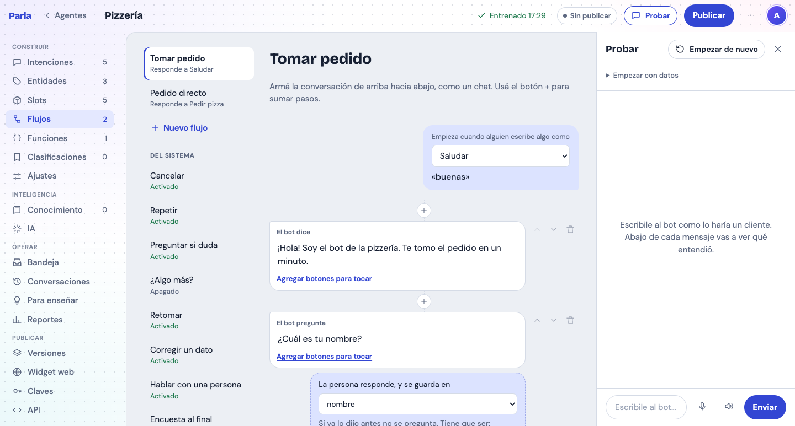
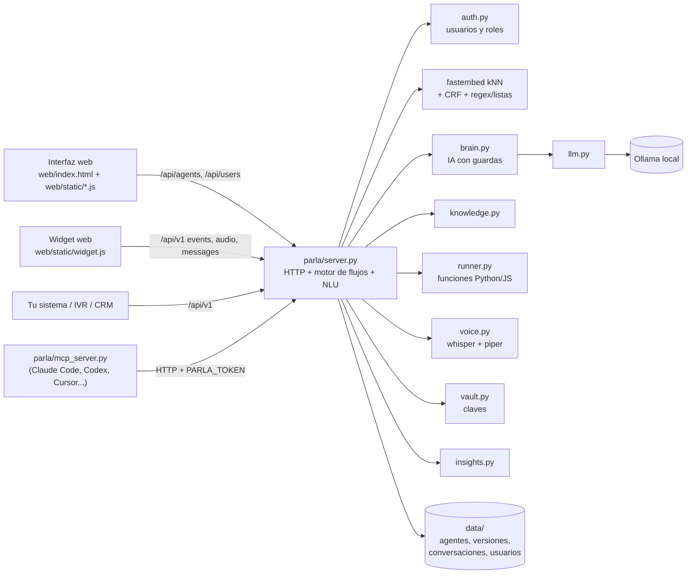

# Parla

> **English summary.** Parla is a local, CPU-friendly conversational bot builder in the spirit of Rasa, with a
> no-code web UI in Spanish. You define intents, entities, slots and flows; Parla trains a multilingual
> embedding kNN classifier plus a CRF entity extractor in seconds, lets you test in a chat panel, publish
> immutable versions to staging/production, and serve the bot over a small HTTP API or an embeddable web widget.
> Optional local AI via Ollama (default `qwen2.5:0.5b`) rescues intents, fills slots and answers from a knowledge
> base, always with guardrails. Optional local voice (faster-whisper + piper). It also ships an MCP server so
> Claude Code, Codex, Claude Desktop or Cursor can design and test bots for you. Everything runs on your machine,
> bound to `127.0.0.1`. Docs are in Spanish under [`docs/`](docs/README.md).

**Parla** es un armador de bots conversacionales que corre en tu compu, sin GPU y sin nube. Armás el bot desde
una interfaz web sin escribir código: qué cosas tiene que entender (intenciones), qué datos sacar del mensaje
(entidades), qué recordar (slots) y qué hacer en cada caso (flujos). Entrenás en segundos, lo probás en un chat al
costado, publicás una versión y lo conectás a tu web, a tu sistema o a un IVR por una API HTTP simple.

**¿Para quién es?**

- Equipos chicos y pymes que quieren un bot de atención (turnos, pedidos, preguntas frecuentes) sin depender de
  una plataforma paga ni mandar las conversaciones afuera.
- Desarrolladores que quieren algo tipo Rasa pero más liviano: un solo proceso Python, archivos JSON en disco,
  sin base de datos, con una API para integrarlo.
- Quien quiera que una IA (Claude, Codex, Cursor) le arme el bot: Parla trae un servidor MCP.

## Qué trae

### Comprensión
- Intenciones por similitud: embeddings multilingües (`google/embeddinggemma-300m` vía fastembed) y
  vecino más cercano. Sumar una frase no requiere reentrenar un modelo pesado.
- Entidades de varios tipos: por ejemplos marcados en las frases (`[pedro](nombre)`, aprendidas con un CRF de
  python-crfsuite), listas de opciones con sinónimos, formatos (número, email, teléfono, DNI, regex propia) y
  fechas en lenguaje natural en español rioplatense («el jueves que viene a la tarde»).
- Entrenamiento con autoevaluación (deja una frase afuera y mira a dónde la manda), matriz de confusión,
  consejos concretos y registro de lo que hizo cada paso.
- Multilingüe: español, portugués e inglés en la misma charla (traducciones por mensaje, detección de idioma).

### Conversaciones
- Flujos con pasos: mensaje, pregunta, guardar valor, consulta HTTP, condición, saltar, subflujo, fin,
  clasificar, función, pasar con una persona y paso de IA.
- Plantillas `{{ }}` con expresiones CEL, botones de respuesta rápida, flujo de inicio con datos precargados.
- Flujos del sistema editables: cancelar, repetir, «¿quisiste decir…?», retomar lo de antes, corregir un dato,
  pasar con una persona, «¿algo más?» y encuesta de satisfacción (CSAT).

### IA local (opcional)
- Con Ollama (o un servidor local compatible con OpenAI como LM Studio o llama.cpp). Modelo por defecto
  `qwen2.5:0.5b`, ~400 MB.
- Rescata intenciones dudosas, completa slots a partir de una descripción, responde desde la base de
  conocimiento, repregunta cuando no entiende y conversa en un paso `agent` con funciones como herramientas.
- La IA propone y el motor decide: solo se aceptan intenciones de la lista, valores que están en el texto y
  funciones permitidas. Si la IA está apagada o no responde, el bot sigue funcionando igual.
- Voz local (opcional): transcripción con faster-whisper y lectura en voz alta con piper (voz `es_AR`).

### Operación
- Bandeja: tomar una conversación, responderle a la persona y devolverla al bot.
- Conversaciones guardadas con filtros, clasificaciones y reportes por día.
- «Para enseñar»: lo que la gente escribió y el bot no entendió, agrupado por parecido y con la intención sugerida.
- Analítica: contención, derivaciones, fallbacks, CSAT y abandono por flujo y pregunta.

### Publicación
- Borrador → versiones numeradas inmutables → entornos `staging` y `production`. Diff antes de publicar,
  rollback apuntando a una versión anterior, y cada conversación queda atada a la versión con la que empezó.
- API HTTP pública (`/api/v1`), widget web embebible con un `<script>`, exportar e importar agentes.
- Temas claro, oscuro y colorido en la interfaz.

### Seguridad
- Usuarios con roles (dueño, editor, analista, atención), bots visibles por usuario y claves de API.
- Bóveda de claves por agente (`{{ secret.NOMBRE }}`): los valores no viajan en el JSON del bot y se tapan en
  las trazas.
- Escucha solo en `127.0.0.1` y rechaza pedidos de otros sitios web salvo los autorizados para el widget.

### Integraciones
- Servidor MCP con 25 herramientas para armar, validar, entrenar, probar, publicar y analizar bots.
- «Conectar con IA»: un botón registra Parla en Claude Code, Codex, Claude Desktop o Cursor.
- Funciones en Python o JavaScript para la lógica que un paso HTTP no resuelve.

## Capturas

| Entrada | Tus agentes |
|---|---|
|  |  |
| **Editor de flujos** (con los flujos del sistema) | **Entidades con sinónimos** (tema oscuro) |
|  |  |

Tres temas: claro, oscuro y colorido.


## Arranque rápido

Requisitos:

- **Python 3.11 o más nuevo** (obligatorio).
- Node.js (opcional): solo para funciones escritas en JavaScript.
- [Ollama](https://ollama.com) (opcional): para las funciones de IA local.
- Extras de voz (opcional): `requirements-voice.txt` y `ffmpeg` en el sistema.

Con el script (recomendado):

```sh
scripts/setup.sh            # crea .venv e instala las dependencias
scripts/setup.sh --voice    # además instala la voz local
make run                    # abre Parla en http://127.0.0.1:8000
```

O con `make`:

```sh
make setup
make run
```

A mano:

```sh
python3 -m venv .venv
.venv/bin/pip install -r requirements.txt
.venv/bin/pip install -r requirements-voice.txt     # opcional
.venv/bin/python app.py                              # o: .venv/bin/python app.py 8080
```

Abrí `http://127.0.0.1:8000`. La primera vez se crea un bot de ejemplo («Seguimiento de pedidos») y se baja el
modelo de vectores (unos cientos de MB, una sola vez). Para probar algo más completo, importá
`examples/pizzeria.json` o `examples/turnos-clinica.json` con «Importar agente».

**Login:** mientras no exista ningún usuario, Parla está abierto: cualquiera que llegue a la página puede ver y
cambiar todo. El primer usuario que crees (en «Usuarios») queda como dueño y desde ahí se pide iniciar sesión.

IA local (opcional):

```sh
ollama pull qwen2.5:0.5b
```

Después prendela en la sección **IA** del agente. Más en [docs/ai-and-voice.md](docs/ai-and-voice.md).

## Arquitectura



## Estructura del proyecto

```
app.py                  entrada: python app.py [puerto]
mcp_server.py           atajo al servidor MCP (parla/mcp_server.py)
parla/
  server.py             HTTP, motor (handle/run/begin), NLU, versiones, API pública
  auth.py               usuarios, roles, sesiones y claves de API
  brain.py              IA encima del motor (rescate, slots, fallback, paso agent)
  llm.py                cliente de modelos locales (Ollama / compatible OpenAI)
  knowledge.py          base de conocimiento: extraer texto y buscar
  dates.py              fechas en lenguaje natural, por reglas
  insights.py           «para enseñar» y analítica
  runner.py             funciones en un proceso aparte
  vault.py              claves secretas por agente
  voice.py              voz local
  connect.py            «Conectar con IA»
  mcp_server.py         servidor MCP
web/index.html          la interfaz
web/static/*.js         secciones de la interfaz y el widget
tests/                  test_*.py y run_all.py
examples/               bots de ejemplo para importar: pizzeria.json y turnos-clinica.json (botones, conocimiento, pase a persona, fechas)
data/                   datos en tiempo de ejecución (no se versiona)
scripts/setup.sh, Makefile, requirements*.txt, .env.example
```

## Configuración

Todo es opcional. Copiá `.env.example` para ver los valores.

| Variable | Por defecto | Para qué |
|---|---|---|
| `PARLA_DATA` | `data/` | Dónde se guardan agentes, versiones, conversaciones, usuarios y modelos. |
| `PARLA_USERS` | dentro de la carpeta de datos (`users.json`) | Archivo de usuarios. |
| `PARLA_FUNCTIONS` | `1` | `0`, `false`, `no` u `off` apagan las funciones de los agentes. |
| `PARLA_WHISPER` | `base` | Modelo de faster-whisper (`tiny` si la máquina es lenta). |
| `PARLA_URL` | `http://127.0.0.1:8000` | (MCP) dónde está Parla. |
| `PARLA_TOKEN` | vacío | (MCP) clave de API que se manda como `Authorization: Bearer`. |
| `PARLA_MCP_ALLOWED_HOSTS` | vacío | (MCP con `--http`) dominios públicos aceptados detrás de un proxy. |

El puerto se pasa como argumento: `python app.py 8080`. La dirección es siempre `127.0.0.1`.

## Pruebas

```sh
make test                         # o: .venv/bin/python tests/run_all.py
.venv/bin/python tests/test_app.py   # una sola
```

Son scripts con `assert`, sin framework. `test_app.py`, `test_insights.py`, `test_connect.py` y
`test_knowledge.py` no necesitan nada externo; `test_auth.py` levanta su propio servidor en el puerto 8124;
`test_ai.py` saltea lo que necesita Ollama si no está; `test_voice.py` necesita los extras de voz;
`test_mcp.py` necesita Parla corriendo (`PARLA_URL`) y el paquete `mcp`.

## Hoja de ruta

Lo que **todavía no** hace:

- Canal de WhatsApp.
- Endpoint público o túnel integrado (hoy lo publicás vos con un proxy).
- Plantillas de bots y campañas salientes.
- Memoria por usuario entre conversaciones.
- Tapado automático de datos personales (PII) en las conversaciones guardadas.
- Política de retención (las conversaciones no se borran solas).
- Telefonía (la API sirve para un IVR, pero no hay integración directa).

## Comparación

Una mirada general, no un benchmark. Cada herramienta tiene muchas más opciones de las que entran acá.

| | Parla | Rasa | Dialogflow (Google) | Botpress |
|---|---|---|---|---|
| Dónde corre | Tu compu, un proceso Python | Self-hosted | Nube de Google | Nube (también tuvo versión self-hosted) |
| Interfaz sin código | Sí, incluida | Principalmente archivos YAML y CLI; interfaces visuales en la edición comercial | Sí (consola; flujos visuales en CX) | Sí, editor visual |
| NLU | Embeddings + kNN, CRF, reglas | Pipeline de ML configurable y enfoques con LLM | Gestionado por Google | Basado en LLM en las versiones actuales |
| LLM | Opcional, local (Ollama) | Opcional, configurable | Integrado con modelos de Google | Central en la plataforma |
| Escala y ecosistema | Pensado para un servidor chico | Maduro, producción a gran escala | Gestionado, escala de Google | Gran ecosistema de integraciones |
| Canales | API HTTP y widget web | Muchos conectores | Muchas integraciones | Muchos canales |
| Costo | Gratis, local | Open source + edición paga | Pago por uso | Plan gratis + planes pagos |

Si necesitás muchos canales, alta disponibilidad o un equipo grande, las otras opciones son más maduras.
Parla apunta a que un bot útil quede andando en una tarde, en tu máquina y sin mandar datos afuera.

## Documentación

Todo en [`docs/`](docs/README.md): primeros pasos, conceptos, API, MCP, IA y voz, seguridad, despliegue,
desarrollo y preguntas frecuentes.

## Contribuir

1. Abrí un issue contando qué querés cambiar.
2. Seguí el estilo del código: funciones chicas, comentarios en español, la solución más simple que funcione y
   comentarios `ponytail:` cuando se toma un atajo con un límite conocido (ver
   [docs/development.md](docs/development.md)).
3. Sumá o ajustá una prueba en `tests/` y corré `make test` antes de mandar el cambio.

## Licencia

Pendiente de definir.
