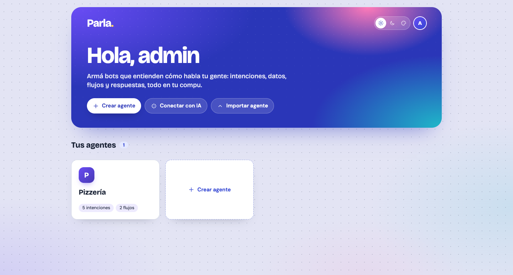
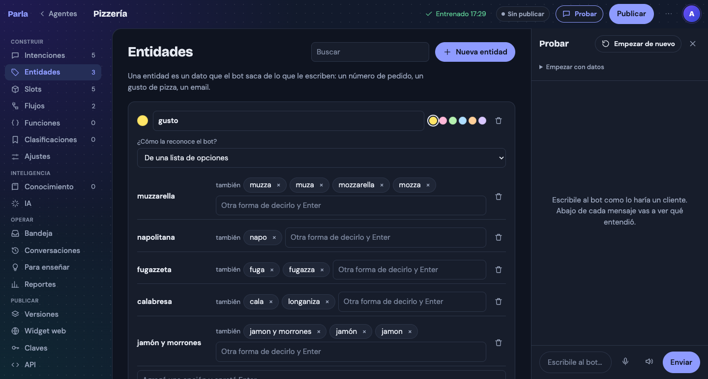
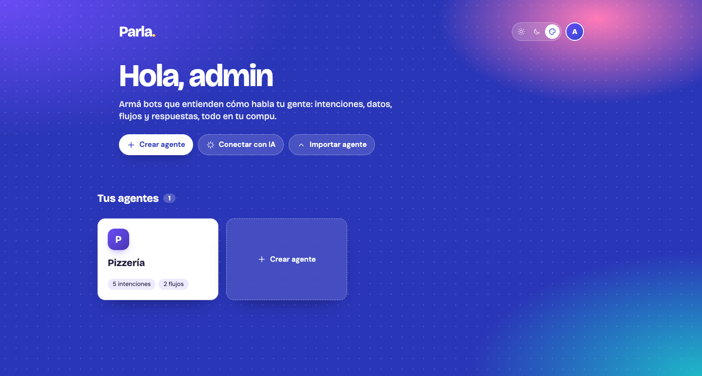
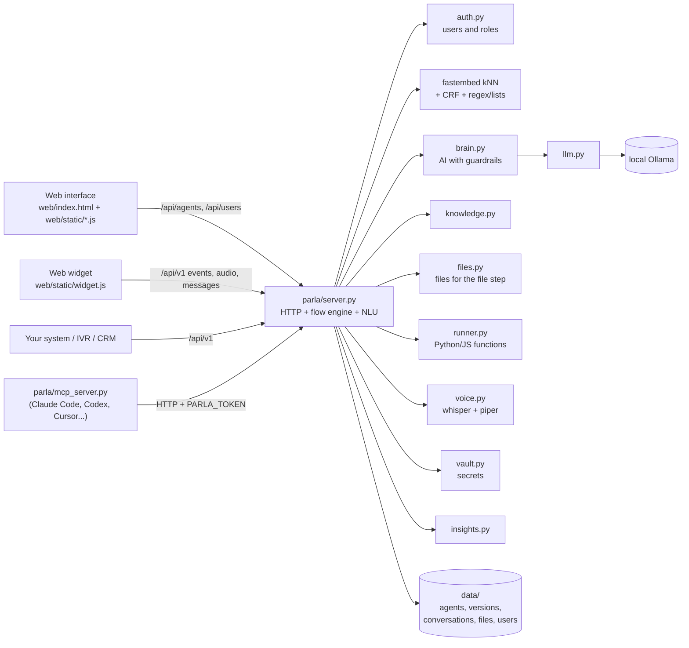

# Parla: open-source conversational AI you can self-host

**English** · [Español](README_es.md)

[](LICENSE)
[](https://github.com/pedroslev/parla-nlu/actions/workflows/ci.yml)
[](https://www.python.org/)
[](https://github.com/pedroslev/parla-nlu/pkgs/container/parla-nlu)

**Build chatbots and voice bots that run on your own servers, on a plain CPU, with no cloud required.**

Parla is a free, open-source chatbot builder and conversational AI platform (Apache-2.0). It combines a no-code
flow editor, a fast embeddings + CRF NLU, an optional LLM (local through Ollama by default) and on-premise voice
(speech-to-text and text-to-speech) in a single Python process. It is designed as a self-hosted alternative to
closed platforms such as Rasa Pro, Dialogflow CX, Cognigy, Kore.ai or Copilot Studio: your conversations, models
and data stay on your infrastructure. It is built Spanish-first and also understands Portuguese and English. See
the [comparison](docs/comparison.md) and the [roadmap](docs/ROADMAP.md).

### No open core

Every Parla feature is, and will stay, in this open-source repository under Apache-2.0. There is no paid tier,
"enterprise edition" or license key that withholds features. If companies need support or hosting, that can be
offered around the project, never by moving features out of it.

## What it is

**Parla** is a conversational bot builder that runs on your computer, with no GPU and no cloud. You build the bot
from a web interface without writing code: what it has to understand (intents), what data to pull out of a
message (entities), what to remember (slots) and what to do in each case (flows). You train in seconds, test it in
a side chat panel, publish a version and connect it to your website, your system or an IVR through a simple HTTP
API.

The interface is available in English, Spanish and Portuguese (pick it next to the theme picker: home screen,
⋯ menu or sign-in screen), and Parla's language understanding is built Spanish-first, with Portuguese and English too.

**Who is it for?**

- Small teams and businesses that want a customer-service bot (appointments, orders, FAQs) without depending on a
  paid platform or sending conversations to third parties.
- Developers who want something like Rasa but lighter: a single Python process, JSON files and a SQLite file on
  disk, no database server, with an API for integration.
- Anyone who wants an AI (Claude, Codex, Cursor) to build the bot for them: Parla ships an MCP server.

## Features

### Understanding
- Intents by similarity: multilingual embeddings (`google/embeddinggemma-300m` via fastembed) and nearest
  neighbour. Adding a phrase doesn't require retraining a heavy model.
- Answers understood by meaning, without generative AI: given «¿presencial o virtual?» ("in person or online?"),
  the reply «la quiero desde mi casa» ("I want it from home") picks «virtual» if you taught it those ways of
  saying it (`phrasings` in the entity JSON; the interface doesn't edit it yet).
- Several entity types: from examples marked in phrases (`[pedro](nombre)`, learned with a python-crfsuite CRF),
  option lists with synonyms, formats (number, email, phone, DNI, custom regex) and natural-language dates in
  Rioplatense Spanish («el jueves que viene a la tarde», "next Thursday afternoon").
- Training with self-evaluation (leaves one phrase out and checks where it gets sent), confusion matrix, concrete
  tips and a log of what each step did.
- Multilingual: Spanish, Portuguese and English in the same conversation (per-message translations, language
  detection).

### Conversations
- Flows with steps: message, question, set value, HTTP request, condition, jump, subflow, end, classify, send a
  file (PDF, image, spreadsheet…), function, hand off to a person, schedule a reminder, and AI step.
- While it's asking something, it understands corrections, side questions («¿qué es presencial?», "what does in
  person mean?", answered from the knowledge base) and interruptions (it handles the other thing and then goes back
  to the question).
- `{{ }}` templates with CEL expressions, quick-reply buttons, a start flow with preloaded data.
- Editable system flows: cancel, repeat, "did you mean…?", resume what was going on before, correct a value, hand
  off to a person, "anything else?" and a satisfaction survey (CSAT).

### Local AI (optional)
- With Ollama by default (model `qwen2.5:0.5b`, ~400 MB), or any OpenAI-compatible endpoint: vLLM, llama.cpp,
  LM Studio, LocalAI, OpenAI, Azure OpenAI, Groq, OpenRouter ([docs/ai-and-voice.md](docs/ai-and-voice.md#openai-compatible-endpoints)).
- Bring your own API key (optional): the AI can use OpenAI, Claude (Anthropic), Google Gemini or any
  OpenAI-compatible endpoint, and voice can use OpenAI, Deepgram, ElevenLabs or Google Cloud for transcription and
  text-to-speech. Keys live in the agent's vault; local stays the default ([docs/ai-and-voice.md](docs/ai-and-voice.md)).
- Rescues uncertain intents, fills slots from a description, reads an answer together with the recent
  conversation (did they answer, ask something else or request a different action), answers from the knowledge
  base, asks again when it doesn't understand, and converses in an `agent` step that can use tools: functions, HTTP APIs and allow-listed tools from MCP servers
  (Parla as an MCP client) ([docs/ai-and-voice.md](docs/ai-and-voice.md#tools-in-the-agent-step)).
- The AI proposes and the engine decides: only intents from the list, values that appear in the text and allowed
  functions are accepted. If the AI is off or doesn't respond, the bot keeps working the same.
- Local voice (optional): transcription with faster-whisper and text-to-speech with piper (`es_AR` voice). The test
  chat has a **voice call** you can interrupt by speaking; the bot's fixed phrases are pre-generated so they play
  instantly.

### Operations
- **Inbox**: take over a conversation, reply to the person and hand it back to the bot.
- **External contact centers**: hand off to Genesys, Twilio Flex, Five9, Zendesk, Salesforce… with signed webhooks, an
  API to reply and release, and SIP headers with context on calls ([docs/contact-centers.md](docs/contact-centers.md)).
- Saved conversations with filters, classifications and daily reports. Each one can be replayed as a test against
  another version, or you can keep talking as that customer.
- **Improve**: what people wrote that the bot didn't understand, grouped by similarity and with a
  suggested intent.
- Analytics: containment, handoffs, fallbacks, CSAT and drop-off by flow and question.
- **Costs per conversation**: measured tokens, audio minutes, characters, phone minutes and messages × your own price
  table (verified defaults with sources), per day, channel, provider and resolved conversation, to compare with
  closed vendors ([docs/costs.md](docs/costs.md)).
- Observability: Prometheus metrics at `/metrics`, OpenTelemetry traces over OTLP/HTTP (with GenAI attributes and
  W3C trace context to your APIs) and JSON request logs; off by default and without conversation content
  ([docs/observability.md](docs/observability.md)).

### Publishing
- Draft → immutable numbered versions → `staging` and `production` environments. Diff before publishing, rollback
  by pointing to an earlier version, and each conversation stays tied to the version it started with.
- Conversation test suites (**Tests**): expected conversations stored in the bot, run from the UI, the API, the MCP
  or the command line in CI, and run before every publish to production
  ([docs/testing-bots.md](docs/testing-bots.md)).
- Public HTTP API (`/api/v1`), web widget embeddable with a `<script>`, agent export and import.
- WhatsApp (Cloud API) and Telegram channels, with buttons, files and Inbox replies ([docs/channels.md](docs/channels.md)).
- Phone calls through Twilio or jambonz (open source, self-hostable): speech and keypad (DTMF), buttons as «press 1
  for…» menus, barge-in, transfer to a person, optional local piper voice ([docs/channels.md](docs/channels.md#phone-calls-twilio-and-jambonz)).
- Real-time voice (phone stream mode, browser call, widget): streaming ASR, reply from the first sentence and true
  barge-in over WebSocket, under a second with streaming providers ([docs/ai-and-voice.md](docs/ai-and-voice.md#real-time-voice)).
- The bot writes first: an outbound API, **campaigns** from a CSV (WhatsApp templates, Telegram or outbound calls,
  with schedule, rate, quiet hours, delivery statuses and conversions), reminders from a flow, and automatic
  opt-outs («STOP», «BAJA») ([docs/outbound.md](docs/outbound.md)).
- Light, dark and colorful themes in the interface.

### Security
- Users with roles (owner, editor, analyst, support agent), per-user bot visibility and API keys.
- Single sign-on with OIDC (Keycloak, Entra ID, Google, Okta, Authentik, Auth0), with roles from your provider's
  groups ([docs/sso.md](docs/sso.md)).
- Per-agent secret vault (`{{ secret.NOMBRE }}`): values don't travel in the bot JSON and are masked in traces.
- Listens on `127.0.0.1` (unless you change `PARLA_HOST`) and rejects requests from other websites except those
  authorized for the widget.
- Audit log of who changed what (owner only), per-agent conversation retention and optional masking of personal
  data (emails, phones, cards, ID numbers, bank accounts) in saved conversations. See
  [docs/security.md](docs/security.md#audit-log).

### Integrations
- MCP server with 27 tools to build, validate, train, test, publish and analyze bots.
- **Connect to AI**: one button registers Parla in Claude Code, Codex, Claude Desktop or Cursor.
- **Skills for AI assistants**: bot-building best practices as Agent Skills, also served by the MCP server, so the
  assistant builds bots that work ([docs/skills.md](docs/skills.md), [best practices](docs/best-practices.md)).
- Functions in Python or JavaScript for logic that an HTTP step can't handle.
- **Import from Rasa**: upload your Rasa 3.x project (classic or CALM) as a .zip and get a Parla agent plus a list of what
  couldn't be migrated. See [docs/migrate-from-rasa.md](docs/migrate-from-rasa.md).

## Screenshots

| Login | Your agents |
|---|---|
|  |  |
| **Flow editor** (with the system flows) | **Entities with synonyms** (dark theme) |
|  |  |

Three themes: light, dark and colorful.



## Quick start

Requirements:

- **Python 3.11 or newer** (required).
- Node.js (optional): only for functions written in JavaScript.
- [Ollama](https://ollama.com) (optional): for the local AI features.
- Voice extras (optional): `requirements-voice.txt` and `ffmpeg` on the system.
- Provider extras (optional, only needed for Claude): `requirements-providers.txt`.

With the script (recommended):

```sh
scripts/setup.sh            # creates .venv and installs the dependencies
scripts/setup.sh --voice    # also installs local voice
scripts/setup.sh --providers  # also installs the Claude SDK (optional)
make run                    # opens Parla at http://127.0.0.1:8000
```

Or with `make`:

```sh
make setup
make run
```

By hand:

```sh
python3 -m venv .venv
.venv/bin/pip install -r requirements.txt
.venv/bin/pip install -r requirements-voice.txt     # optional
.venv/bin/pip install -r requirements-providers.txt # optional, only for Claude
.venv/bin/python app.py                              # or: .venv/bin/python app.py 8080
```

Open `http://127.0.0.1:8000`. The first time, a sample bot is created («Seguimiento de pedidos», order tracking)
and, when you train, the embedding model is downloaded (~1.2 GB, only once). To try something more complete,
import `examples/pizzeria.json` or `examples/turnos-clinica.json` with **Import agent**.

**Login:** as long as no user exists, Parla is open: anyone who reaches the page can see and change everything.
The first user you create (in **Users**) becomes the owner, and from then on login is required.

Local AI (optional):

```sh
ollama pull qwen2.5:0.5b          # or: scripts/setup.sh --ollama
```

Then turn it on in the agent's **AI** section. More in [docs/ai-and-voice.md](docs/ai-and-voice.md).

With Docker:

```sh
docker compose up -d              # http://127.0.0.1:8000; with --profile ai it adds Ollama
```

Or the prebuilt multi-arch image (`linux/amd64`, `linux/arm64`; published from the first tagged release on, `edge`
follows `main`, and `-voice` tags include local voice):

```sh
docker run -d -p 127.0.0.1:8000:8000 -v parla-data:/data ghcr.io/pedroslev/parla-nlu:latest
```

For Kubernetes there is a **Helm chart** in [deploy/helm/parla](deploy/helm/parla) (Ingress with only the public routes, SSO,
metrics, nightly backups, NetworkPolicy egress lockdown, optional Ollama) and plain Kustomize manifests for k8s and k3s:
see [docs/kubernetes.md](docs/kubernetes.md). The proxy, variables and backups are in [docs/deployment.md](docs/deployment.md).
SQLite is the default; with **Postgres** (`PARLA_DATABASE_URL`) several replicas serve the same bots, with failover
([high availability](docs/deployment.md#postgres-and-high-availability)).

## Architecture



## Project structure

```
app.py                  entry point: python app.py [port]
mcp_server.py           shortcut to the MCP server (parla/mcp_server.py)
parla/
  server.py             HTTP, engine (handle/run/begin), NLU, versions, public API
  auth.py               users, roles, sessions and API keys
  db.py                 SQLite database (parla.db): conversations, logins and audit log
  pii.py                masking of personal data in what is stored
  brain.py              AI on top of the engine (rescue, slots, reading answers, fallback, agent step)
  llm.py                LLM client (local Ollama / OpenAI / Claude / Gemini / any OpenAI-compatible endpoint)
  knowledge.py          knowledge base: text extraction and search
  files.py              files sent by the “Send a file” step
  dates.py              rule-based natural-language dates
  insights.py           “Improve” and analytics
  runner.py             functions in a separate process
  telemetry.py          Prometheus metrics, OpenTelemetry traces, JSON logs
  vault.py              per-agent secrets
  voice.py              voice: local or BYOK providers (and cache of pre-generated phrases)
  phone.py              phone calls (Twilio, jambonz)
  connect.py            “Connect to AI”
  mcp_server.py         MCP server
web/index.html          the interface
web/static/*.js         interface sections and the widget
tests/                  test_*.py and run_all.py
examples/               sample bots to import: pizzeria.json and turnos-clinica.json (buttons, knowledge, handoff, dates)
data/                   runtime data (not versioned)
deploy/                 Helm chart (helm/), Kubernetes (k8s/, k8s-ha/) and k3s (k3s/) manifests, observability
Dockerfile, docker-compose.yml
scripts/setup.sh, Makefile, requirements*.txt, .env.example
```

## Configuration

Everything is optional. Copy `.env.example` to see the values.

| Variable | Default | Purpose |
|---|---|---|
| `PARLA_DATA` | `data/` | Where agents, versions, conversations, users and models are stored. |
| `PARLA_USERS` | inside the data folder (`users.json`) | Users file. |
| `PARLA_HOST` | `127.0.0.1` | Address it listens on (the Docker image uses `0.0.0.0`). |
| `PARLA_EMBED_CACHE` | the repo's `data/models/embeddings` | Where the embedding model (~1.2 GB) is stored. |
| `PARLA_HOSTS` | empty | Extra hostnames used to reach Parla behind a proxy (see [docs/deployment.md](docs/deployment.md)). |
| `PARLA_SECURE_COOKIE` | empty | `1` marks the session cookie as `Secure` (behind HTTPS). |
| `PARLA_RETENTION_DAYS` | empty | Days to keep conversations with no activity, for agents without their own `retention_days`. Empty or `0`: forever. |
| `PARLA_AUDIT_DAYS` | `365` | Days to keep the audit log. |
| `PARLA_DATABASE_URL`, `PARLA_SECRET_KEY` | empty | `postgresql://…`: Postgres instead of SQLite, for several replicas; the secret key (same in every replica) signs call audio URLs. See [docs/deployment.md](docs/deployment.md#postgres-and-high-availability). |
| `PARLA_CAMPAIGN_MAX` | `10000` | Maximum recipients per campaign, for agents without `outbound.max_recipients` (see [docs/outbound.md](docs/outbound.md)). |
| `PARLA_PUBLIC_URL` | empty | Public HTTPS address, for the WhatsApp, Telegram and phone webhooks (see [docs/channels.md](docs/channels.md)) and the SSO redirect URI. |
| `PARLA_METRICS`, `PARLA_METRICS_TOKEN` | empty | `1` serves Prometheus metrics at `/metrics`; the token (`Authorization: Bearer`) is needed from another host. See [docs/observability.md](docs/observability.md). |
| `PARLA_OTEL_ENDPOINT` | empty | OTLP/HTTP base URL for OpenTelemetry traces (the standard `OTEL_EXPORTER_OTLP_*` and `OTEL_SERVICE_NAME` work too). `PARLA_OTEL_CONTENT=1` adds masked message text. |
| `PARLA_LOG_FORMAT` | empty | `json`: one JSON line per request on stderr, with `trace_id` and `span_id`. |
| `PARLA_OIDC_ISSUER`, `PARLA_OIDC_CLIENT_ID` | empty | Single sign-on with OIDC; secret, role mapping and the other `PARLA_OIDC_*` in [docs/sso.md](docs/sso.md). |
| `PARLA_FUNCTIONS` | `1` | `0`, `false`, `no` or `off` disable agent functions. |
| `PARLA_WHISPER` | `base` | faster-whisper model (`tiny` if the machine is slow). |
| `PARLA_URL` | `http://127.0.0.1:8000` | (MCP) where Parla is. |
| `PARLA_TOKEN` | empty | (MCP) API key sent as `Authorization: Bearer`. |
| `PARLA_MCP_ALLOWED_HOSTS` | empty | (MCP with `--http`) public domains accepted behind a proxy. |

The port is passed as an argument: `python app.py 8080`.

## Tests

```sh
make test                         # or: .venv/bin/python tests/run_all.py
.venv/bin/python tests/test_app.py   # a single one
```

They are scripts with `assert`, no framework, and they never touch your `data/`. `test_app.py`,
`test_insights.py`, `test_connect.py`, `test_auth.py` and `test_storage.py` need nothing external (`test_auth.py`
and `test_storage.py` start their own server on a free port); `test_knowledge.py` and `test_mcp.py` need the embedding model (`test_mcp.py` starts its
own temporary Parla); `test_ai.py` skips what needs Ollama if it isn't there; `test_voice.py` is skipped without
the voice extras. Details in [docs/development.md](docs/development.md#tests).

## Roadmap

The public plan (Now / Next / Later) is in [docs/ROADMAP.md](docs/ROADMAP.md). What it does **not** do yet:

- Built-in public endpoint or tunnel (today you publish it yourself with a proxy).
- Bot templates.
- Per-user memory across conversations.
- Real-time audio streaming on calls, and answering machine detection on outbound calls.

## Comparison

A general overview, not a benchmark. Each tool has many more options than fit here. A detailed, sourced comparison
with Rasa Pro/Studio, Cognigy, Kore.ai, Dialogflow CX, Copilot Studio, Botpress and Voiceflow, including what
Parla doesn't have yet, is in [docs/comparison.md](docs/comparison.md).

| | Parla | Rasa | Dialogflow (Google) | Botpress |
|---|---|---|---|---|
| Where it runs | Your computer (or a container), one Python process | Self-hosted | Google Cloud | Cloud (it also had a self-hosted version) |
| No-code interface | Yes, included | Mainly YAML files and CLI; visual interfaces in the commercial edition | Yes (console; visual flows in CX) | Yes, visual editor |
| NLU | Embeddings + kNN, CRF, rules | Configurable ML pipeline and LLM-based approaches | Managed by Google | LLM-based in current versions |
| LLM | Optional: local (Ollama) by default, or your own key for OpenAI, Claude, Gemini or any OpenAI-compatible endpoint | Optional, configurable | Integrated with Google models | Central to the platform |
| Scale and ecosystem | Designed for a small server | Mature, large-scale production | Managed, Google scale | Large integration ecosystem |
| Channels | HTTP API, web widget, WhatsApp, Telegram and phone (Twilio, jambonz) | Many connectors | Many integrations | Many channels |
| Cost | Free, local | Open source + paid edition | Pay per use | Free plan + paid plans |

If you need many channels, high availability or a large team, the other options are more mature. Parla aims to
get a useful bot running in an afternoon, on your machine and without sending data elsewhere.

## Documentation

**[User manual](docs/manual/README.md)**: a step-by-step guide for people who use the web interface (building bots, Inbox, reports, administration).

Everything is in [`docs/`](docs/README.md): getting started, concepts, API, [testing bots](docs/testing-bots.md), [WhatsApp, Telegram and phone](docs/channels.md), MCP, [skills](docs/skills.md), [best practices](docs/best-practices.md),
AI and voice, security, [single sign-on](docs/sso.md), deployment, development, FAQ, [migrating from Rasa](docs/migrate-from-rasa.md),
[comparison](docs/comparison.md) and [roadmap](docs/ROADMAP.md). Release notes are in [CHANGELOG.md](CHANGELOG.md).

## Contributing

Contributions are welcome: read [CONTRIBUTING.md](CONTRIBUTING.md) (setup, tests, style, DCO sign-off with
`git commit -s`) and the [Code of Conduct](CODE_OF_CONDUCT.md). Report security issues privately as described in
[SECURITY.md](SECURITY.md).

## License

[Apache License 2.0](LICENSE). Copyright 2026 The Parla Authors; see [NOTICE](NOTICE). Every feature is open source
([no open core](#no-open-core)).

Product names mentioned in this repository are trademarks of their respective owners and are used only to
identify them; Parla is not affiliated with or endorsed by them.
