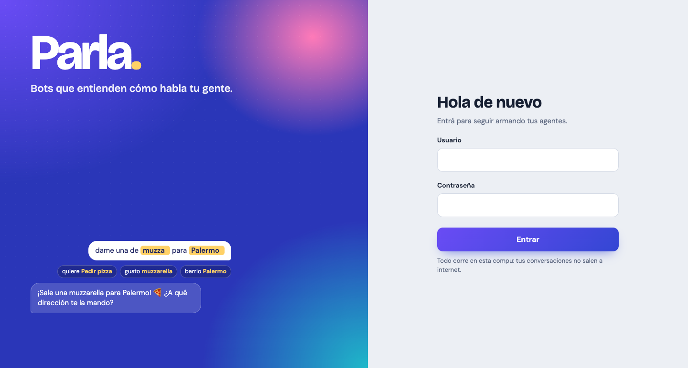
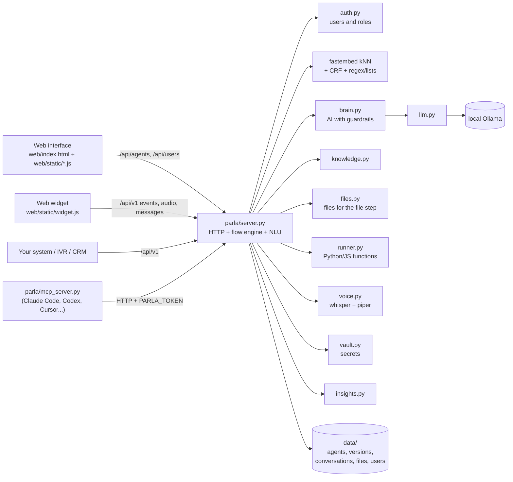

# Parla

**English** · [Español](README_es.md)

**Parla** is a conversational bot builder that runs on your computer, with no GPU and no cloud. You build the bot
from a web interface without writing code: what it has to understand (intents), what data to pull out of a
message (entities), what to remember (slots) and what to do in each case (flows). You train in seconds, test it in
a side chat panel, publish a version and connect it to your website, your system or an IVR through a simple HTTP
API.

The interface is in Spanish, and Parla is aimed at bots for Spanish-speaking users.

**Who is it for?**

- Small teams and businesses that want a customer-service bot (appointments, orders, FAQs) without depending on a
  paid platform or sending conversations to third parties.
- Developers who want something like Rasa but lighter: a single Python process, JSON files on disk, no database,
  with an API for integration.
- Anyone who wants an AI (Claude, Codex, Cursor) to build the bot for them: Parla ships an MCP server.

## Features

### Understanding
- Intents by similarity: multilingual embeddings (`google/embeddinggemma-300m` via fastembed) and nearest
  neighbour. Adding a phrase doesn't require retraining a heavy model.
- Answers understood by meaning, without generative AI: given «¿presencial o virtual?» ("in person or online?"),
  the reply «la quiero desde mi casa» ("I want it from home") picks «virtual» if you taught it those ways of
  saying it (`phrasings` in the entity JSON; the interface doesn't edit it yet).
- Several entity types: from examples marked in phrases (`[pedro](nombre)`, learned with a python-crfsuite CRF),
  option lists with synonyms, formats (number, email, phone, DNI, custom regex) and natural-language dates in
  Rioplatense Spanish («el jueves que viene a la tarde», "next Thursday afternoon").
- Training with self-evaluation (leaves one phrase out and checks where it gets sent), confusion matrix, concrete
  tips and a log of what each step did.
- Multilingual: Spanish, Portuguese and English in the same conversation (per-message translations, language
  detection).

### Conversations
- Flows with steps: message, question, set value, HTTP request, condition, jump, subflow, end, classify, send a
  file (PDF, image, spreadsheet…), function, hand off to a person, and AI step.
- While it's asking something, it understands corrections, side questions («¿qué es presencial?», "what does in
  person mean?", answered from the knowledge base) and interruptions (it handles the other thing and then goes back
  to the question).
- `{{ }}` templates with CEL expressions, quick-reply buttons, a start flow with preloaded data.
- Editable system flows: cancel, repeat, "did you mean…?", resume what was going on before, correct a value, hand
  off to a person, "anything else?" and a satisfaction survey (CSAT).

### Local AI (optional)
- With Ollama (or a local OpenAI-compatible server such as LM Studio or llama.cpp). Default model
  `qwen2.5:0.5b`, ~400 MB.
- Rescues uncertain intents, fills slots from a description, reads an answer together with the recent
  conversation (did they answer, ask something else or request a different action), answers from the knowledge
  base, asks again when it doesn't understand, and converses in an `agent` step with functions as tools.
- The AI proposes and the engine decides: only intents from the list, values that appear in the text and allowed
  functions are accepted. If the AI is off or doesn't respond, the bot keeps working the same.
- Local voice (optional): transcription with faster-whisper and text-to-speech with piper (`es_AR` voice). The test
  chat has a **voice call** you can interrupt by speaking; the bot's fixed phrases are pre-generated so they play
  instantly.

### Operations
- **Bandeja** (Inbox): take over a conversation, reply to the person and hand it back to the bot.
- Saved conversations with filters, classifications and daily reports. Each one can be replayed as a test against
  another version, or you can keep talking as that customer.
- **Para enseñar** (To teach): what people wrote that the bot didn't understand, grouped by similarity and with a
  suggested intent.
- Analytics: containment, handoffs, fallbacks, CSAT and drop-off by flow and question.

### Publishing
- Draft → immutable numbered versions → `staging` and `production` environments. Diff before publishing, rollback
  by pointing to an earlier version, and each conversation stays tied to the version it started with.
- Public HTTP API (`/api/v1`), web widget embeddable with a `<script>`, agent export and import.
- Light, dark and colorful themes in the interface.

### Security
- Users with roles (owner, editor, analyst, support agent), per-user bot visibility and API keys.
- Per-agent secret vault (`{{ secret.NOMBRE }}`): values don't travel in the bot JSON and are masked in traces.
- Listens on `127.0.0.1` (unless you change `PARLA_HOST`) and rejects requests from other websites except those
  authorized for the widget.

### Integrations
- MCP server with 25 tools to build, validate, train, test, publish and analyze bots.
- **Conectar con IA** (Connect to AI): one button registers Parla in Claude Code, Codex, Claude Desktop or Cursor.
- Functions in Python or JavaScript for logic that an HTTP step can't handle.

## Screenshots

| Login | Your agents |
|---|---|
|  |  |
| **Flow editor** (with the system flows) | **Entities with synonyms** (dark theme) |
|  |  |

Three themes: light, dark and colorful.


## Quick start

Requirements:

- **Python 3.11 or newer** (required).
- Node.js (optional): only for functions written in JavaScript.
- [Ollama](https://ollama.com) (optional): for the local AI features.
- Voice extras (optional): `requirements-voice.txt` and `ffmpeg` on the system.

With the script (recommended):

```sh
scripts/setup.sh            # creates .venv and installs the dependencies
scripts/setup.sh --voice    # also installs local voice
make run                    # opens Parla at http://127.0.0.1:8000
```

Or with `make`:

```sh
make setup
make run
```

By hand:

```sh
python3 -m venv .venv
.venv/bin/pip install -r requirements.txt
.venv/bin/pip install -r requirements-voice.txt     # optional
.venv/bin/python app.py                              # or: .venv/bin/python app.py 8080
```

Open `http://127.0.0.1:8000`. The first time, a sample bot is created («Seguimiento de pedidos», order tracking)
and, when you train, the embedding model is downloaded (~1.2 GB, only once). To try something more complete,
import `examples/pizzeria.json` or `examples/turnos-clinica.json` with **Importar agente** (Import agent).

**Login:** as long as no user exists, Parla is open: anyone who reaches the page can see and change everything.
The first user you create (in **Usuarios**, Users) becomes the owner, and from then on login is required.

Local AI (optional):

```sh
ollama pull qwen2.5:0.5b          # or: scripts/setup.sh --ollama
```

Then turn it on in the agent's **IA** (AI) section. More in [docs/ai-and-voice.md](docs/ai-and-voice.md).

With Docker:

```sh
docker compose up -d              # http://127.0.0.1:8000; with --profile ai it adds Ollama
```

There are also Kubernetes (and k3s) manifests in `deploy/`. How to use them, the proxy and backups are covered in
[docs/deployment.md](docs/deployment.md).

## Architecture



## Project structure

```
app.py                  entry point: python app.py [port]
mcp_server.py           shortcut to the MCP server (parla/mcp_server.py)
parla/
  server.py             HTTP, engine (handle/run/begin), NLU, versions, public API
  auth.py               users, roles, sessions and API keys
  brain.py              AI on top of the engine (rescue, slots, reading answers, fallback, agent step)
  llm.py                client for local models (Ollama / OpenAI-compatible)
  knowledge.py          knowledge base: text extraction and search
  files.py              files sent by the «Enviar un archivo» (Send a file) step
  dates.py              rule-based natural-language dates
  insights.py           «para enseñar» (to teach) and analytics
  runner.py             functions in a separate process
  vault.py              per-agent secrets
  voice.py              local voice (and cache of pre-generated phrases)
  connect.py            «Conectar con IA» (Connect to AI)
  mcp_server.py         MCP server
web/index.html          the interface
web/static/*.js         interface sections and the widget
tests/                  test_*.py and run_all.py
examples/               sample bots to import: pizzeria.json and turnos-clinica.json (buttons, knowledge, handoff, dates)
data/                   runtime data (not versioned)
deploy/                 Kubernetes (k8s/) and k3s (k3s/) manifests
Dockerfile, docker-compose.yml
scripts/setup.sh, Makefile, requirements*.txt, .env.example
```

## Configuration

Everything is optional. Copy `.env.example` to see the values.

| Variable | Default | Purpose |
|---|---|---|
| `PARLA_DATA` | `data/` | Where agents, versions, conversations, users and models are stored. |
| `PARLA_USERS` | inside the data folder (`users.json`) | Users file. |
| `PARLA_HOST` | `127.0.0.1` | Address it listens on (the Docker image uses `0.0.0.0`). |
| `PARLA_EMBED_CACHE` | the repo's `data/models/embeddings` | Where the embedding model (~1.2 GB) is stored. |
| `PARLA_HOSTS` | empty | Extra hostnames used to reach Parla behind a proxy (see [docs/deployment.md](docs/deployment.md)). |
| `PARLA_SECURE_COOKIE` | empty | `1` marks the session cookie as `Secure` (behind HTTPS). |
| `PARLA_FUNCTIONS` | `1` | `0`, `false`, `no` or `off` disable agent functions. |
| `PARLA_WHISPER` | `base` | faster-whisper model (`tiny` if the machine is slow). |
| `PARLA_URL` | `http://127.0.0.1:8000` | (MCP) where Parla is. |
| `PARLA_TOKEN` | empty | (MCP) API key sent as `Authorization: Bearer`. |
| `PARLA_MCP_ALLOWED_HOSTS` | empty | (MCP with `--http`) public domains accepted behind a proxy. |

The port is passed as an argument: `python app.py 8080`.

## Tests

```sh
make test                         # or: .venv/bin/python tests/run_all.py
.venv/bin/python tests/test_app.py   # a single one
```

They are scripts with `assert`, no framework, and they never touch your `data/`. `test_app.py`,
`test_insights.py`, `test_connect.py` and `test_auth.py` need nothing external (`test_auth.py` starts its own
server on a free port); `test_knowledge.py` and `test_mcp.py` need the embedding model (`test_mcp.py` starts its
own temporary Parla); `test_ai.py` skips what needs Ollama if it isn't there; `test_voice.py` is skipped without
the voice extras. Details in [docs/development.md](docs/development.md#tests).

## Roadmap

What it does **not** do yet:

- WhatsApp channel.
- Built-in public endpoint or tunnel (today you publish it yourself with a proxy).
- Bot templates and outbound campaigns.
- Per-user memory across conversations.
- Automatic masking of personal data (PII) in saved conversations.
- Retention policy (conversations aren't deleted automatically).
- Telephony (the API works for an IVR, but there's no direct integration).

## Comparison

A general overview, not a benchmark. Each tool has many more options than fit here.

| | Parla | Rasa | Dialogflow (Google) | Botpress |
|---|---|---|---|---|
| Where it runs | Your computer (or a container), one Python process | Self-hosted | Google Cloud | Cloud (it also had a self-hosted version) |
| No-code interface | Yes, included | Mainly YAML files and CLI; visual interfaces in the commercial edition | Yes (console; visual flows in CX) | Yes, visual editor |
| NLU | Embeddings + kNN, CRF, rules | Configurable ML pipeline and LLM-based approaches | Managed by Google | LLM-based in current versions |
| LLM | Optional, local (Ollama) | Optional, configurable | Integrated with Google models | Central to the platform |
| Scale and ecosystem | Designed for a small server | Mature, large-scale production | Managed, Google scale | Large integration ecosystem |
| Channels | HTTP API and web widget | Many connectors | Many integrations | Many channels |
| Cost | Free, local | Open source + paid edition | Pay per use | Free plan + paid plans |

If you need many channels, high availability or a large team, the other options are more mature. Parla aims to
get a useful bot running in an afternoon, on your machine and without sending data elsewhere.

## Documentation

Everything is in [`docs/`](docs/README.md): getting started, concepts, API, MCP, AI and voice, security,
deployment, development and FAQ.

## Contributing

1. Open an issue describing what you want to change.
2. Follow the code style: small functions, comments in Spanish, the simplest solution that works, and `ponytail:`
   comments when taking a shortcut with a known limit (see [docs/development.md](docs/development.md)).
3. Add or adjust a test in `tests/` and run `make test` before submitting the change.

## License

To be defined.
