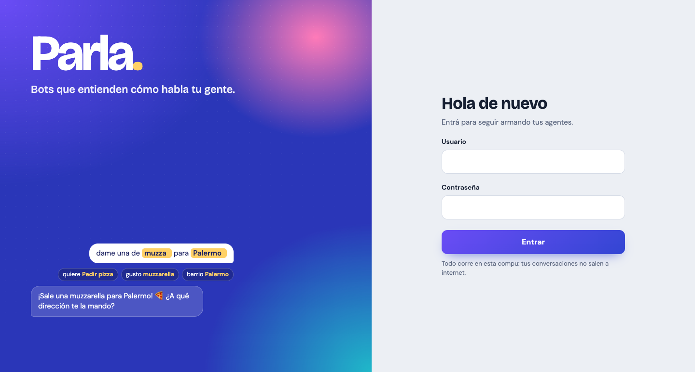
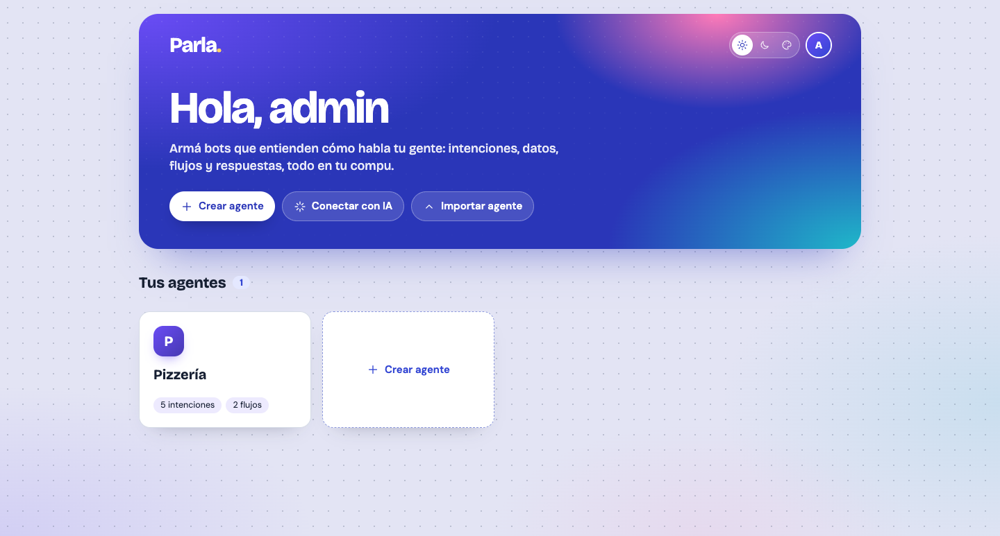
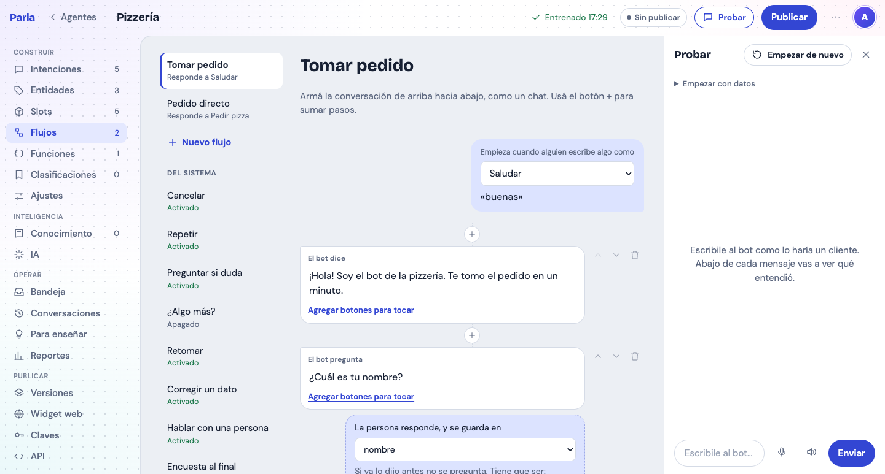
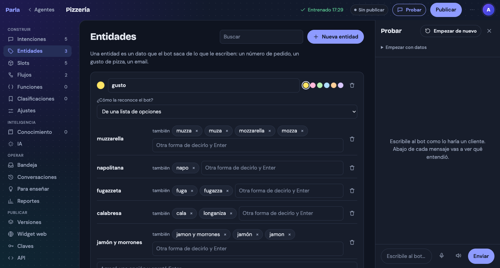
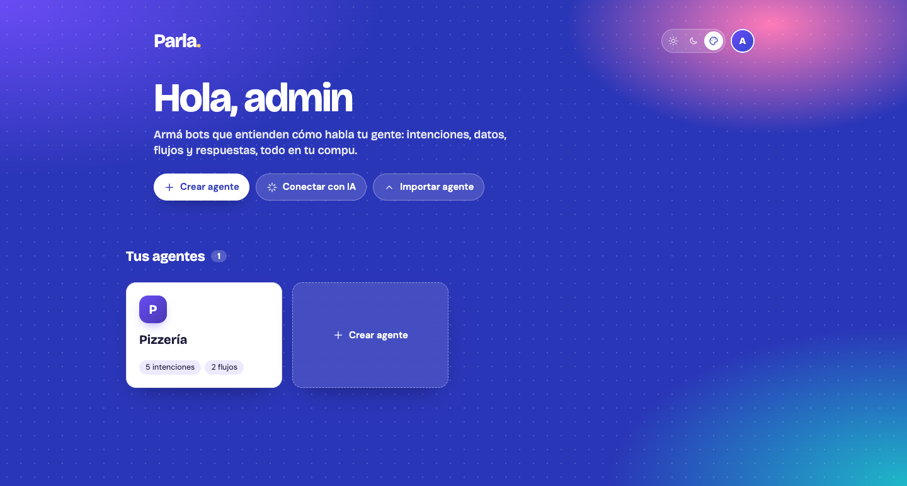
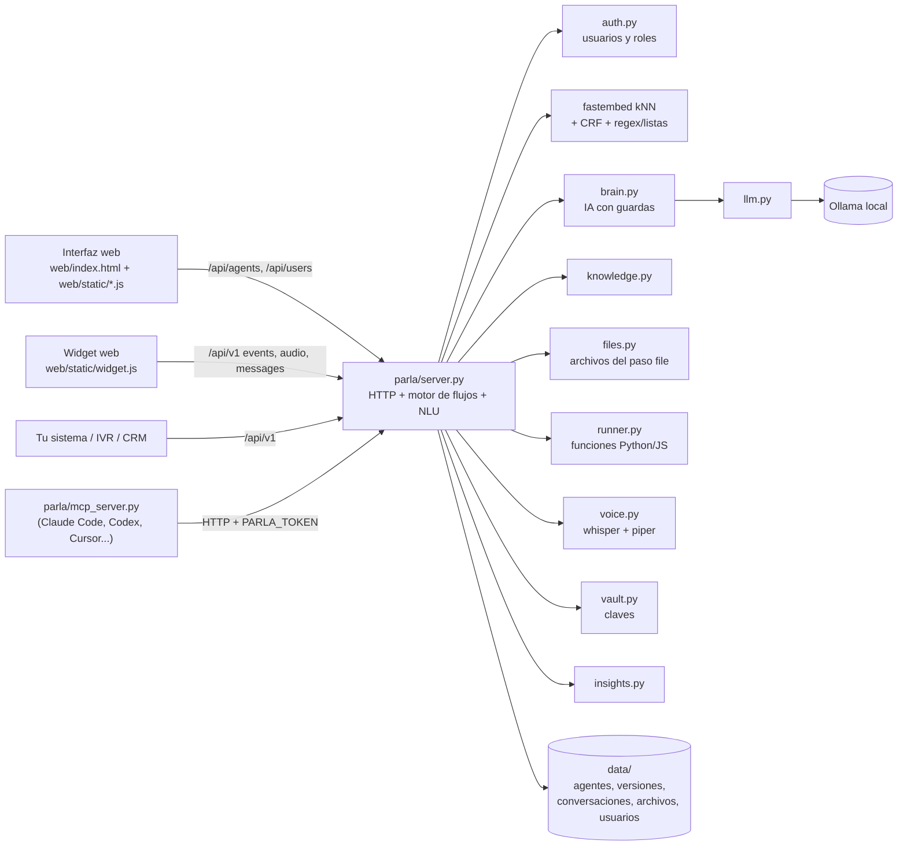

# Parla: IA conversacional open source y autoalojada

[English](README.md) · **Español**

[](LICENSE)
[](https://github.com/pedroslev/parla-nlu/actions/workflows/ci.yml)
[](https://www.python.org/)
[](https://github.com/pedroslev/parla-nlu/pkgs/container/parla-nlu)

**Armá chatbots y bots de voz que corren en tus propios servidores, en una CPU común, sin depender de la nube.**

Parla es una plataforma de IA conversacional y constructor de chatbots gratuita y open source (Apache-2.0). Junta
un editor de flujos sin código, un NLU rápido con embeddings + CRF, un LLM opcional (local con Ollama por defecto) y voz on-premise
(dictado y voz sintetizada) en un solo proceso Python. Está pensada como alternativa autoalojada a plataformas cerradas
como Rasa Pro, Dialogflow CX, Cognigy, Kore.ai o Copilot Studio: las conversaciones, los modelos y los datos quedan
en tu infraestructura. Está pensado primero para bots en español y entiende también portugués e inglés. Ver la
[comparación](docs/comparison_es.md) y la [hoja de ruta](docs/ROADMAP_es.md).

### Sin open core

Todas las funciones de Parla están, y van a seguir estando, en este repositorio open source bajo Apache-2.0. No
hay un plan pago, una «edición enterprise» ni una clave de licencia que se guarde funciones. Si hace falta soporte
o hosting, se puede ofrecer alrededor del proyecto, nunca sacándole funciones.

## Qué es

**Parla** es un armador de bots conversacionales que corre en tu compu, sin GPU y sin nube. Armás el bot desde
una interfaz web sin escribir código: qué cosas tiene que entender (intenciones), qué datos sacar del mensaje
(entidades), qué recordar (slots) y qué hacer en cada caso (flujos). Entrenás en segundos, lo probás en un chat al
costado, publicás una versión y lo conectás a tu web, a tu sistema o a un IVR por una API HTTP simple.

La interfaz está en español, inglés y portugués (se elige al lado del selector de
tema: inicio, menú ⋯ o pantalla de entrada).

**¿Para quién es?**

- Equipos chicos y pymes que quieren un bot de atención (turnos, pedidos, preguntas frecuentes) sin depender de
  una plataforma paga ni mandar las conversaciones afuera.
- Desarrolladores que quieren algo tipo Rasa pero más liviano: un solo proceso Python, archivos JSON y un archivo
  SQLite en disco, sin servidor de base de datos, con una API para integrarlo.
- Quien quiera que una IA (Claude, Codex, Cursor) le arme el bot: Parla trae un servidor MCP.

## Qué trae

### Comprensión
- Intenciones por similitud: embeddings multilingües (`google/embeddinggemma-300m` vía fastembed) y
  vecino más cercano. Sumar una frase no requiere reentrenar un modelo pesado.
- Respuestas entendidas por significado, sin IA generativa: «la quiero desde mi casa» a «¿presencial o virtual?»
  elige «virtual» si le enseñaste esas formas de decirlo (`phrasings` en el JSON de la entidad; la interfaz todavía
  no lo edita).
- Entidades de varios tipos: por ejemplos marcados en las frases (`[pedro](nombre)`, aprendidas con un CRF de
  python-crfsuite), listas de opciones con sinónimos, formatos (número, email, teléfono, DNI, regex propia) y
  fechas en lenguaje natural en español rioplatense («el jueves que viene a la tarde»).
- Entrenamiento con autoevaluación (deja una frase afuera y mira a dónde la manda), matriz de confusión,
  consejos concretos y registro de lo que hizo cada paso.
- Multilingüe: español, portugués e inglés en la misma charla (traducciones por mensaje, detección de idioma).

### Conversaciones
- Flujos con pasos: mensaje, pregunta, guardar valor, consulta HTTP, condición, saltar, subflujo, fin,
  clasificar, enviar un archivo (PDF, imagen, planilla…), función, pasar con una persona, programar un recordatorio
  y paso de IA.
- Mientras pregunta algo: entiende correcciones, preguntas sueltas («¿qué es presencial?», desde la base de
  conocimiento) e interrupciones (atiende otra cosa y después vuelve a la pregunta).
- Plantillas `{{ }}` con expresiones CEL, botones de respuesta rápida, flujo de inicio con datos precargados.
- Flujos del sistema editables: cancelar, repetir, «¿quisiste decir…?», retomar lo de antes, corregir un dato,
  pasar con una persona, «¿algo más?» y encuesta de satisfacción (CSAT).

### IA local (opcional)
- Con Ollama por defecto (modelo `qwen2.5:0.5b`, ~400 MB), o cualquier endpoint compatible con OpenAI: vLLM,
  llama.cpp, LM Studio, LocalAI, OpenAI, Azure OpenAI, Groq, OpenRouter ([docs/ai-and-voice_es.md](docs/ai-and-voice_es.md#endpoints-compatibles-con-openai)).
- Con tu propia API key (opcional): la IA puede usar OpenAI, Claude (Anthropic), Google Gemini o cualquier
  endpoint compatible con OpenAI, y la voz puede usar OpenAI, Deepgram, ElevenLabs o Google Cloud para transcribir
  y sintetizar. Las keys van en las Claves del agente; lo local sigue siendo lo que viene por defecto ([docs/ai-and-voice_es.md](docs/ai-and-voice_es.md)).
- Rescata intenciones dudosas, completa slots a partir de una descripción, lee una respuesta con la charla
  reciente (contestó, preguntó otra cosa o pidió otra acción), responde desde la base de conocimiento, repregunta
  cuando no entiende y conversa en un paso `agent` que puede usar herramientas: funciones, APIs HTTP y herramientas
  habilitadas de servidores MCP (Parla como cliente MCP) ([docs/ai-and-voice_es.md](docs/ai-and-voice_es.md#herramientas-en-el-paso-agente)).
- La IA propone y el motor decide: solo se aceptan intenciones de la lista, valores que están en el texto y
  funciones permitidas. Si la IA está apagada o no responde, el bot sigue funcionando igual.
- Voz local (opcional): transcripción con faster-whisper y lectura en voz alta con piper (voz `es_AR`). En el
  chat de prueba hay una **llamada de voz** que se puede interrumpir hablando; las frases fijas del bot quedan
  pregeneradas para que suenen al instante.

### Operación
- Bandeja: tomar una conversación, responderle a la persona y devolverla al bot.
- Conversaciones guardadas con filtros, clasificaciones y reportes por día. Cada una se puede re-ejecutar como
  prueba contra otra versión o seguir hablando como ese cliente.
- «Para enseñar»: lo que la gente escribió y el bot no entendió, agrupado por parecido y con la intención sugerida.
- Analítica: contención, derivaciones, fallbacks, CSAT y abandono por flujo y pregunta.
- **Costos por conversación**: tokens, minutos de audio, caracteres, minutos de teléfono y mensajes medidos × tu
  propia tabla de precios (valores de fábrica verificados, con fuente), por día, canal, proveedor y conversación
  resuelta, para comparar con proveedores cerrados ([docs/costs_es.md](docs/costs_es.md)).
- Observabilidad: métricas de Prometheus en `/metrics`, trazas de OpenTelemetry por OTLP/HTTP (con atributos GenAI
  y contexto de traza W3C hacia tus APIs) y logs de pedidos en JSON; apagado por defecto y sin el contenido de las
  conversaciones ([docs/observability_es.md](docs/observability_es.md)).

### Publicación
- Borrador → versiones numeradas inmutables → entornos `staging` y `production`. Diff antes de publicar,
  rollback apuntando a una versión anterior, y cada conversación queda atada a la versión con la que empezó.
- Suites de pruebas de conversación («Tests»): conversaciones esperadas guardadas en el bot, que se corren desde la
  interfaz, la API, el MCP o la línea de comandos en CI, y antes de cada publicación a producción
  ([docs/testing-bots_es.md](docs/testing-bots_es.md)).
- API HTTP pública (`/api/v1`), widget web embebible con un `<script>`, exportar e importar agentes.
- Canales de WhatsApp (Cloud API) y Telegram, con botones, archivos y respuestas desde la Bandeja ([docs/channels_es.md](docs/channels_es.md)).
- Llamadas telefónicas por Twilio o jambonz (código abierto, se puede instalar en casa): voz y teclado (DTMF), botones
  como menú «marcá 1 para…», interrupción, transferencia a una persona y voz piper local como opción ([docs/channels_es.md](docs/channels_es.md#llamadas-telefónicas-twilio-y-jambonz)).
- Voz en tiempo real (modo stream del teléfono, llamada en el navegador, widget): ASR en streaming, respuesta desde la
  primera oración y barge-in de verdad por WebSocket, en menos de un segundo con proveedores en streaming
  ([docs/ai-and-voice.md](docs/ai-and-voice_es.md#voz-en-tiempo-real)).
- El bot escribe primero: una API de salida, **campañas** desde un CSV (plantillas de WhatsApp, Telegram o llamadas
  salientes, con fecha de inicio, ritmo, horario de silencio, estados de entrega y conversiones), recordatorios desde
  un flujo y bajas automáticas («STOP», «BAJA») ([docs/outbound_es.md](docs/outbound_es.md)).
- Temas claro, oscuro y colorido en la interfaz.

### Seguridad
- Usuarios con roles (dueño, editor, analista, atención), bots visibles por usuario y claves de API.
- Inicio de sesión único con OIDC (Keycloak, Entra ID, Google, Okta, Authentik, Auth0), con roles desde los grupos
  de tu proveedor ([docs/sso_es.md](docs/sso_es.md)).
- Bóveda de claves por agente (`{{ secret.NOMBRE }}`): los valores no viajan en el JSON del bot y se tapan en
  las trazas.
- Escucha en `127.0.0.1` (salvo que cambies `PARLA_HOST`) y rechaza pedidos de otros sitios web salvo los
  autorizados para el widget.
- Registro de auditoría de quién cambió qué (solo el dueño), retención de conversaciones por agente y tapado
  opcional de datos personales (emails, teléfonos, tarjetas, documentos, cuentas) en lo guardado. Ver
  [docs/security_es.md](docs/security_es.md#registro-de-auditoría).

### Integraciones
- Servidor MCP con 27 herramientas para armar, validar, entrenar, probar, publicar y analizar bots.
- «Conectar con IA»: un botón registra Parla en Claude Code, Codex, Claude Desktop o Cursor.
- **Skills para asistentes de IA**: las buenas prácticas para armar bots como Agent Skills, que también sirve el
  servidor MCP, para que el asistente arme bots que anden ([docs/skills_es.md](docs/skills_es.md),
  [buenas prácticas](docs/best-practices_es.md)).
- Funciones en Python o JavaScript para la lógica que un paso HTTP no resuelve.
- **Importar de Rasa**: subís tu proyecto de Rasa 3.x (clásico o CALM) en un .zip y queda un agente de Parla, con la
  lista de lo que no se pudo pasar. Ver [docs/migrate-from-rasa_es.md](docs/migrate-from-rasa_es.md).

## Capturas

| Entrada | Tus agentes |
|---|---|
|  |  |
| **Editor de flujos** (con los flujos del sistema) | **Entidades con sinónimos** (tema oscuro) |
|  |  |

Tres temas: claro, oscuro y colorido.



## Arranque rápido

Requisitos:

- **Python 3.11 o más nuevo** (obligatorio).
- Node.js (opcional): solo para funciones escritas en JavaScript.
- [Ollama](https://ollama.com) (opcional): para las funciones de IA local.
- Extras de voz (opcional): `requirements-voice.txt` y `ffmpeg` en el sistema.
- Extras de proveedores (opcional, solo hace falta para Claude): `requirements-providers.txt`.

Con el script (recomendado):

```sh
scripts/setup.sh            # crea .venv e instala las dependencias
scripts/setup.sh --voice    # además instala la voz local
scripts/setup.sh --providers  # además instala el SDK de Claude (opcional)
make run                    # abre Parla en http://127.0.0.1:8000
```

O con `make`:

```sh
make setup
make run
```

A mano:

```sh
python3 -m venv .venv
.venv/bin/pip install -r requirements.txt
.venv/bin/pip install -r requirements-voice.txt     # opcional
.venv/bin/pip install -r requirements-providers.txt # opcional, solo para Claude
.venv/bin/python app.py                              # o: .venv/bin/python app.py 8080
```

Abrí `http://127.0.0.1:8000`. La primera vez se crea un bot de ejemplo («Seguimiento de pedidos») y, al entrenar,
se baja el modelo de vectores (~1,2 GB, una sola vez). Para probar algo más completo, importá
`examples/pizzeria.json` o `examples/turnos-clinica.json` con «Importar agente».

**Login:** mientras no exista ningún usuario, Parla está abierto: cualquiera que llegue a la página puede ver y
cambiar todo. El primer usuario que crees (en «Usuarios») queda como dueño y desde ahí se pide iniciar sesión.

IA local (opcional):

```sh
ollama pull qwen2.5:0.5b          # o: scripts/setup.sh --ollama
```

Después prendela en la sección **IA** del agente. Más en [docs/ai-and-voice.md](docs/ai-and-voice_es.md).

Con Docker:

```sh
docker compose up -d              # http://127.0.0.1:8000; con --profile ai suma Ollama
```

O la imagen multiarquitectura ya armada (`linux/amd64`, `linux/arm64`; se publica desde la primera versión
etiquetada, `edge` sigue a `main` y las etiquetas `-voice` traen la voz local):

```sh
docker run -d -p 127.0.0.1:8000:8000 -v parla-data:/data ghcr.io/pedroslev/parla-nlu:latest
```

Para Kubernetes hay un **chart de Helm** en [deploy/helm/parla](deploy/helm/parla) (Ingress solo con las rutas públicas, SSO,
métricas, copias nocturnas, NetworkPolicy que limita las salidas, Ollama opcional) y manifiestos de Kustomize para k8s y k3s:
ver [docs/kubernetes_es.md](docs/kubernetes_es.md). El proxy, las variables y las copias están en [docs/deployment_es.md](docs/deployment_es.md).
SQLite es lo de siempre; con **Postgres** (`PARLA_DATABASE_URL`) varias réplicas atienden los mismos bots y se
reemplazan si una se cae ([alta disponibilidad](docs/deployment_es.md#postgres-y-alta-disponibilidad)).

## Arquitectura



## Estructura del proyecto

```
app.py                  entrada: python app.py [puerto]
mcp_server.py           atajo al servidor MCP (parla/mcp_server.py)
parla/
  server.py             HTTP, motor (handle/run/begin), NLU, versiones, API pública
  auth.py               usuarios, roles, sesiones y claves de API
  db.py                 base SQLite (parla.db): conversaciones, logins y auditoría
  pii.py                tapado de datos personales en lo guardado
  brain.py              IA encima del motor (rescate, slots, leer respuestas, fallback, paso agent)
  llm.py                cliente de modelos (Ollama local / OpenAI / Claude / Gemini / cualquier endpoint compatible con OpenAI)
  knowledge.py          base de conocimiento: extraer texto y buscar
  files.py              archivos que manda el paso «Enviar un archivo»
  dates.py              fechas en lenguaje natural, por reglas
  insights.py           «para enseñar» y analítica
  runner.py             funciones en un proceso aparte
  telemetry.py          métricas de Prometheus, trazas de OpenTelemetry, logs JSON
  vault.py              claves secretas por agente
  voice.py              voz: local o proveedores con tu key (y caché de frases pregeneradas)
  phone.py              llamadas telefónicas (Twilio, jambonz)
  connect.py            «Conectar con IA»
  mcp_server.py         servidor MCP
web/index.html          la interfaz
web/static/*.js         secciones de la interfaz y el widget
tests/                  test_*.py y run_all.py
examples/               bots de ejemplo para importar: pizzeria.json y turnos-clinica.json (botones, conocimiento, pase a persona, fechas)
data/                   datos en tiempo de ejecución (no se versiona)
deploy/                 chart de Helm (helm/), manifiestos de Kubernetes (k8s/, k8s-ha/) y k3s (k3s/), observabilidad
Dockerfile, docker-compose.yml
scripts/setup.sh, Makefile, requirements*.txt, .env.example
```

## Configuración

Todo es opcional. Copiá `.env.example` para ver los valores.

| Variable | Por defecto | Para qué |
|---|---|---|
| `PARLA_DATA` | `data/` | Dónde se guardan agentes, versiones, conversaciones, usuarios y modelos. |
| `PARLA_USERS` | dentro de la carpeta de datos (`users.json`) | Archivo de usuarios. |
| `PARLA_HOST` | `127.0.0.1` | Dirección en la que escucha (la imagen de Docker usa `0.0.0.0`). |
| `PARLA_EMBED_CACHE` | `data/models/embeddings` del repo | Dónde se guarda el modelo de vectores (~1,2 GB). |
| `PARLA_HOSTS` | vacío | Nombres extra por los que se entra a Parla detrás de un proxy (ver [docs/deployment.md](docs/deployment_es.md)). |
| `PARLA_SECURE_COOKIE` | vacío | `1` marca la cookie de sesión como `Secure` (detrás de HTTPS). |
| `PARLA_RETENTION_DAYS` | vacío | Días que se guardan las conversaciones sin movimiento, para los agentes sin `retention_days` propio. Vacío o `0`: para siempre. |
| `PARLA_AUDIT_DAYS` | `365` | Días que se guarda la auditoría. |
| `PARLA_DATABASE_URL`, `PARLA_SECRET_KEY` | vacío | `postgresql://…`: Postgres en vez de SQLite, para varias réplicas; la clave secreta (la misma en todas) firma las direcciones de audio de las llamadas. Ver [docs/deployment_es.md](docs/deployment_es.md#postgres-y-alta-disponibilidad). |
| `PARLA_CAMPAIGN_MAX` | `10000` | Máximo de destinatarios por campaña, para los agentes sin `outbound.max_recipients` (ver [docs/outbound_es.md](docs/outbound_es.md)). |
| `PARLA_PUBLIC_URL` | vacío | Dirección pública con HTTPS, para los webhooks de WhatsApp, Telegram y teléfono (ver [docs/channels_es.md](docs/channels_es.md)) y la redirect URI del SSO. |
| `PARLA_METRICS`, `PARLA_METRICS_TOKEN` | vacío | `1` sirve métricas de Prometheus en `/metrics`; desde otra máquina hace falta el token (`Authorization: Bearer`). Ver [docs/observability_es.md](docs/observability_es.md). |
| `PARLA_OTEL_ENDPOINT` | vacío | URL base OTLP/HTTP para las trazas de OpenTelemetry (también valen las estándar `OTEL_EXPORTER_OTLP_*` y `OTEL_SERVICE_NAME`). `PARLA_OTEL_CONTENT=1` suma el texto de los mensajes, tapado. |
| `PARLA_LOG_FORMAT` | vacío | `json`: una línea JSON por pedido en stderr, con `trace_id` y `span_id`. |
| `PARLA_OIDC_ISSUER`, `PARLA_OIDC_CLIENT_ID` | vacío | Inicio de sesión único con OIDC; el secreto, el mapa de roles y las demás `PARLA_OIDC_*` en [docs/sso_es.md](docs/sso_es.md). |
| `PARLA_FUNCTIONS` | `1` | `0`, `false`, `no` u `off` apagan las funciones de los agentes. |
| `PARLA_WHISPER` | `base` | Modelo de faster-whisper (`tiny` si la máquina es lenta). |
| `PARLA_URL` | `http://127.0.0.1:8000` | (MCP) dónde está Parla. |
| `PARLA_TOKEN` | vacío | (MCP) clave de API que se manda como `Authorization: Bearer`. |
| `PARLA_MCP_ALLOWED_HOSTS` | vacío | (MCP con `--http`) dominios públicos aceptados detrás de un proxy. |

El puerto se pasa como argumento: `python app.py 8080`.

## Pruebas

```sh
make test                         # o: .venv/bin/python tests/run_all.py
.venv/bin/python tests/test_app.py   # una sola
```

Son scripts con `assert`, sin framework, y nunca tocan tu `data/`. `test_app.py`, `test_insights.py`,
`test_connect.py`, `test_auth.py` y `test_storage.py` no necesitan nada externo (`test_auth.py` y
`test_storage.py` levantan su propio servidor en un puerto libre); `test_knowledge.py` y `test_mcp.py` necesitan el modelo de vectores (`test_mcp.py` levanta su
propio Parla temporal); `test_ai.py` saltea lo que necesita Ollama si no está; `test_voice.py` se saltea sin los
extras de voz. Detalle en [docs/development.md](docs/development_es.md#pruebas).

## Hoja de ruta

El plan público (Ahora / Después / Más adelante) está en [docs/ROADMAP_es.md](docs/ROADMAP_es.md). Lo que
**todavía no** hace:

- Endpoint público o túnel integrado (hoy lo publicás vos con un proxy).
- Plantillas de bots.
- Memoria por usuario entre conversaciones.
- Audio en streaming en tiempo real en las llamadas, y detección de contestadores en las llamadas salientes.

## Comparación

Una mirada general, no un benchmark. Cada herramienta tiene muchas más opciones de las que entran acá. Una
comparación detallada y con fuentes contra Rasa Pro/Studio, Cognigy, Kore.ai, Dialogflow CX, Copilot Studio,
Botpress y Voiceflow, incluido lo que a Parla todavía le falta, está en [docs/comparison_es.md](docs/comparison_es.md).

| | Parla | Rasa | Dialogflow (Google) | Botpress |
|---|---|---|---|---|
| Dónde corre | Tu compu (o un contenedor), un proceso Python | Self-hosted | Nube de Google | Nube (también tuvo versión self-hosted) |
| Interfaz sin código | Sí, incluida | Principalmente archivos YAML y CLI; interfaces visuales en la edición comercial | Sí (consola; flujos visuales en CX) | Sí, editor visual |
| NLU | Embeddings + kNN, CRF, reglas | Pipeline de ML configurable y enfoques con LLM | Gestionado por Google | Basado en LLM en las versiones actuales |
| LLM | Opcional: local (Ollama) por defecto, o tu propia key de OpenAI, Claude, Gemini o cualquier endpoint compatible con OpenAI | Opcional, configurable | Integrado con modelos de Google | Central en la plataforma |
| Escala y ecosistema | Pensado para un servidor chico | Maduro, producción a gran escala | Gestionado, escala de Google | Gran ecosistema de integraciones |
| Canales | API HTTP, widget web, WhatsApp, Telegram y teléfono (Twilio, jambonz) | Muchos conectores | Muchas integraciones | Muchos canales |
| Costo | Gratis, local | Open source + edición paga | Pago por uso | Plan gratis + planes pagos |

Si necesitás muchos canales, alta disponibilidad o un equipo grande, las otras opciones son más maduras.
Parla apunta a que un bot útil quede andando en una tarde, en tu máquina y sin mandar datos afuera.

## Documentación

**[Manual de uso](docs/manual/README_es.md)**: guía paso a paso para quienes usan la interfaz web (armar bots, Bandeja, reportes, administración).

Todo en [`docs/`](docs/README_es.md): primeros pasos, conceptos, API, [probar bots](docs/testing-bots_es.md), [WhatsApp, Telegram y teléfono](docs/channels_es.md), MCP, [skills](docs/skills_es.md), [buenas prácticas](docs/best-practices_es.md),
IA y voz, seguridad, [inicio de sesión único](docs/sso_es.md), despliegue, desarrollo, preguntas frecuentes, [migrar desde Rasa](docs/migrate-from-rasa_es.md),
[comparación](docs/comparison_es.md) y [hoja de ruta](docs/ROADMAP_es.md). Las novedades de cada versión están en [CHANGELOG.md](CHANGELOG.md).

## Contribuir

Las contribuciones son bienvenidas: leé [CONTRIBUTING_es.md](CONTRIBUTING_es.md) (entorno, pruebas, estilo, firma
DCO con `git commit -s`) y el [Código de conducta](CODE_OF_CONDUCT_es.md). Los problemas de seguridad se reportan
en privado como dice [SECURITY_es.md](SECURITY_es.md).

## Licencia

[Licencia Apache 2.0](LICENSE). Copyright 2026 The Parla Authors; ver [NOTICE](NOTICE). Todas las funciones son
open source ([sin open core](#sin-open-core)).

Los nombres de productos mencionados en este repositorio son marcas de sus respectivos dueños y se usan solo para
identificarlos; Parla no está afiliado a ellos ni cuenta con su respaldo.
