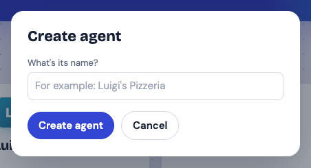
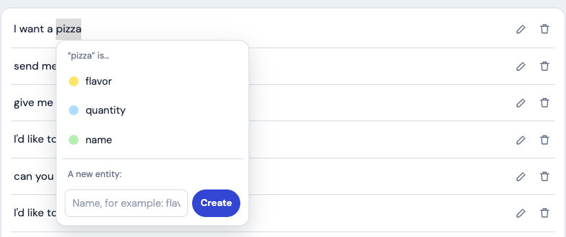
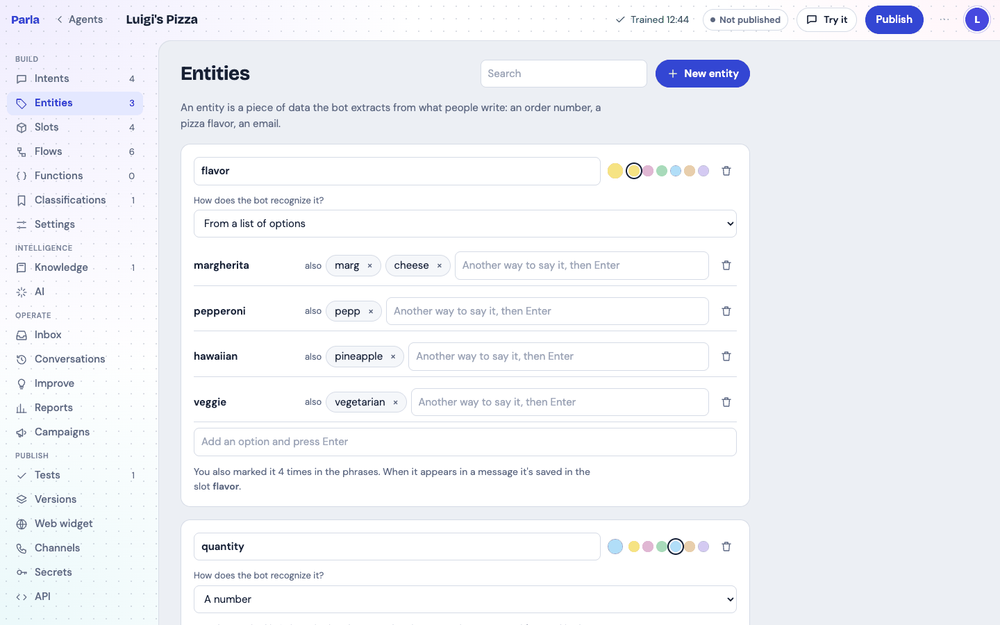
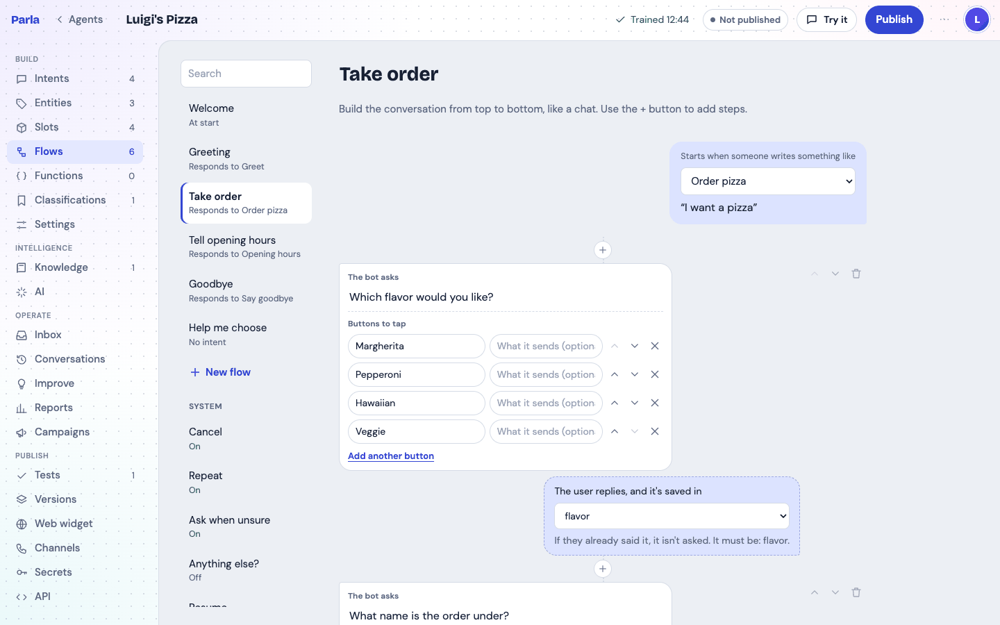
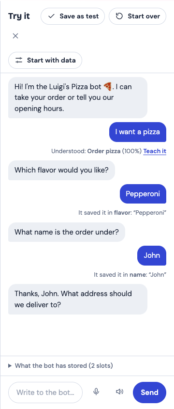
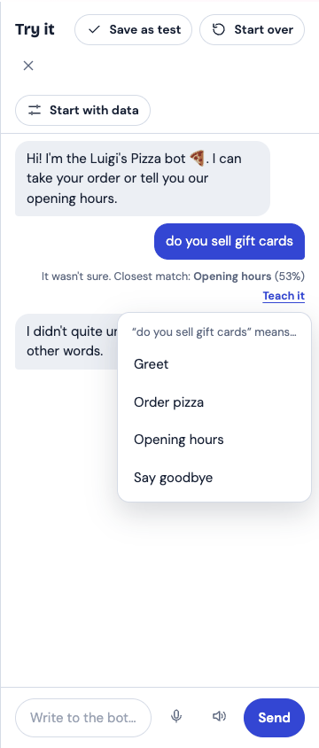
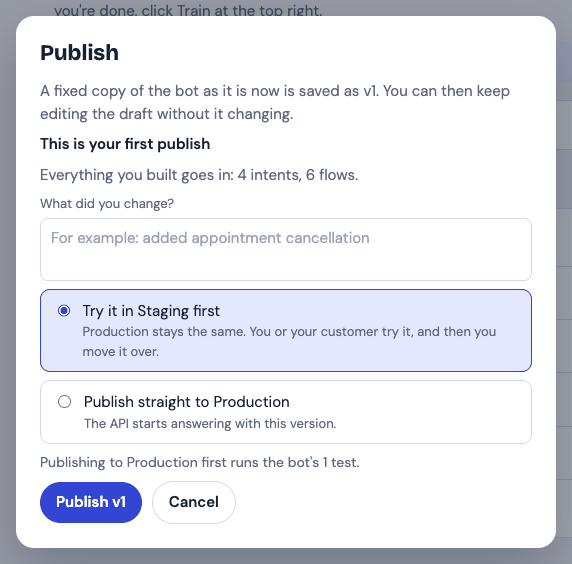

# 1. Your first bot

**English** · [Español](01-first-bot_es.md)

In this tutorial you'll build a small bot for a pizzeria, from zero to published. It takes about 20 minutes.
When you finish, your bot will:

- understand when someone wants to order a pizza, however they phrase it;
- ask for the flavor (with buttons), the name, the address and the quantity;
- confirm the order;
- be published so customers can use it.

You'll learn the words you'll see everywhere in Parla: **intent**, **example phrase**, **entity**, **slot** and
**flow**. Chapter [2](02-understanding.md) explains them in depth.

> Want to see the finished result first? Your administrator can import the example bots that come with Parla
> (`examples/pizzeria.json`) with **Import agent** on the home screen.

## Step 1. Create the agent

1. On the home screen, click **Create agent**.
2. Type a name, for example *Luigi's Pizza*, and click **Create agent**.

The agent opens on **Intents**, empty.

## Step 2. Teach it what people want: an intent

An **intent** is something people ask the bot for. Our first one is "order a pizza".

1. In the list next to the menu, click **+ New intent**.
2. The name *New intent* appears at the top, selected. Type *Order pizza* and press Enter.
3. In the box **Type a phrase the way a person would say it and press Enter**, write a way of asking for a
   pizza and press Enter (or click **Add phrase**). Repeat with different wordings:
   - I want a pizza
   - send me 2 pepperoni
   - give me a margherita
   - I'd like to order a hawaiian
   - can you bring me 3 pizzas
   - I'd like to place an order
   - do you deliver? I want a veggie

Five to ten varied phrases are enough. Write them the way real customers would: short, long, with typos, with
and without "please". These are called **example phrases**.

> Tip: also create an intent called *Greet* with phrases like "hi", "hello", "good evening". Otherwise, when
> someone says hello, the bot won't know what to do.

## Step 3. Mark the important words: entities

In "send me 2 pepperoni", two words matter: **2** (how many) and **pepperoni** (which flavor). The pieces of data
the bot pulls out of a message are called **entities**.

1. In a phrase, select the word *pepperoni* with the mouse (as if you were going to copy it).
2. A small menu appears: **"pepperoni" is…**. Under **A new entity:**, type *flavor* and click **Create**.

The word is now highlighted with a color and the entity's name. Now tell Parla which flavors exist:

1. In the menu on the left, click **Entities**.
2. In the *flavor* card, under **How does the bot recognize it?**, choose **From a list of options**.
3. In **Add an option and press Enter**, add *margherita*, *pepperoni*, *hawaiian* and *veggie*.
4. Next to each option, in **Another way to say it, then Enter**, add synonyms: *marg* and *cheese* for margherita,
   *pineapple* for hawaiian, *vegetarian* for veggie.

Now create the quantity:

1. Click **+ New entity**, type *quantity* and click **Create entity**.
2. In **How does the bot recognize it?**, choose **A number**.

When you create an entity, Parla also creates a **slot** with the same name. A slot is a box where the bot writes
down a piece of data during the conversation. When a customer says "2 pepperoni", the bot fills in the *flavor*
and *quantity* boxes by itself.

## Step 4. Add the slots you'll ask for

The name and address aren't entities (they can be anything), but the bot still needs boxes to store them.

1. Click **Slots** in the menu.
2. Click **+ New slot**, type *name* and click **Create slot**.
3. Do the same for *address*.

## Step 5. Build the conversation: a flow

A **flow** is what the bot does when it understands an intent: what it says, what it asks, in what order.

1. Go back to **Intents** and open *Order pizza*.
2. You'll see a notice: **No flow responds to this intent yet.** Click **Build the flow**.

The flow opens. At the top, in the blue box, it says **Starts when someone writes something like** and shows
*Order pizza*. Below, you'll add the steps, from top to bottom, like a chat.

1. Click **+ Add the first step** and choose **Ask a question**.
2. In the bubble, type *Which flavor would you like?*.
3. Below the bubble, in **The user replies, and it's saved in**, choose the slot *flavor*.
4. Click **Add buttons to tap** and add one button per flavor: *Margherita*, *Pepperoni*, *Hawaiian*, *Veggie*.
   Customers can tap them or type the answer.
5. Click **+ Add a step** → **Ask a question**: *What name is the order under?*, saved in *name*.
6. Another **Ask a question**: *Thanks, {{ name }}. What address should we deliver to?*, saved in *address*.
   To insert *{{ name }}*, click inside the text and then on the **name** chip under **Insert:**.
7. Another **Ask a question**: *How many {{ flavor }} pizzas?*, saved in *quantity*.
8. Finally **Send a message**: *Done, {{ name }}: {{ quantity }} {{ flavor }} for {{ address }}. They'll arrive in 40 minutes.*

> Why is the quantity asked last? Because addresses usually contain numbers. If you ask for the quantity first and
> then the address "12 Baker St", the bot may think the customer is correcting the quantity to 12.
> More on this in [Troubleshooting](10-troubleshooting.md#it-keeps-asking-the-same-thing-or-saves-the-wrong-value).

Nice detail: if the customer already said the flavor ("send me 2 pepperoni"), the bot **doesn't ask again**. A
question is skipped when its slot already has a value.

## Step 6. Train

Every time you change example phrases or entities, the bot needs to **train** (study them again). At the top
right you'll see **Untrained changes** and a **Train** button. Click it. In a few seconds it changes to
**Trained** with the time.

Flows, slots and messages don't need training: they're used as soon as you change them.

## Step 7. Try it

1. Click **Try it** at the top if the panel isn't open.
2. Choose **Chat**.
3. Write *I want a pizza* and press Enter.

Under each message you send, Parla shows what it understood: **Understood: Order pizza (100%)**. The percentage
is how sure it is. When it saves an answer, it says **It saved it in flavor: "Pepperoni"**.

Play the role of a difficult customer: answer with typos, give everything at once ("2 marg for John"), change
your mind. To start again, click **Start over**.

## Step 8. Fix what it doesn't understand

Sooner or later you'll write something the bot doesn't understand. You'll see
**It wasn't sure. Closest match: …** under your message, and the bot will reply with "I didn't understand".

1. Click **Teach it** under the message.
2. Choose the intent it should have recognized.
3. You'll see **Learned: that phrase now counts as "…"**. Click **Train** at the top and try again.

If what you wrote is a new topic (for example "do you sell gift cards"), it's better to create a new intent or add
the answer to [Knowledge](04-knowledge-and-ai.md).

## Step 9. Publish

While you're building, the bot answers with what you're editing (the **draft**). When you're happy, publish it so
customers get a fixed **version** that doesn't change while you keep working.

1. Click **Publish** at the top right.
2. Optionally, in **What did you change?**, write a note, for example *First version*.
3. Choose **Publish straight to Production** and click **Publish v1**.

The top bar now says **Production: v1**. Congratulations: you have a bot.

## What's next

- Put it on your website or WhatsApp: [6. Channels](06-channels.md).
- Make it answer frequent questions (hours, prices) without building a flow for each:
  [4. Knowledge and AI](04-knowledge-and-ai.md).
- Learn every step you can add to a flow: [3. Flows](03-flows.md).
- Protect it from breaking when you change things: [5. Testing and publishing](05-testing-and-publishing.md).
