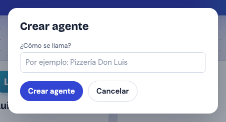
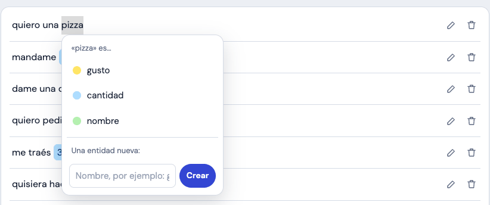
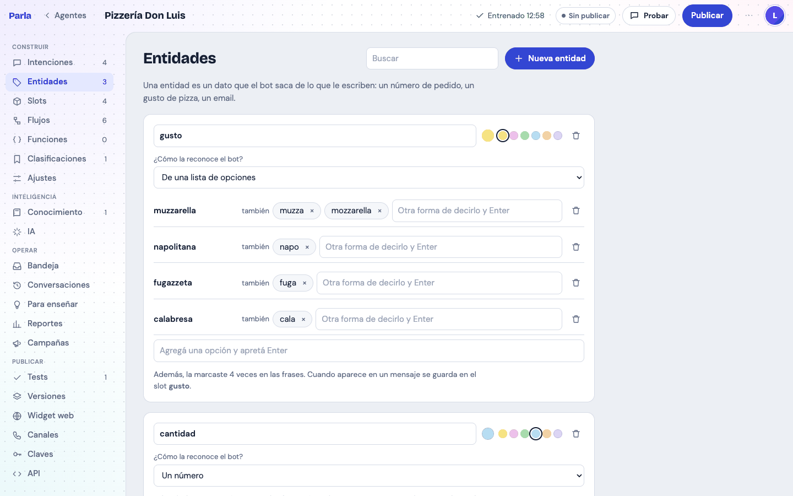
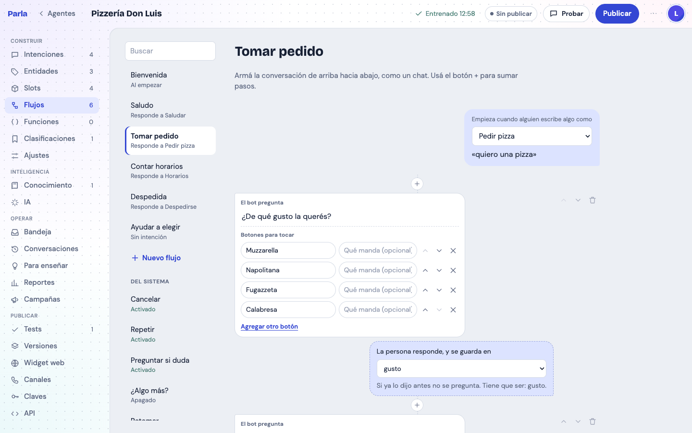
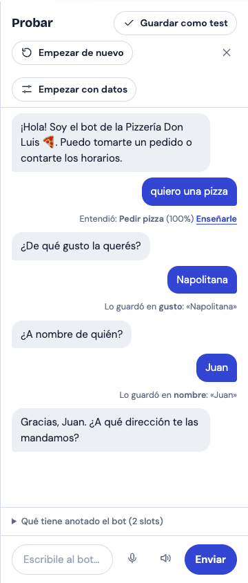
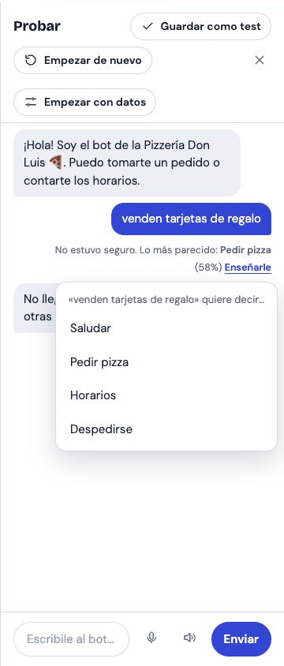
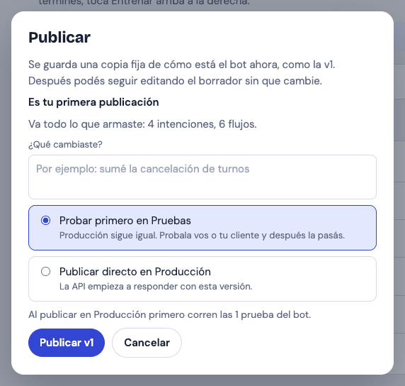

# 1. Tu primer bot

[English](01-first-bot.md) · **Español**

En este tutorial vas a armar un bot chico para una pizzería, de cero a publicado. Lleva unos 20 minutos.
Cuando termines, tu bot va a:

- entender cuando alguien quiere pedir una pizza, lo diga como lo diga;
- preguntar el gusto (con botones), el nombre, la dirección y la cantidad;
- confirmar el pedido;
- estar publicado para que lo usen los clientes.

Vas a aprender las palabras que vas a ver en todo Parla: **intención**, **frase de ejemplo**, **entidad**,
**slot** y **flujo**. El capítulo [2](02-understanding_es.md) las explica a fondo.

> ¿Querés ver primero el resultado terminado? Quien administra Parla puede importar los bots de ejemplo que trae
> Parla (`examples/pizzeria.json`) con **Importar agente** en la pantalla de inicio.

## Paso 1. Crear el agente

1. En la pantalla de inicio, tocá **Crear agente**.
2. Escribí un nombre, por ejemplo *Pizzería Don Luis*, y tocá **Crear agente**.

El agente se abre en **Intenciones**, vacío.

## Paso 2. Enseñale lo que quiere la gente: una intención

Una **intención** es algo que la gente le pide al bot. La primera va a ser "pedir una pizza".

1. En la lista al lado del menú, tocá **+ Nueva intención**.
2. Arriba aparece el nombre *Nueva intención*, seleccionado. Escribí *Pedir pizza* y apretá Enter.
3. En el cuadro **Escribí una frase como la diría una persona y apretá Enter**, escribí una forma de pedir una
   pizza y apretá Enter (o tocá **Agregar frase**). Repetí con distintas formas:
   - quiero una pizza
   - mandame 2 de napo
   - dame una de muzza
   - quiero pedir una fugazzeta
   - me traés 3 pizzas
   - quisiera hacer un pedido
   - hacen delivery? quiero una de calabresa

Con cinco a diez frases variadas alcanza. Escribilas como las escribirían clientes de verdad: cortas, largas, con
errores, con y sin "por favor". Se llaman **frases de ejemplo**.

> Consejo: creá también una intención *Saludar* con frases como "hola", "buenas", "buen día". Si no, cuando
> alguien salude, el bot no va a saber qué hacer.

## Paso 3. Marcá las palabras importantes: entidades

En "mandame 2 de napo" importan dos palabras: **2** (cuántas) y **napo** (qué gusto). Los datos que el bot saca de
un mensaje se llaman **entidades**.

1. En una frase, seleccioná la palabra *napo* con el mouse (como si la fueras a copiar).
2. Aparece un menú chico: **«napo» es…**. En **Una entidad nueva:**, escribí *gusto* y tocá **Crear**.

La palabra queda resaltada con un color y el nombre de la entidad. Ahora contale a Parla qué gustos hay:

1. En el menú de la izquierda, tocá **Entidades**.
2. En la tarjeta *gusto*, en **¿Cómo la reconoce el bot?**, elegí **De una lista de opciones**.
3. En **Agregá una opción y apretá Enter**, agregá *muzzarella*, *napolitana*, *fugazzeta* y *calabresa*.
4. Al lado de cada opción, en **Otra forma de decirlo y Enter**, agregá sinónimos: *muzza* y *mozzarella* para
   muzzarella, *napo* para napolitana, *fuga* para fugazzeta, *cala* para calabresa.

Ahora creá la cantidad:

1. Tocá **+ Nueva entidad**, escribí *cantidad* y tocá **Crear entidad**.
2. En **¿Cómo la reconoce el bot?**, elegí **Un número**.

Cuando creás una entidad, Parla también crea un **slot** con el mismo nombre. Un slot es un casillero donde el bot
anota un dato durante la conversación. Cuando un cliente dice "2 de napo", el bot completa solo los casilleros
*gusto* y *cantidad*.

## Paso 4. Sumá los slots que vas a preguntar

El nombre y la dirección no son entidades (pueden ser cualquier cosa), pero el bot igual necesita casilleros para
guardarlos.

1. Tocá **Slots** en el menú.
2. Tocá **+ Nuevo slot**, escribí *nombre* y tocá **Crear slot**.
3. Hacé lo mismo con *direccion*.

## Paso 5. Armá la conversación: un flujo

Un **flujo** es lo que hace el bot cuando entiende una intención: qué dice, qué pregunta, en qué orden.

1. Volvé a **Intenciones** y abrí *Pedir pizza*.
2. Vas a ver un aviso: **Todavía ningún flujo responde a esta intención.** Tocá **Armar el flujo**.

Se abre el flujo. Arriba, en el recuadro azul, dice **Empieza cuando alguien escribe algo como** y muestra
*Pedir pizza*. Abajo vas a sumar los pasos, de arriba hacia abajo, como un chat.

1. Tocá **+ Agregar el primer paso** y elegí **Hacer una pregunta**.
2. En la burbuja, escribí *¿De qué gusto la querés?*.
3. Abajo de la burbuja, en **La persona responde, y se guarda en**, elegí el slot *gusto*.
4. Tocá **Agregar botones para tocar** y agregá un botón por gusto: *Muzzarella*, *Napolitana*, *Fugazzeta*,
   *Calabresa*. Los clientes pueden tocarlos o escribir la respuesta.
5. Tocá **+ Agregar un paso** → **Hacer una pregunta**: *¿A nombre de quién?*, que se guarda en *nombre*.
6. Otro **Hacer una pregunta**: *Gracias, {{ nombre }}. ¿A qué dirección te las mandamos?*, que se guarda en
   *direccion*. Para insertar *{{ nombre }}*, hacé clic dentro del texto y después en el botoncito **nombre** que
   aparece en **Insertar:**.
7. Otro **Hacer una pregunta**: *¿Cuántas pizzas de {{ gusto }}?*, que se guarda en *cantidad*.
8. Por último **Enviar un mensaje**: *Listo, {{ nombre }}: {{ cantidad }} de {{ gusto }} para {{ direccion }}.
   Llegan en 40 minutos.*

> ¿Por qué la cantidad se pregunta al final? Porque las direcciones suelen tener números. Si preguntás primero la
> cantidad y después la dirección "Corrientes 1234", el bot puede creer que el cliente está corrigiendo la cantidad.
> Más sobre esto en [Problemas frecuentes](10-troubleshooting_es.md#pregunta-lo-mismo-una-y-otra-vez-o-guarda-mal-un-dato).

Un detalle lindo: si el cliente ya dijo el gusto ("mandame 2 de napo"), el bot **no lo vuelve a preguntar**. Una
pregunta se saltea cuando su slot ya tiene un valor.

## Paso 6. Entrenar

Cada vez que cambiás frases de ejemplo o entidades, el bot tiene que **entrenar** (estudiarlas de nuevo). Arriba a
la derecha vas a ver **Hay cambios sin entrenar** y un botón **Entrenar**. Tocalo. En unos segundos cambia a
**Entrenado** con la hora.

Los flujos, los slots y los mensajes no necesitan entrenar: se usan apenas los cambiás.

## Paso 7. Probalo

1. Tocá **Probar** arriba si el panel no está abierto.
2. Elegí **Chat**.
3. Escribí *quiero una pizza* y apretá Enter.

Abajo de cada mensaje que mandás, Parla muestra qué entendió: **Entendió: Pedir pizza (100%)**. El porcentaje es
qué tan seguro está. Cuando guarda una respuesta, dice **Lo guardó en gusto: «Napolitana»**.

Hacé de cliente difícil: contestá con errores, decí todo junto ("2 de muzza a nombre de Juan"), cambiá de idea.
Para empezar otra vez, tocá **Empezar de nuevo**.

## Paso 8. Arreglá lo que no entiende

Tarde o temprano vas a escribir algo que el bot no entiende. Vas a ver **No estuvo seguro. Lo más parecido: …**
abajo de tu mensaje, y el bot va a contestar que no entendió.

1. Tocá **Enseñarle** abajo del mensaje.
2. Elegí la intención que tendría que haber reconocido.
3. Vas a ver **Aprendido: ahora esa frase cuenta como «…»**. Tocá **Entrenar** arriba y probá de nuevo.

Si lo que escribiste es un tema nuevo (por ejemplo "venden tarjetas de regalo"), es mejor crear una intención nueva
o sumar la respuesta a [Conocimiento](04-knowledge-and-ai_es.md).

## Paso 9. Publicar

Mientras armás, el bot responde con lo que estás editando (el **borrador**). Cuando te guste, publicalo para que los
clientes usen una **versión** fija que no cambia mientras seguís trabajando.

1. Tocá **Publicar** arriba a la derecha.
2. Si querés, en **¿Qué cambiaste?** escribí una nota, por ejemplo *Primera versión*.
3. Elegí **Publicar directo en Producción** y tocá **Publicar v1**.

Ahora la barra de arriba dice **Producción: v1**. Felicitaciones: tenés un bot.

## Y ahora

- Ponelo en tu sitio web o en WhatsApp: [6. Canales](06-channels_es.md).
- Hacé que responda preguntas frecuentes (horarios, precios) sin armar un flujo para cada una:
  [4. Conocimiento e IA](04-knowledge-and-ai_es.md).
- Conocé todos los pasos que podés sumar a un flujo: [3. Flujos](03-flows_es.md).
- Evitá que se rompa cuando cambiás cosas: [5. Probar y publicar](05-testing-and-publishing_es.md).
