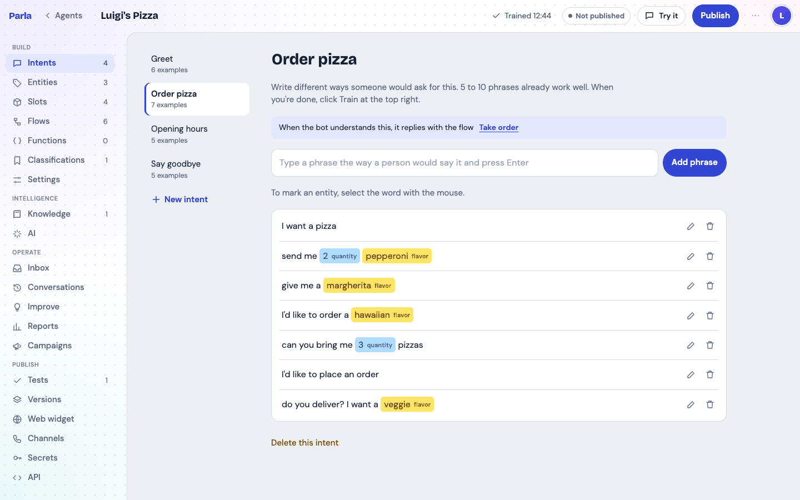
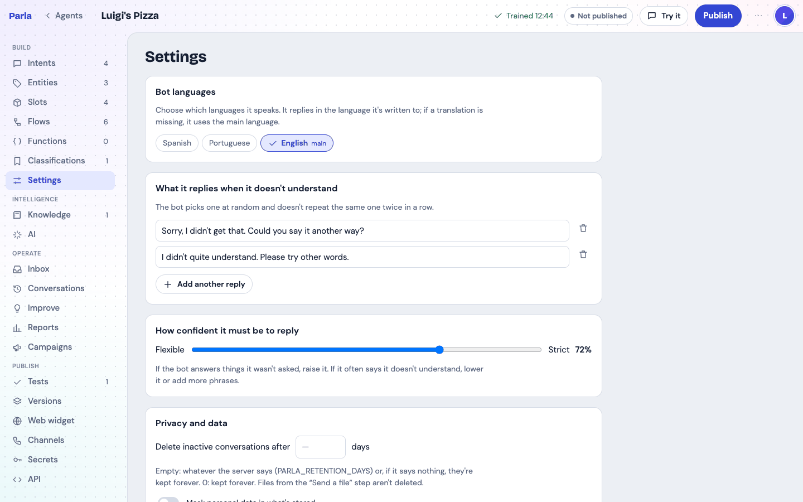
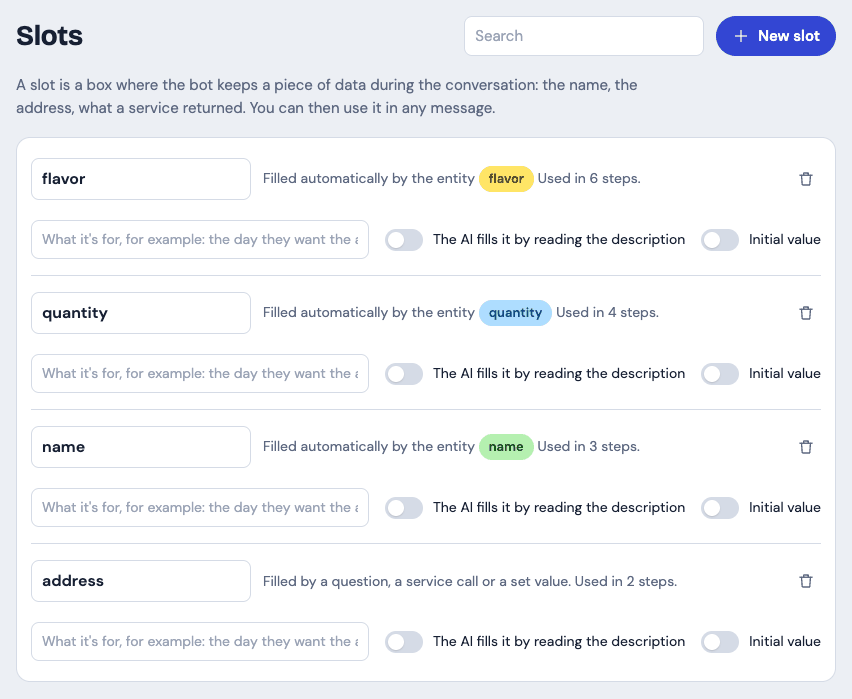
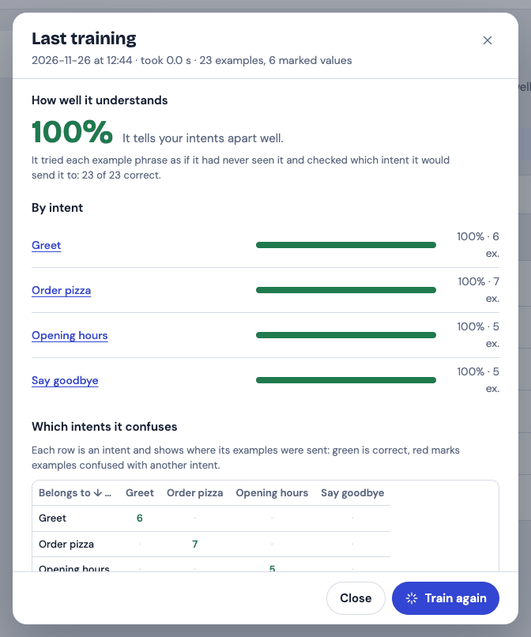

# 2. How the bot understands

**English** · [Español](02-understanding_es.md)

This chapter explains how Parla figures out what a person wants and which pieces of data they gave. Everything
happens in the **Build** block of the menu: **Intents**, **Entities** and **Slots**, plus a couple of settings in
**Settings**.

## The big picture

When a customer writes "send me 2 pepperoni", Parla answers three questions:

1. **What do they want?** It compares the message with the example phrases of each **intent** and picks the
   most similar one: *Order pizza*.
2. **What data did they give?** It looks for **entities**: *quantity* = 2, *flavor* = pepperoni.
3. **Where does it write that down?** In the **slots** with those names, so the flow can use them.

Then the **flow** linked to that intent takes over (see [Flows](03-flows.md)).

## Intents

An intent is one thing people ask for: "order a pizza", "check opening hours", "cancel an appointment",
"say goodbye". Each intent has a name and a list of example phrases.

- **Create one**: click **+ New intent** in the list and type its name at the top.
- **Rename it**: click the name at the top and change it. The flows that use it are updated.
- **Delete it**: **Delete this intent**, at the bottom. Its flow stays, but without an intent.
- Under the name you'll see which flow answers it (**When the bot understands this, it replies with the flow …**)
  or a warning (**No flow responds to this intent yet.**) with a **Build the flow** button.

### Writing good example phrases

- **Five to ten per intent** is enough to start. Add more later from real conversations
  (see [Improve](08-improving-and-reports.md#improve-teaching-what-it-missed)).
- **Vary them**: short and long, formal and casual, with and without typos, with questions and orders.
  "pizza", "I want a pizza", "could you send me a large pepperoni please?".
- **Don't repeat** almost identical phrases: "I want a pizza" and "I want pizza" teach nothing new.
- **Keep intents apart**: if two intents have very similar phrases, the bot will mix them up. If you can't tell
  them apart by reading the phrases, merge them into one.
- To **edit** a phrase, click the pencil; to **delete** it, the trash can.

### When is the bot "sure"?

Every time it reads a message, the bot calculates how similar it is to each intent, as a percentage. If the best
one passes a minimum, it answers; if not, it says it didn't understand. You set that minimum in
**Settings → How confident it must be to reply**, between **Flexible** and **Strict**.

- If the bot **answers things it wasn't asked**, move it toward **Strict**.
- If it **often says it doesn't understand**, move it toward **Flexible**, or better, add more phrases.

With few intents, a value around 70% usually works well. In the same screen, under
**What it replies when it doesn't understand**, write a few ways of saying "I didn't understand": the bot picks
one at random so it doesn't sound like a broken record.

## Entities

An entity is a piece of data the bot extracts from a message. Open **Entities** to see them all; each card has a
name, a color (used to highlight it in phrases) and, most importantly, **How does the bot recognize it?**:

| Option | Use it for | Example |
|---|---|---|
| **From the examples I mark in the phrases** | Free values you can't list: names, streets, products. The bot learns from the words you marked and then recognizes new ones in similar phrases. | If it learned "my name is Peter", it understands "my name is Olivia". |
| **From a list of options** | A closed set: flavors, branches, plans, sizes. Each option can have synonyms. | *margherita* (also *marg*, *cheese*). |
| **A number** | Quantities, order numbers. | "2", "3.5" |
| **An email** | Email addresses. | ana@example.com |
| **A phone number** | Phone numbers in their usual formats. | +1 555 123 4567 |
| **An ID number (DNI)** | Argentine national ID numbers. | 30.123.456 |
| **Date or time (tomorrow, next Thursday…)** | Dates and times said in many ways. No need to mark it in phrases or list anything. | "tomorrow at 10", "next Thursday", "12/05" |
| **A custom format (regex, advanced)** | Codes with a fixed shape (for example ABC-1234). Ask a technical person to write the format. | |

### Options and synonyms

With **From a list of options**, add each option in **Add an option and press Enter**. Next to each option, under
**also**, add other ways people say it (**Another way to say it, then Enter**). The bot always saves the main
option, so "marg" ends up stored as *margherita*. This keeps your reports and flows tidy.

You can also add synonyms while testing: if the bot asks for a flavor and you answer "cheese" and it doesn't
recognize it, under your message you'll see **It didn't recognize it as flavor. Teach it**; click it and choose
which option "cheese" means.

### Marking words in phrases

Marking tells the bot where the data is inside an example phrase.

1. Open an intent.
2. Select one or more words in a phrase with the mouse.
3. Choose the entity in the menu that appears, or create a new one under **A new entity:**.

To remove a mark, click the highlighted word and choose **Remove the mark**.

You need marks for entities of the **From the examples I mark in the phrases** kind. For the other kinds (list,
number, date…) they're optional, but they help the bot learn the context.

### Teaching from the chat

When the bot asks for a value without a fixed format (a name, for example) and the person answers with a whole
phrase ("my name is Olivia Smith"), the Try it chat offers **Mark the value** under the message. Click the words
that are the value (*Olivia Smith*) and **Save example**. Then train and try again.

## Slots

A slot is a box where the bot writes down a piece of data during the conversation: the name, the address, the
date, what a service answered. Then you can use it in any message by writing it between double braces:
*Thanks, {{ name }}*.

Each row in **Slots** shows:

- **The name.** If you rename it here, Parla updates the messages and steps that use it.
- **How it's filled**: **Filled automatically by the entity …** (when it's linked to an entity with the same name)
  or **Filled by a question, a service call or a set value.** It also tells you how many steps use it.
- **A description** (**What it's for…**). Useful for your team, and required if the AI fills it.
- **The AI fills it by reading the description**: instead of asking a direct question, the AI picks the value
  from whatever the person says. Requires [AI](04-knowledge-and-ai.md) to be on.
- **Initial value**: marks the slots that arrive from outside when the conversation starts (for example, the
  customer's ID that the phone system already asked for). Only those show up in
  [Start with data](05-testing-and-publishing.md#start-with-data).

Create slots with **+ New slot** or straight from a flow step (**+ Create a new slot…** in any slot picker).

## Training and the self-check

Parla uses the example phrases and entities **from the last time you trained**. That's why, after changing
them, you'll see **Untrained changes** at the top and a notice in the chat:
**The bot isn't using your latest changes to phrases and entities yet. Train now**.

Click **Train**. When it finishes, the top bar says **Trained** and the time. Click that text to open the
**Last training** window, a quick health check of your bot:

- **How well it understands**: Parla took each example phrase, pretended it had never seen it, and checked which
  intent it would send it to. "23 of 23 correct" is the ideal.
- **By intent**: the same, intent by intent. An intent with **needs 2 or more examples** can't be evaluated yet.
- **Which intents it confuses**: a table where each row is an intent and shows where its phrases went. Green is
  correct; red marks phrases that went to another intent.
- **Examples it confuses**: the exact phrases, as in *It belongs to "Cancel" but it looks more like "Order"*.
  Click **Open …** to go fix that intent.

What to do when there's red:

1. Read the confused phrases. Often a phrase is in the wrong intent, or is too generic ("I want to ask
   something") and fits anywhere.
2. Add more **distinctive** phrases to the intents involved.
3. If two intents really mean the same thing, merge them.
4. Train again and check the window.

## Bots that speak more than one language

In **Settings → Bot languages**, choose which languages the bot speaks (Spanish, Portuguese, English). The first
one is the **main** language. The bot replies in the language each person writes in; if a message isn't
translated, it uses the main language.

To translate messages, open a flow: above each bubble you'll see **ES · PT · EN**. Click a language and type the
translation. You can also translate the "I didn't understand" replies in **Settings**.

## When the bot doesn't understand

Go through this list in order:

1. **Try it** and read the line under your message. If it says **It wasn't sure. Closest match: …**, the phrase
   was close but not enough: click **Teach it**.
2. If it understood **a different intent**, add that phrase to the right intent and train. Check
   **Which intents it confuses** in the training window.
3. If **nothing comes close**, it's a new topic: create an intent and its flow, or add the answer to
   [Knowledge](04-knowledge-and-ai.md).
4. If it understands well when you test but fails with customers, check **Improve** every week
   (see [chapter 8](08-improving-and-reports.md)).
5. If it **answers too eagerly** (it replies to things nobody asked), raise **How confident it must be to reply**.

More cases in [Troubleshooting](10-troubleshooting.md).
