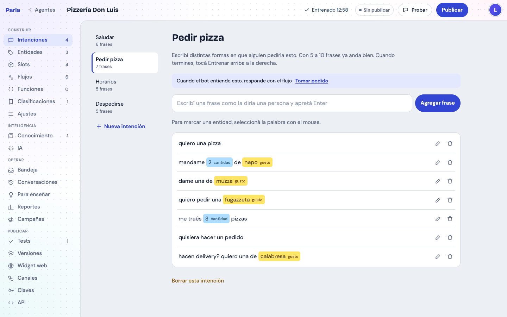
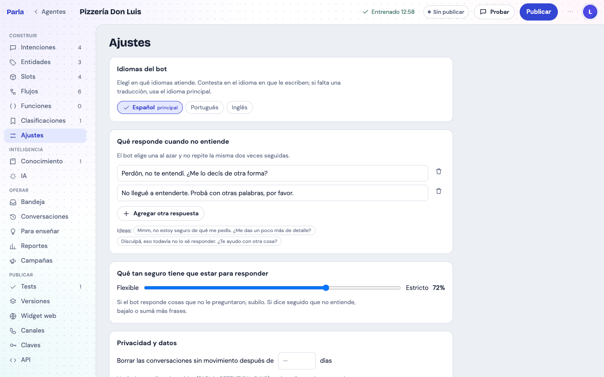
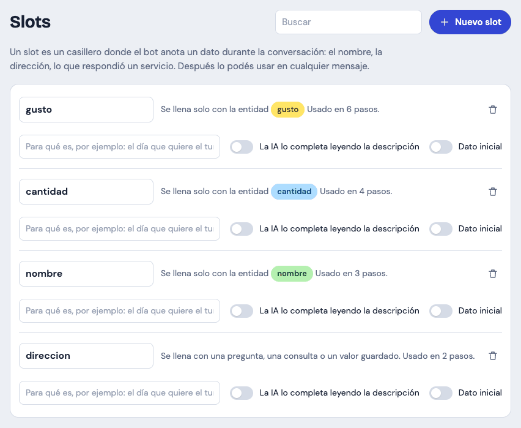
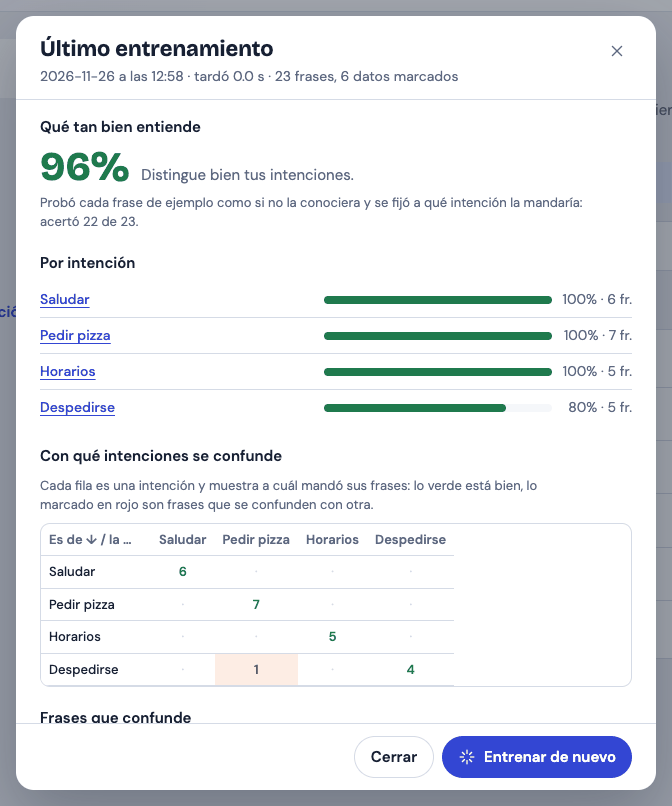

# 2. Cómo entiende el bot

[English](02-understanding.md) · **Español**

Este capítulo explica cómo Parla se da cuenta de qué quiere una persona y qué datos dio. Todo pasa en el bloque
**Construir** del menú: **Intenciones**, **Entidades** y **Slots**, más un par de opciones en **Ajustes**.

## El panorama

Cuando un cliente escribe "mandame 2 de napo", Parla responde tres preguntas:

1. **¿Qué quiere?** Compara el mensaje con las frases de ejemplo de cada **intención** y elige la más parecida:
   *Pedir pizza*.
2. **¿Qué datos dio?** Busca **entidades**: *cantidad* = 2, *gusto* = napolitana.
3. **¿Dónde lo anota?** En los **slots** con esos nombres, para que el flujo los pueda usar.

Después toma la posta el **flujo** de esa intención (mirá [Flujos](03-flows_es.md)).

## Intenciones

Una intención es una cosa que la gente pide: "pedir una pizza", "consultar el horario", "cancelar un turno",
"despedirse". Cada intención tiene un nombre y una lista de frases de ejemplo.

- **Crear una**: tocá **+ Nueva intención** en la lista y escribí su nombre arriba.
- **Cambiarle el nombre**: hacé clic en el nombre de arriba y cambialo. Los flujos que la usan se actualizan.
- **Borrarla**: **Borrar esta intención**, abajo de todo. Su flujo queda, pero sin intención.
- Abajo del nombre ves qué flujo la responde (**Cuando el bot entiende esto, responde con el flujo …**) o un aviso
  (**Todavía ningún flujo responde a esta intención.**) con el botón **Armar el flujo**.

### Cómo escribir buenas frases de ejemplo

- **De cinco a diez por intención** alcanza para empezar. Sumá más después, sacadas de conversaciones reales
  (mirá [Para enseñar](08-improving-and-reports_es.md#para-enseñar-lo-que-el-bot-no-entendió)).
- **Variá**: cortas y largas, formales e informales, con y sin errores, preguntas y pedidos.
  "pizza", "quiero una pizza", "¿me mandás una grande de napo, por favor?".
- **No repitas** frases casi iguales: "quiero una pizza" y "quiero pizza" no enseñan nada nuevo.
- **Separá bien las intenciones**: si dos intenciones tienen frases muy parecidas, el bot las va a confundir. Si
  leyendo las frases no te das cuenta de cuál es cuál, juntalas en una.
- Para **editar** una frase, tocá el lápiz; para **borrarla**, el tachito.

### ¿Cuándo está "seguro" el bot?

Cada vez que lee un mensaje, el bot calcula qué tan parecido es a cada intención, en porcentaje. Si la mejor pasa un
mínimo, responde; si no, dice que no entendió. Ese mínimo lo ajustás en
**Ajustes → Qué tan seguro tiene que estar para responder**, entre **Flexible** y **Estricto**.

- Si el bot **responde cosas que no le preguntaron**, movelo hacia **Estricto**.
- Si **dice seguido que no entiende**, movelo hacia **Flexible** o, mejor, sumá más frases.

Con pocas intenciones, un valor cerca de 70% suele andar bien. En la misma pantalla, en
**Qué responde cuando no entiende**, escribí varias formas de decir "no entendí": el bot elige una al azar para no
sonar como un disco rayado.

## Entidades

Una entidad es un dato que el bot saca de un mensaje. Abrí **Entidades** para verlas todas; cada tarjeta tiene un
nombre, un color (con el que se resalta en las frases) y, lo más importante, **¿Cómo la reconoce el bot?**:

| Opción | Usala para | Ejemplo |
|---|---|---|
| **Por los ejemplos que marco en las frases** | Valores libres que no podés listar: nombres, calles, productos. El bot aprende de las palabras que marcaste y después reconoce otras nuevas en frases parecidas. | Si aprendió "me llamo Pedro", entiende "me llamo Olivia". |
| **De una lista de opciones** | Un conjunto cerrado: gustos, sucursales, planes, tamaños. Cada opción puede tener sinónimos. | *muzzarella* (también *muzza*, *mozzarella*). |
| **Un número** | Cantidades, números de pedido. | "2", "3,5" |
| **Un email** | Direcciones de correo. | ana@ejemplo.com |
| **Un teléfono** | Teléfonos en sus formatos habituales. | +54 11 5555-1234 |
| **Un DNI** | Números de documento. | 30.123.456 |
| **Fecha u hora (mañana, el jueves que viene…)** | Fechas y horas dichas de muchas formas. No hace falta marcarla en las frases ni cargar nada. | "mañana a las 10", "el jueves que viene", "12/05" |
| **Un formato propio (regex, avanzado)** | Códigos con forma fija (por ejemplo ABC-1234). Pedile a alguien técnico que escriba el formato. | |

### Opciones y sinónimos

Con **De una lista de opciones**, agregá cada opción en **Agregá una opción y apretá Enter**. Al lado de cada
opción, en **también**, sumá otras formas en que la gente la dice (**Otra forma de decirlo y Enter**). El bot
siempre guarda la opción principal, así que "muzza" queda guardado como *muzzarella*. Eso mantiene ordenados tus
reportes y tus flujos.

También podés sumar sinónimos mientras probás: si el bot pregunta el gusto, contestás "mozza" y no lo reconoce, abajo
de tu mensaje vas a ver **No lo reconoció como gusto. Enseñarle**; tocalo y elegí qué opción quiere decir "mozza".

### Marcar palabras en las frases

Marcar le dice al bot dónde está el dato dentro de una frase de ejemplo.

1. Abrí una intención.
2. Seleccioná una o más palabras de una frase con el mouse.
3. Elegí la entidad en el menú que aparece, o creá una nueva en **Una entidad nueva:**.

Para sacar una marca, tocá la palabra resaltada y elegí **Quitar la marca**.

Las marcas hacen falta para las entidades del tipo **Por los ejemplos que marco en las frases**. Para los otros
tipos (lista, número, fecha…) son opcionales, pero ayudan al bot a aprender el contexto.

### Enseñar desde el chat

Cuando el bot pide un dato sin formato fijo (un nombre, por ejemplo) y la persona contesta con una frase entera ("mi
nombre es Olivia Gómez"), el chat de Probar ofrece **Marcar el dato** abajo del mensaje. Tocá las palabras que son el
dato (*Olivia Gómez*) y **Guardar ejemplo**. Después entrená y probá de nuevo.

## Slots

Un slot es un casillero donde el bot anota un dato durante la conversación: el nombre, la dirección, la fecha, lo que
respondió un servicio. Después lo podés usar en cualquier mensaje escribiéndolo entre llaves dobles:
*Gracias, {{ nombre }}*.

Cada fila de **Slots** muestra:

- **El nombre.** Si lo cambiás acá, Parla actualiza los mensajes y pasos que lo usan.
- **Cómo se llena**: **Se llena solo con la entidad …** (cuando está unido a una entidad del mismo nombre) o
  **Se llena con una pregunta, una consulta o un valor guardado.** También te dice cuántos pasos lo usan.
- **Una descripción** (**Para qué es…**). Útil para tu equipo, y obligatoria si la completa la IA.
- **La IA lo completa leyendo la descripción**: en vez de hacer una pregunta directa, la IA saca el valor de lo que
  diga la persona. Necesita la [IA](04-knowledge-and-ai_es.md) prendida.
- **Dato inicial**: marca los slots que llegan de afuera cuando empieza la conversación (por ejemplo, el DNI del
  cliente que ya pidió el conmutador). Solo esos aparecen en
  [Empezar con datos](05-testing-and-publishing_es.md#empezar-con-datos).

Creá slots con **+ Nuevo slot** o directamente desde un paso de un flujo (**+ Crear un slot nuevo…** en cualquier
selector de slot).

## Entrenar y el chequeo de salud

Parla usa las frases de ejemplo y las entidades **de la última vez que entrenaste**. Por eso, después de cambiarlas,
arriba ves **Hay cambios sin entrenar** y un aviso en el chat:
**El bot todavía no usa tus últimos cambios en frases y entidades. Entrenar ahora**.

Tocá **Entrenar**. Cuando termina, la barra de arriba dice **Entrenado** y la hora. Tocá ese texto para abrir la
ventana **Último entrenamiento**, un chequeo rápido de la salud de tu bot:

- **Qué tan bien entiende**: Parla tomó cada frase de ejemplo, hizo de cuenta que nunca la había visto y se fijó a
  qué intención la mandaría. "Acertó 23 de 23" es lo ideal.
- **Por intención**: lo mismo, intención por intención. Una intención que **necesita 2 frases o más** todavía no se
  puede evaluar.
- **Con qué intenciones se confunde**: una tabla donde cada fila es una intención y muestra a dónde fueron sus
  frases. Lo verde está bien; lo rojo son frases que se fueron a otra intención.
- **Frases que confunde**: las frases exactas, como *Es de «Cancelar» pero se parece más a «Pedir pizza»*.
  Tocá **Ver …** para ir a arreglar esa intención.

Qué hacer cuando hay rojo:

1. Leé las frases confundidas. Muchas veces una frase está en la intención equivocada, o es demasiado general
   ("quiero consultar algo") y entra en cualquier lado.
2. Sumá frases más **distintivas** a las intenciones involucradas.
3. Si dos intenciones de verdad quieren decir lo mismo, juntalas.
4. Entrená de nuevo y mirá la ventana.

## Bots que hablan más de un idioma

En **Ajustes → Idiomas del bot**, elegí qué idiomas habla el bot (español, portugués, inglés). El primero es el
**principal**. El bot contesta en el idioma en que le escribe cada persona; si un mensaje no está traducido, usa el
idioma principal.

Para traducir mensajes, abrí un flujo: arriba de cada burbuja vas a ver **ES · PT · EN**. Tocá un idioma y escribí la
traducción. También podés traducir las respuestas de "no entendí" en **Ajustes**.

## Cuando el bot no entiende

Seguí esta lista en orden:

1. **Probalo** en el panel y leé la línea abajo de tu mensaje. Si dice **No estuvo seguro. Lo más parecido: …**, la
   frase estuvo cerca pero no alcanzó: tocá **Enseñarle**.
2. Si entendió **otra intención**, sumá esa frase a la intención correcta y entrená. Mirá
   **Con qué intenciones se confunde** en la ventana del entrenamiento.
3. Si **nada se le parece**, es un tema nuevo: creá una intención y su flujo, o sumá la respuesta a
   [Conocimiento](04-knowledge-and-ai_es.md).
4. Si entiende bien cuando probás vos pero falla con los clientes, revisá **Para enseñar** todas las semanas
   (mirá el [capítulo 8](08-improving-and-reports_es.md)).
5. Si **responde de más** (contesta cosas que nadie preguntó), subí **Qué tan seguro tiene que estar para responder**.

Más casos en [Problemas frecuentes](10-troubleshooting_es.md).
