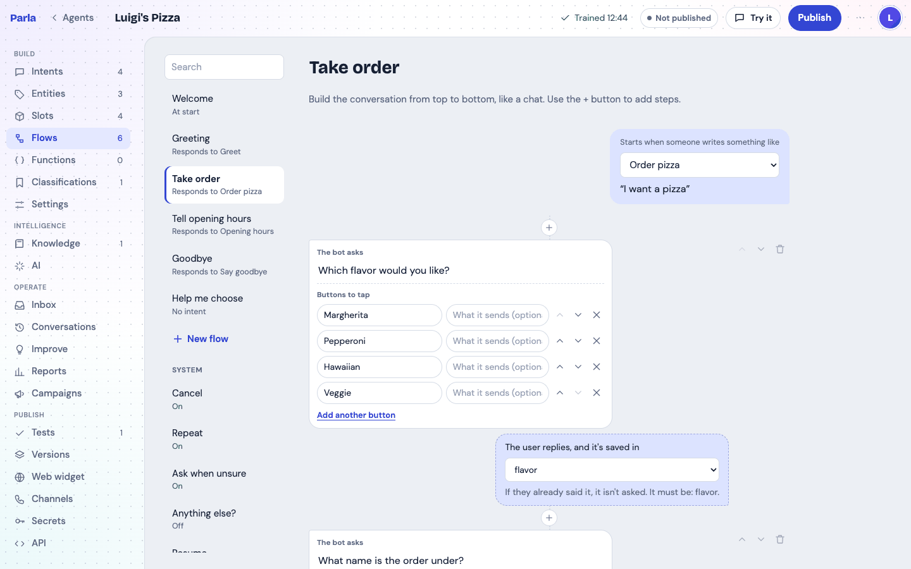
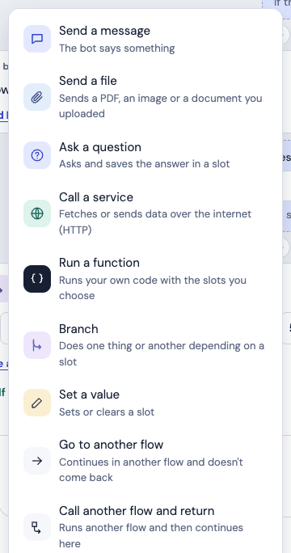
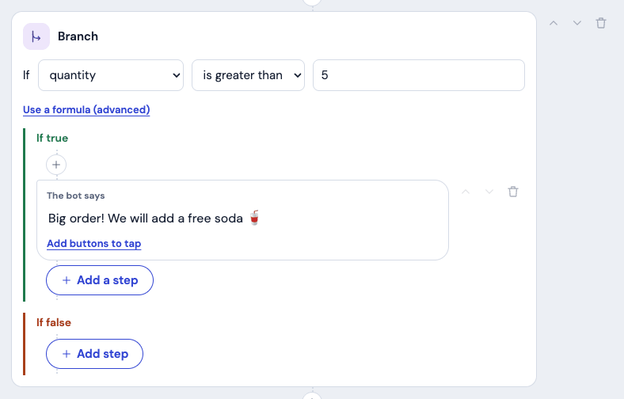
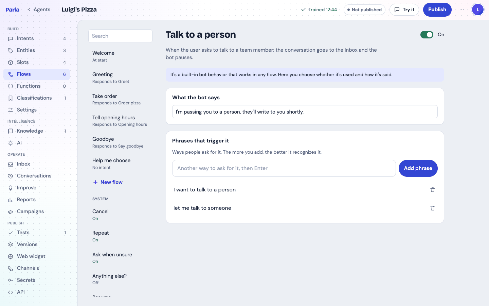

# 3. Flows

**English** · [Español](03-flows_es.md)

A **flow** is a conversation script: what the bot says, what it asks and what it does, step by step. Every intent
the bot should act on needs a flow. This chapter explains how flows are organized and every kind of step you can
use.

## The Flows screen

Click **Flows** in the menu. On the left you'll see:

- **Your flows**, each with what starts it underneath: **Responds to Order pizza**, **At start** or **No intent**.
- **+ New flow**.
- Under **System**, the built-in behaviors (cancel, repeat, hand off to a person…) with **On** or **Off**.
  They're explained [below](#system-flows).

In the middle you build the selected flow. It reads like a chat: the blue box at the top is what the customer
says; below it, the bot's steps.

### What starts a flow

In the blue box, choose:

- **An intent**: the flow runs when the bot understands that intent. Below you'll see one of its example phrases.
- **When the conversation starts**: the flow runs as soon as the conversation opens, before the customer writes.
  Perfect for a welcome message. Only one flow can start the conversation; if you choose this in another flow,
  the previous one is left without a trigger (Parla warns you).
- **Nothing** (**Choose an intent…**): the flow only runs when another flow calls it. Useful for pieces you reuse,
  like "verify identity".

### Adding, moving and deleting steps

- Click **+ Add the first step**, **+ Add a step** at the end, or the small **+** between two steps to insert one
  there. A menu with all the step types opens.
- Hover over a step to see its tools on the right: **Move up**, **Move down** and **Delete step**.
- Below the last step you'll read **The flow ends here and the bot waits for a new message.**
- To delete the whole flow, use **Delete this flow** at the bottom.

## The steps, one by one

### Send a message

The bot says something. Write the text in the bubble.

- **Use data**: click inside the text and then a chip under **Insert:** to add a slot, like *{{ name }}*. When the
  bot sends the message, it's replaced by the real value: "Thanks, Anna".
- **Buttons**: click **Add buttons to tap** to show options under the message. Each button has the text people see
  and, optionally, **What it sends (optional)**: what the bot receives when it's tapped. Empty means it receives
  the button text. Reorder them with the arrows or remove them with the ✕.
- **Translations**: if the bot speaks several languages, click **ES · PT · EN** above the bubble to write each one.

Buttons are a suggestion: people can always type instead. On WhatsApp and Telegram they appear as that app's
buttons.

### Send a file

Sends a PDF, an image or a document (Word, Excel, PowerPoint, CSV, TXT or ZIP, up to 10 MB). Choose a file you
already uploaded or click **Upload a file**, and optionally add **Text sent with the file**
("Here's our menu, {{ name }}").

> Anyone with the file's link can open it, so don't upload anything private. Files belong to the bot, not to a
> version: if you delete one, it also stops being sent in published versions.

### Ask a question

The bot asks something and saves the answer in a slot.

1. Write the question in the bubble.
2. In **The user replies, and it's saved in**, choose the slot (or **+ Create a new slot…**).

Two things happen automatically:

- **If the slot already has a value, the question is skipped.** If the customer said "2 pepperoni" at the start,
  the bot won't ask for the flavor or the quantity.
- **If the slot is linked to an entity, the answer must match it.** If you ask for the flavor and they answer
  "beer", the bot says it didn't recognize the value and asks again.

You can add buttons to questions too, exactly as with messages.

### Call a service

Fetches or sends data over the internet (to your ordering system, a calendar, a CRM). It needs a web address and
sometimes keys, so it's usually set up by someone technical. Once it's configured, anyone can:

- click **Test the call** to see what the service answers;
- **click a value** in the answer to save it in a slot (**Click a value to save it in a slot:**);
- add **Save whether it succeeded (code 200)** to then decide with a **Branch** what to say if it failed.

Passwords and keys never go in the step itself: they're stored in [Secrets](09-administration.md#secrets).

### Run a function

Runs a small program written by your developers (in **Functions**) with the slots you choose, and saves what it
returns. As with services, the setup is technical; the step just says which function to run.

### Branch

Does one thing or another depending on a slot. It reads like a sentence:

**If** [slot] [comparison] [value]

The comparisons are: **is equal to**, **is not equal to**, **contains**, **is greater than**, **is less than**,
**is empty** and **has a value**.

Underneath there are two paths, **If true** and **If false**, each with its own steps. When the chosen path ends,
the flow continues with the step after the branch.

Examples:

- If *quantity* **is greater than** 5 → "Big order! We'll add a free soda".
- If *reservation_status* **is equal to** 200 → "Booked!"; if not → hand off to a person.
- If *email* **is empty** → ask for it.

For complex conditions there's **Use a formula (advanced)**; ask someone technical.

### Set a value

Writes something in a slot without asking: **save this text** (can include other slots), **clear it** (empty it,
for example to take a second order) or **save a formula (advanced)**.

### Go to another flow

Continues in another flow and **doesn't come back**. Useful when two intents should end up in the same place
("I want a pizza" and "I want to order" both go to *Take order*).

### Call another flow and return

Runs all the steps of another flow and then **comes back** and continues with the next step here. It's how you
reuse a piece, such as "verify identity", in several flows (a *sub-flow*). Design that piece as a flow with no
intent.

### Talk with AI

An AI model chats freely with the person until a goal is met, can use tools and fills slots. It's explained in
[Knowledge and AI](04-knowledge-and-ai.md#the-talk-with-ai-step).

### Hand off to a person

The bot pauses and someone from your team replies from the [Inbox](07-inbox-and-conversations.md).

- **What the bot says before handing off**: for example *I'm handing you over to a person, they'll write to you shortly.*
- **Reason (the team sees it in the Inbox)**: for example *complaint* or *dental emergency*. It helps your team
  prioritize.

The bot doesn't answer that conversation again until someone hands it back.

### Classify the conversation

Records how the conversation ended, for [Reports](08-improving-and-reports.md#reports): **Mark as**
"Order placed", "Cancellation", "Price inquiry". Each conversation counts once per classification. Create
classifications in the step itself (**+ Create a new classification…**) or in **Classifications**.

Put this step at the points that mean success or failure: after confirming an order, after cancelling, before
handing off.

### Schedule a reminder

Writes to the same person later, for example an appointment reminder.

- **When**: **After** a while (type a number and a unit: *30m*, *24h* or *2d*) or **At a date and time** (it can
  use a slot, like the appointment date).
- **What it does**: **Send a text** (write it below) or **Run the flow "…"** you choose.
- **WhatsApp template (optional)**: on WhatsApp, if more than 24 hours have passed since the person's last message,
  an approved template is needed (add them in **Channels**).

Nothing is sent to people who opted out. It belongs to the outbound features; see
[Channels → Campaigns](06-channels.md#campaigns-coming-soon).

### End

Stops the flow here. The bot waits for a new message. Useful inside a branch ("If not interested → End").

## System flows

These are behaviors every bot already has and that work **in any flow**, at any time. You don't build them; you
only decide whether they're on and what they say. Open them under **System** in the Flows list.

| System flow | What it does | Example |
|---|---|---|
| **Cancel** | When the person wants to stop what they're doing. | "cancel", "forget it" |
| **Repeat** | Repeats the bot's last message. | "what?", "say that again" |
| **Ask when unsure** | When two intents are very close, asks which one they meant and shows both as buttons. With the slider (**Rarely** ↔ **Often**) you decide how easily it asks. If it asks too often, lower it. | "Did you mean…? Order pizza / Opening hours" |
| **Anything else?** | When a flow finishes, asks if it can help with something else. | |
| **Resume** | If the person goes off on a tangent in the middle of a flow, once that's answered the bot goes back to where it was. | Asked for the address, the person asks the hours; the bot answers and asks for the address again. |
| **Correct a value** | When the person corrects something they said, the bot changes it and continues. | "no, make it a margherita" |
| **Talk to a person** | When the person asks for a human: the conversation goes to the Inbox and the bot pauses. | "I want to talk to a person" |
| **Closing survey** | When the conversation's first flow ends, asks for a 1 to 5 rating. You see the results in Reports. | "How did I do? From 1 to 5." |

Each one has a switch (**On** / **Off**), **What the bot says** and, for those triggered by a phrase,
**Phrases that trigger it**. Add the ways your customers actually say it; without phrases, it never triggers.

> Watch out with very short trigger phrases. A **Repeat** phrase like "how?" can catch questions such as "how can
> I pay?". If the bot replies with nothing or repeats itself unexpectedly, check these phrases.

## Starting with data

Sometimes the conversation arrives with data already known: the phone system asked for the customer's ID, your
website knows who's logged in, your CRM knows the customer's name. That data lands in slots before the first
message.

1. In **Slots**, turn on **Initial value** for the slots that arrive from outside.
2. Create a flow and set it to start **When the conversation starts**.
3. Use those slots in its messages ("Hi {{ name }}! How can I help?") or in a **Branch** ("If *customer_id* **is
   empty** → ask for it").

To try it, use [Start with data](05-testing-and-publishing.md#start-with-data) in the Try it panel. How the data
gets there from your systems is a technical setup (see the [API docs](../api.md)).

## Tips for good flows

- **One flow, one job.** "Take order", "Cancel order", "Opening hours". Short flows are easier to fix.
- **Confirm before acting.** Summarize what you understood before booking or charging.
- **Always offer a way out**: a "Talk to a person" button, or keep the **Talk to a person** system flow on.
- **Classify the endings** so you can measure them.
- **Test after every change** and save the good conversations as tests (see [chapter 5](05-testing-and-publishing.md)).
