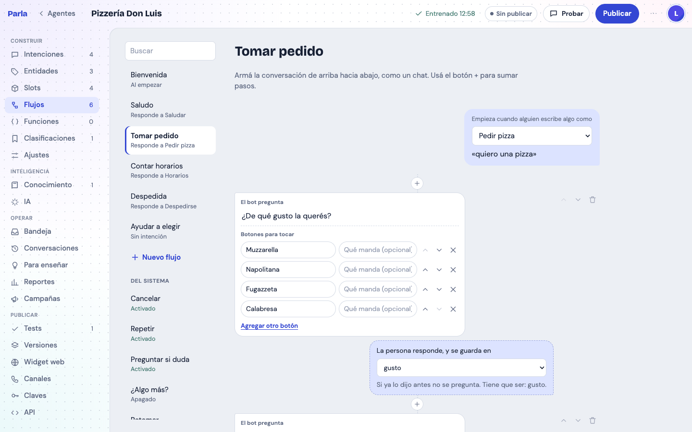
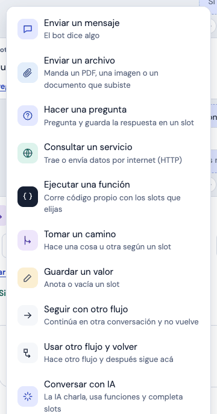
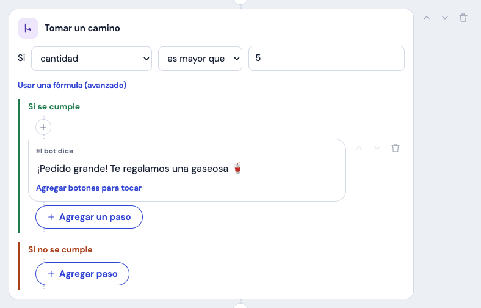
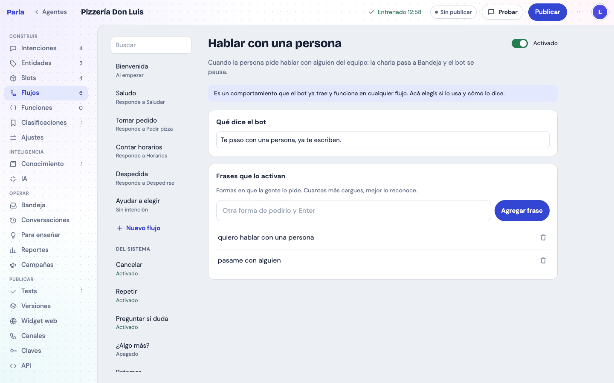

# 3. Flujos

[English](03-flows.md) · **Español**

Un **flujo** es el guion de una conversación: qué dice el bot, qué pregunta y qué hace, paso a paso. Cada intención
a la que el bot tenga que responder necesita un flujo. Este capítulo explica cómo se organizan los flujos y cada
tipo de paso que podés usar.

## La pantalla Flujos

Tocá **Flujos** en el menú. A la izquierda vas a ver:

- **Tus flujos**, cada uno con lo que lo arranca abajo: **Responde a Pedir pizza**, **Al empezar** o
  **Sin intención**.
- **+ Nuevo flujo**.
- En **Del sistema**, los comportamientos que el bot ya trae (cancelar, repetir, pasar a una persona…) con
  **Activado** o **Apagado**. Se explican [más abajo](#flujos-del-sistema).

En el medio armás el flujo elegido. Se lee como un chat: el recuadro azul de arriba es lo que dice el cliente; abajo,
los pasos del bot.

### Qué arranca un flujo

En el recuadro azul, elegí:

- **Una intención**: el flujo corre cuando el bot entiende esa intención. Abajo vas a ver una de sus frases de ejemplo.
- **Al empezar la conversación**: el flujo corre apenas se abre la conversación, antes de que el cliente escriba.
  Ideal para un mensaje de bienvenida. Solo un flujo puede arrancar la conversación; si lo elegís en otro flujo, el
  anterior queda sin intención (Parla te avisa).
- **Nada** (**Elegí una intención…**): el flujo solo corre cuando otro flujo lo usa. Sirve para partes que
  reutilizás, como "validar identidad".

### Agregar, mover y borrar pasos

- Tocá **+ Agregar el primer paso**, **+ Agregar un paso** al final, o el **+** chiquito entre dos pasos para meter
  uno ahí. Se abre un menú con todos los tipos de paso.
- Pasá el mouse por un paso para ver sus herramientas a la derecha: **Subir**, **Bajar** y **Borrar paso**.
- Abajo del último paso vas a leer **Acá termina el flujo y el bot espera un mensaje nuevo.**
- Para borrar el flujo entero, usá **Borrar este flujo** abajo de todo.

## Los pasos, uno por uno

### Enviar un mensaje

El bot dice algo. Escribí el texto en la burbuja.

- **Usar datos**: hacé clic dentro del texto y después en un botoncito de **Insertar:** para sumar un slot, como
  *{{ nombre }}*. Cuando el bot manda el mensaje, se reemplaza por el valor real: "Gracias, Ana".
- **Botones**: tocá **Agregar botones para tocar** para mostrar opciones abajo del mensaje. Cada botón tiene el texto
  que ve la gente y, si querés, **Qué manda (opcional)**: lo que el bot recibe al tocarlo. Vacío, recibe el texto del
  botón. Ordenalos con las flechas o sacalos con la ✕.
- **Traducciones**: si el bot habla varios idiomas, tocá **ES · PT · EN** arriba de la burbuja para escribir cada uno.

Los botones son una sugerencia: la gente siempre puede escribir. En WhatsApp y Telegram aparecen como los botones de
esa app.

### Enviar un archivo

Manda un PDF, una imagen o un documento (Word, Excel, PowerPoint, CSV, TXT o ZIP, hasta 10 MB). Elegí un archivo que
ya subiste o tocá **Subir un archivo**, y si querés sumá un **Texto que acompaña el archivo**
("Acá tenés la carta, {{ nombre }}").

> Quien tenga el enlace del archivo lo puede abrir, así que no subas nada privado. Los archivos son del bot, no de una
> versión: si borrás uno, también deja de enviarse en las versiones publicadas.

### Hacer una pregunta

El bot pregunta algo y guarda la respuesta en un slot.

1. Escribí la pregunta en la burbuja.
2. En **La persona responde, y se guarda en**, elegí el slot (o **+ Crear un slot nuevo…**).

Hay dos cosas que pasan solas:

- **Si el slot ya tiene un valor, la pregunta se saltea.** Si el cliente dijo "2 de napo" al principio, el bot no le
  va a preguntar el gusto ni la cantidad.
- **Si el slot está unido a una entidad, la respuesta tiene que coincidir.** Si preguntás el gusto y te contestan
  "cerveza", el bot dice que no reconoció el dato y vuelve a preguntar.

A las preguntas también les podés sumar botones, igual que a los mensajes.

### Consultar un servicio

Trae o manda datos por internet (a tu sistema de pedidos, una agenda, un CRM). Necesita una dirección web y a veces
claves, así que suele configurarlo alguien técnico. Una vez armado, cualquiera puede:

- tocar **Probar la consulta** para ver qué responde el servicio;
- **tocar un dato** de la respuesta para guardarlo en un slot (**Tocá un dato para guardarlo en un slot:**);
- sumar **Guardar si salió bien (código 200)** para después decidir con **Tomar un camino** qué decir si falló.

Las contraseñas y claves nunca van en el paso: se guardan en [Claves](09-administration_es.md#claves).

### Ejecutar una función

Corre un programita escrito por tus desarrolladores (en **Funciones**) con los slots que elijas, y guarda lo que
devuelve. Como con los servicios, la configuración es técnica; el paso solo dice qué función correr.

### Tomar un camino

Hace una cosa u otra según un slot. Se lee como una oración:

**Si** [slot] [comparación] [valor]

Las comparaciones son: **es igual a**, **es distinto de**, **contiene**, **es mayor que**, **es menor que**,
**está vacío** y **tiene un valor**.

Abajo hay dos caminos, **Si se cumple** y **Si no se cumple**, cada uno con sus pasos. Cuando termina el camino
elegido, el flujo sigue con el paso que viene después.

Ejemplos:

- Si *cantidad* **es mayor que** 5 → "¡Pedido grande! Te regalamos una gaseosa".
- Si *estado_reserva* **es igual a** 200 → "¡Reservado!"; si no → pasar a una persona.
- Si *email* **está vacío** → preguntarlo.

Para condiciones complejas está **Usar una fórmula (avanzado)**; pedíselo a alguien técnico.

### Guardar un valor

Anota algo en un slot sin preguntar: **guardar este texto** (puede incluir otros slots), **dejarlo vacío** (por
ejemplo, para tomar un segundo pedido) o **guardar una fórmula (avanzado)**.

### Seguir con otro flujo

Sigue en otro flujo y **no vuelve**. Sirve cuando dos intenciones tienen que terminar en el mismo lugar
("quiero una pizza" y "quiero hacer un pedido" van las dos a *Tomar pedido*).

### Usar otro flujo y volver

Hace todos los pasos de otro flujo y después **vuelve** y sigue con el próximo paso de acá. Es la forma de reutilizar
una parte, como "validar identidad", en varios flujos (un *subflujo*). Armá esa parte como un flujo sin intención.

### Conversar con IA

Un modelo de IA charla libremente con la persona hasta cumplir un objetivo, puede usar herramientas y completa slots.
Se explica en [Conocimiento e IA](04-knowledge-and-ai_es.md#el-paso-conversar-con-ia).

### Pasar a una persona

El bot se pausa y alguien de tu equipo responde desde la [Bandeja](07-inbox-and-conversations_es.md).

- **Qué dice el bot antes de pasar**: por ejemplo *Te paso con una persona, ya te escriben.*
- **Motivo (lo ve el equipo en Bandeja)**: por ejemplo *reclamo* o *urgencia dental*. Ayuda a tu equipo a priorizar.

El bot no vuelve a contestar esa conversación hasta que alguien se la devuelva.

### Clasificar la conversación

Anota cómo terminó la conversación, para los [Reportes](08-improving-and-reports_es.md#reportes): **Marcar como**
"Pedido tomado", "Cancelación", "Consulta de precios". Cada conversación cuenta una sola vez por clasificación. Creá
clasificaciones en el mismo paso (**+ Crear una clasificación nueva…**) o en **Clasificaciones**.

Poné este paso en los puntos que significan éxito o fracaso: después de confirmar un pedido, después de cancelar,
antes de pasar a una persona.

### Programar un recordatorio

Le escribe más tarde a la misma persona, por ejemplo un recordatorio de turno.

- **Cuándo**: **Después de** un tiempo (escribí un número y una unidad: *30m*, *24h* o *2d*) o **En una fecha y hora**
  (puede usar un slot, como la fecha del turno).
- **Qué hace**: **Mandar un texto** (lo escribís abajo) o **Correr el flujo «…»** que elijas.
- **Plantilla de WhatsApp (opcional)**: en WhatsApp, si pasaron más de 24 horas desde el último mensaje de la persona,
  hace falta una plantilla aprobada (las cargás en **Canales**).

No se le manda nada a quien se dio de baja. Es parte de las funciones de salida; mirá
[Canales → Campañas](06-channels_es.md#campañas-muy-pronto).

### Terminar

Corta el flujo acá. El bot espera un mensaje nuevo. Sirve dentro de un camino ("Si no le interesa → Terminar").

## Flujos del sistema

Son comportamientos que todo bot ya trae y que funcionan **en cualquier flujo**, en cualquier momento. No los armás;
solo decidís si están activados y qué dicen. Abrilos en **Del sistema**, en la lista de Flujos.

| Flujo del sistema | Qué hace | Ejemplo |
|---|---|---|
| **Cancelar** | Cuando la persona quiere dejar lo que está haciendo. | "cancelar", "olvidalo" |
| **Repetir** | Repite el último mensaje del bot. | "¿cómo?", "repetí" |
| **Preguntar si duda** | Cuando dos intenciones están muy cerca, pregunta cuál quiso decir y muestra las dos como botones. Con la barra (**Poco** ↔ **Mucho**) decidís qué tan fácil pregunta. Si pregunta demasiado, bajala. | "¿Quisiste decir…? Pedir pizza / Horarios" |
| **¿Algo más?** | Al terminar un flujo, pregunta si puede ayudar con otra cosa. | |
| **Retomar** | Si la persona se va por las ramas en medio de un flujo, cuando eso se resuelve el bot vuelve a donde estaba. | Le pidió la dirección y la persona pregunta el horario; el bot contesta y vuelve a pedir la dirección. |
| **Corregir un dato** | Cuando la persona corrige algo que dijo, el bot lo cambia y sigue. | "no, mejor de muzza" |
| **Hablar con una persona** | Cuando la persona pide hablar con alguien: la conversación pasa a la Bandeja y el bot se pausa. | "quiero hablar con una persona" |
| **Encuesta al final** | Cuando termina el primer flujo de la conversación, pide una nota del 1 al 5. Los resultados los ves en Reportes. | "¿Cómo te atendí? Del 1 al 5." |

Cada uno tiene un interruptor (**Activado** / **Apagado**), **Qué dice el bot** y, en los que se activan con una
frase, **Frases que lo activan**. Sumá las formas en que tus clientes lo dicen de verdad; sin frases, no se activa
nunca.

> Ojo con las frases de activación muy cortas. Una frase de **Repetir** como "¿cómo?" puede atrapar preguntas como
> "¿cómo puedo pagar?". Si el bot no contesta nada o se repite sin motivo, revisá estas frases.

## Empezar con datos

A veces la conversación llega con datos ya conocidos: el conmutador pidió el DNI del cliente, tu sitio sabe quién
inició sesión, tu CRM sabe cómo se llama el cliente. Esos datos caen en los slots antes del primer mensaje.

1. En **Slots**, prendé **Dato inicial** en los slots que llegan de afuera.
2. Creá un flujo y hacé que arranque **Al empezar la conversación**.
3. Usá esos slots en sus mensajes ("¡Hola, {{ nombre }}! ¿En qué te ayudo?") o en un **Tomar un camino** ("Si
   *dni* **está vacío** → preguntarlo").

Para probarlo, usá [Empezar con datos](05-testing-and-publishing_es.md#empezar-con-datos) en el panel Probar. Cómo
llegan esos datos desde tus sistemas es una configuración técnica (mirá la [documentación de la API](../api_es.md)).

## Consejos para buenos flujos

- **Un flujo, una tarea.** "Tomar pedido", "Cancelar pedido", "Horarios". Los flujos cortos se arreglan más fácil.
- **Confirmá antes de actuar.** Resumí lo que entendiste antes de reservar o cobrar.
- **Siempre ofrecé una salida**: un botón "Hablar con una persona", o dejá activado el flujo del sistema
  **Hablar con una persona**.
- **Clasificá los finales** para poder medirlos.
- **Probá después de cada cambio** y guardá las buenas conversaciones como tests (mirá el
  [capítulo 5](05-testing-and-publishing_es.md)).
