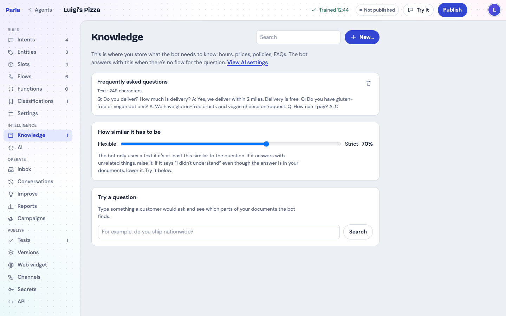
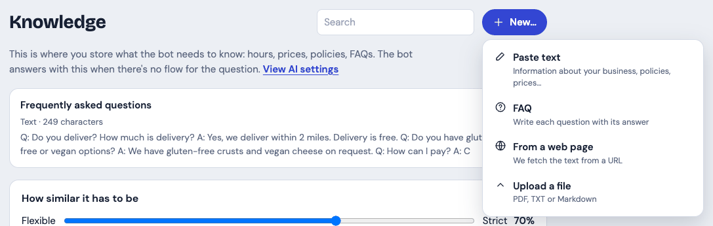
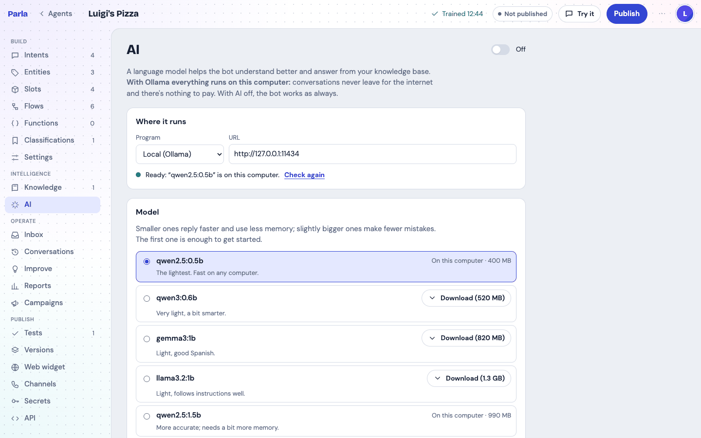
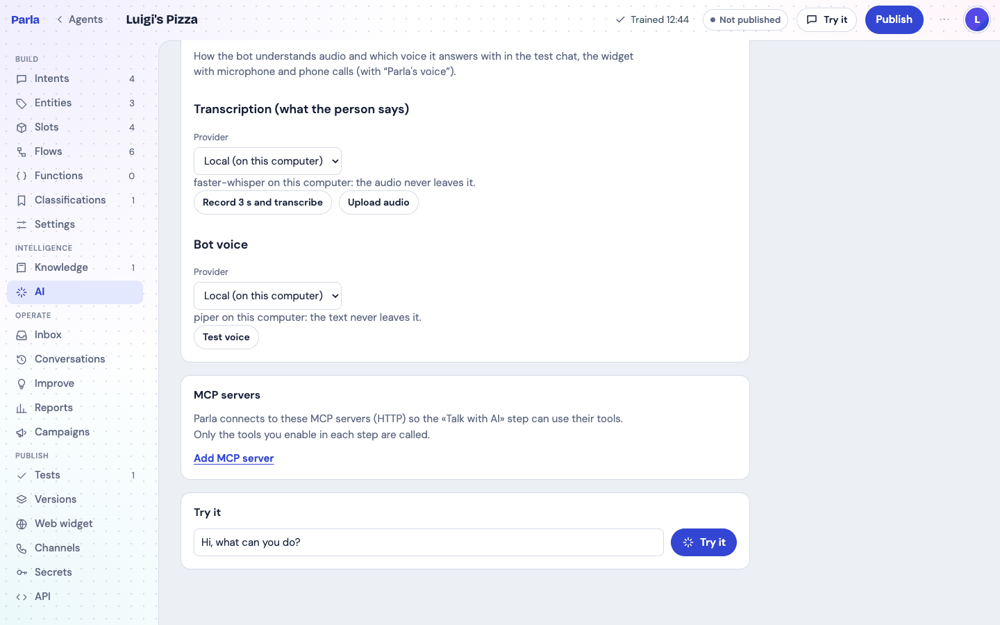
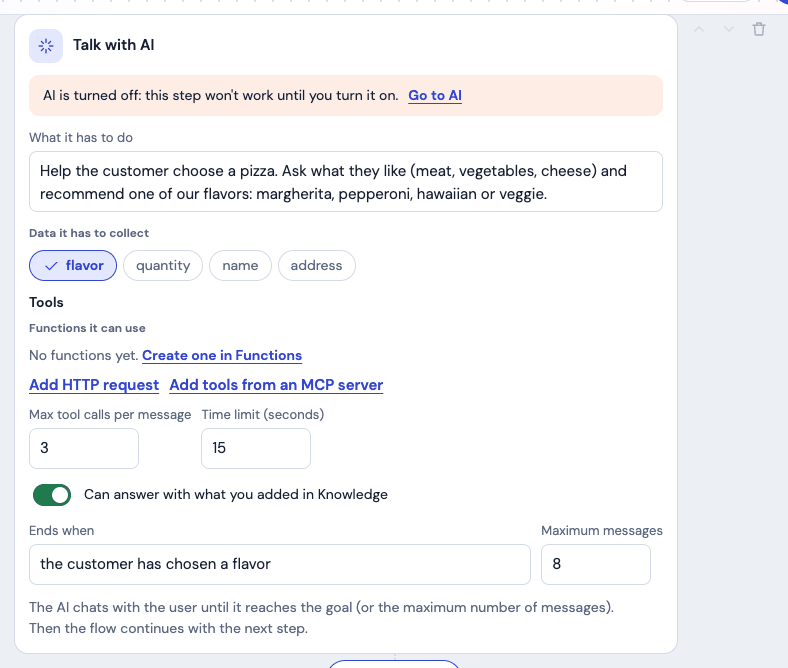

# 4. Knowledge and AI

**English** · [Español](04-knowledge-and-ai_es.md)

The **Intelligence** block of the menu has two screens:

- **Knowledge**: the documents the bot can answer from (hours, prices, policies, FAQs).
- **AI**: whether a language model helps the bot, where it runs, and the bot's voice.

The most important decision in this chapter is about **privacy**: where conversations are processed. We explain
it in plain words [below](#local-or-a-provider-the-privacy-decision).

## Knowledge: answering from your documents

You don't need a flow for every question. Load your information in **Knowledge** and, when someone asks something
that no intent covers, the bot looks for the answer there.

> Knowledge works **even with AI off**: the bot finds the right piece of text and shows it as is. With AI on, it
> also rewrites it as a short, natural answer, without making things up.

### Adding a document

Click **New…** and choose:

- **FAQ** (*Write each question with its answer*): a form with **Question 1**, **Reply 1**… and
  **Add another question**. The easiest way to start.
- **Paste text** (*Information about your business, policies, prices…*): a title and a free text.
- **From a web page** (*We fetch the text from a URL*): type the **Page URL** and click **Fetch text**. Parla copies
  the text once; if the page changes, fetch it again.
- **Upload a file** (*PDF, TXT or Markdown*), up to 15 MB. Scanned PDFs (photos of paper) have no text to read.

Click a document to open it, change its title or **Edit as text**. Delete it with the trash can.

### Writing good questions and answers

- **One topic per question.** "What days are you open?" and "Do you deliver?" are two questions, not one.
- **Write the question the way customers ask it**, and add variants in the same line:
  *What are your hours? When do you open? Are you open on Sundays?*
- **Make each answer complete on its own.** The bot shows just that piece: "From Monday to Friday, 9 am to 7 pm"
  works; "See above" doesn't.
- **Keep answers short**: two or three sentences. If the topic is long, split it.
- **Include the exact data**: prices, addresses, phone numbers. Update them when they change.
- In free text, leave a blank line between topics and use a line starting with **#** as a section title
  (*# Delivery*). For questions and answers, start lines with *Q:* and *A:*.

People don't need to use your exact words: the bot understands similar questions.

### How similar it has to be

The slider (between **Flexible** and **Strict**) sets how similar a piece of text must be to the question before
the bot uses it.

- If it **answers with unrelated things**, raise it.
- If it **says "I didn't understand" even though the answer is in your documents**, lower it.

Check it with **Try a question**: type something a customer would ask and click **Search**. You'll see which
pieces it finds, how similar they are (**87% similar**) and whether it **would use it to answer** or is
**below the minimum**.

In the Try it chat, answers from your documents are marked **Answered from Knowledge**, with the sources.

## The AI screen

Out of the box, Parla understands people without any AI model: it compares messages with your example phrases.
Turning AI on adds some extra abilities. Open **AI** in the menu.

### What the AI does when it's on

Under **What the AI does** you choose each ability:

- **Reply when it doesn't understand**: instead of the usual "I didn't understand", it asks the person to rephrase
  and tells them what it can help with.
- **Help when unsure**: if the bot isn't sure which intent it is, the AI picks among the closest ones.
- **Use the knowledge base**: builds the answer from what you loaded in Knowledge, without making things up. Off,
  the bot shows the text as is.
- **How it talks**: the bot's personality in one or two sentences, for example *You're Lula, from Paws Vet
  Clinic. You speak warmly, in short sentences.*

It also enables the [Talk with AI](#the-talk-with-ai-step) step and slots that
[the AI fills by reading the description](02-understanding.md#slots).

With AI off, the bot works exactly as before.

### Local or a provider: the privacy decision

Under **Where it runs**, **Program**, you choose who runs the AI:

| Option | Where conversations go | Cost | Good for |
|---|---|---|---|
| **Local (Ollama)** | Nowhere: everything runs on the computer or server where Parla is. | Free. | Sensitive data (health, banking), or when you just want privacy. |
| **OpenAI**, **Anthropic (Claude)**, **Google Gemini** | The conversation text (and the knowledge pieces used) is sent to that company. | That company charges your key for usage. | Better answers with less hardware. |
| **OpenAI-compatible** | Wherever that address points: could be a server of your own or a third party. | Depends. | When your IT team runs its own model server. |

If you choose an address outside your computer or network, Parla warns you: *the text of conversations (and
whatever is used from the knowledge base) is sent to that provider. Review its privacy and data use terms.*

Things that are **always local**, whatever you choose: how the bot compares messages with your example phrases
and how it searches your documents.

Questions to ask yourself (or your IT/legal team) before choosing a provider:

- Do customers share personal data in these conversations (IDs, health, money)?
- Does our privacy policy allow sending conversations to another company?
- Who pays for the provider's key, and is there a spending limit?

**Local** is the safe default. With **Local (Ollama)**, the screen tells you if the program is ready
(**Ready: "…" is on this computer**). Under **Model**, smaller models reply faster and use less memory; slightly
bigger ones make fewer mistakes. *The first one is enough to get started.* Click **Download** next to a model to
get it. If you see **Can't connect.**, ask your administrator to install Ollama (see
[ai-and-voice.md](../ai-and-voice.md)).

### Keys for a provider

If you choose a provider, you need its key (an "API key"). Paste it in the key field and click **Save key**: it's
stored in [Secrets](09-administration.md#secrets), never shown again and never exported with the agent.
Then click **Test connection**.

### Try it

At the bottom of the screen, **Try it** sends a test message to the model so you can check it answers. The first
time it takes longer because it loads the model.

## Voice

Further down the AI screen you'll find voice: how the bot **understands audio** and **which voice it speaks with**.
It's used in the Try it panel (microphone and calls), in the web widget with microphone and in phone calls.

- **Transcription (what the person says)**: turns the person's audio into text. **Local (on this computer)** keeps
  the audio on your machine. Test it with **Record 3 s and transcribe** or **Upload audio**.
- **Bot voice**: reads the bot's replies aloud. **Local (on this computer)** keeps the text on your machine. Choose
  a **Voice** and click **Test voice**.

The same privacy rule applies: with an external provider (OpenAI, Deepgram, ElevenLabs, Google Cloud), *the audio
of what the person says* or *the text of the replies* is sent to that company. Parla warns you on screen.

**Real-time voice.** The test chat's **Call (voice)** and the widget microphone talk to the server over a live
audio connection: the bot starts answering with the first sentence and stops as soon as you talk over it. On the
phone it's an option of the channel (`mode: "stream"`). Details in
[ai-and-voice.md](../ai-and-voice.md#real-time-voice).

If the voice buttons don't appear or the microphone doesn't work, see
[Troubleshooting](10-troubleshooting.md#voice-doesnt-work).

## The Talk with AI step

Inside a flow, the **Talk with AI** step lets the AI chat freely with the person to reach a goal: help them choose a
plan, gather the details of a complaint, recommend a product. When the goal is reached, the flow continues with the
next step.

Fill in:

- **What it has to do**: the instructions, in plain language. *Help the customer choose a pizza. Ask what they like
  and recommend one of our flavors.*
- **Data it has to collect**: tap the slots the AI should fill (for example *flavor*).
- **Tools**: what it can use to look things up or act: **Functions it can use**, **Add HTTP request** and
  **Add tools from an MCP server**. These are set up by someone technical. The AI can only use the tools you turn
  on here.
- **Can answer with what you added in Knowledge**: lets it use your documents.
- **Ends when**: the goal, for example *the customer has chosen a flavor*.
- **Maximum messages**: a safety limit (8 by default). After that, the flow continues anyway.

If AI is off, the step shows **AI is turned off: this step won't work until you turn it on.** with a link to **Go to AI**.

### Decisions to make before using it

- **Keep it on a short leash.** Clear instructions, a concrete goal and few tools work better than "help the
  customer with anything".
- **Only give it the tools it needs.** If it doesn't need to book, don't give it the booking tool.
- **Use regular flow steps for anything that must be exact**: prices, confirmations, payments. Use AI for the
  open-ended part of the conversation.
- **Test it a lot** in Try it, and save good conversations as [tests](05-testing-and-publishing.md#tests): AI
  answers vary from one time to another, so check that the *outcome* is right (the slot was filled, the flow
  continued), not the exact wording.
- Remember the [privacy decision](#local-or-a-provider-the-privacy-decision): with a provider, the whole chat
  inside this step goes to that company.
