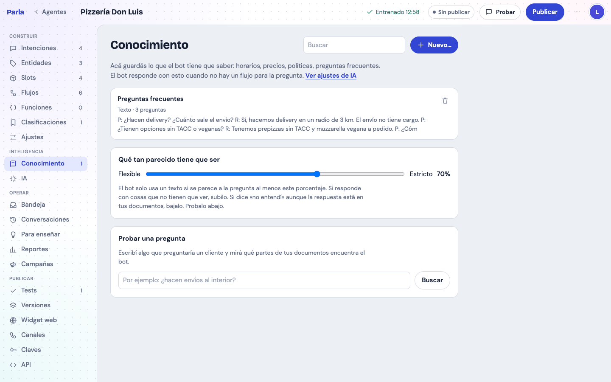
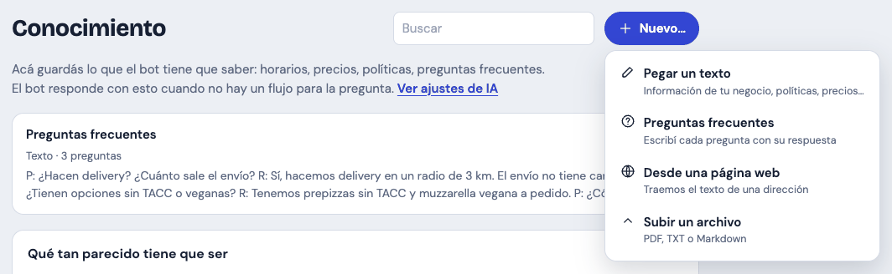
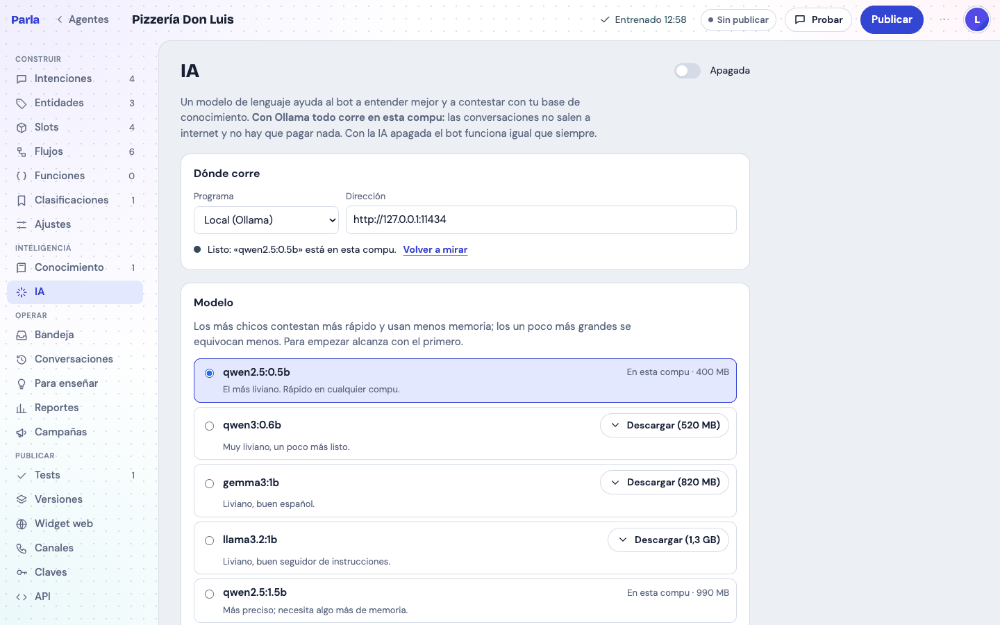
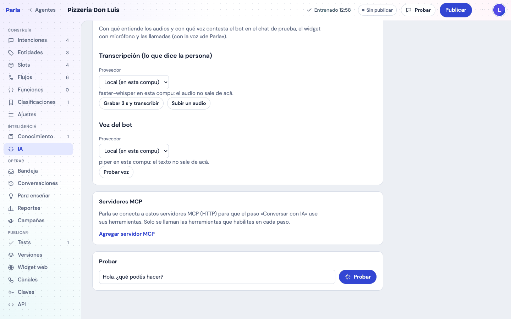
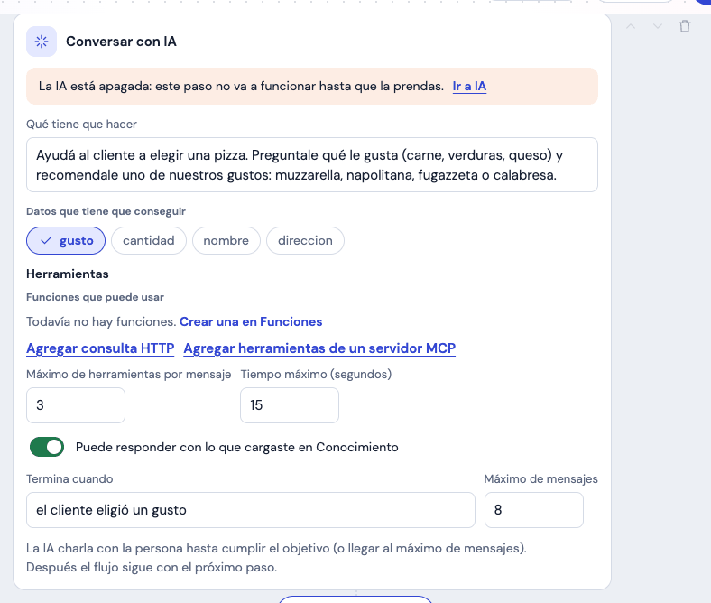

# 4. Conocimiento e IA

[English](04-knowledge-and-ai.md) · **Español**

El bloque **Inteligencia** del menú tiene dos pantallas:

- **Conocimiento**: los documentos con los que el bot puede responder (horarios, precios, políticas, preguntas
  frecuentes).
- **IA**: si un modelo de lenguaje ayuda al bot, dónde corre, y la voz del bot.

La decisión más importante de este capítulo es sobre **privacidad**: dónde se procesan las conversaciones. Te la
explicamos en palabras simples [más abajo](#local-o-un-proveedor-la-decisión-de-privacidad).

## Conocimiento: responder con tus documentos

No hace falta un flujo para cada pregunta. Cargá tu información en **Conocimiento** y, cuando alguien pregunte algo
que ninguna intención cubre, el bot busca la respuesta ahí.

> Conocimiento funciona **aun con la IA apagada**: el bot encuentra el pedazo de texto correcto y lo muestra tal
> cual. Con la IA prendida, además lo reescribe como una respuesta corta y natural, sin inventar.

### Agregar un documento

Tocá **Nuevo…** y elegí:

- **Preguntas frecuentes** (*Escribí cada pregunta con su respuesta*): un formulario con **Pregunta 1**,
  **Respuesta 1**… y **Agregar otra pregunta**. La forma más fácil de empezar.
- **Pegar un texto** (*Información de tu negocio, políticas, precios…*): un título y un texto libre.
- **Desde una página web** (*Traemos el texto de una dirección*): escribí la **Dirección de la página** y tocá
  **Traer texto**. Parla copia el texto una vez; si la página cambia, traelo de nuevo.
- **Subir un archivo** (*PDF, TXT o Markdown*), hasta 15 MB. Los PDF escaneados (fotos de papel) no tienen texto
  para leer.

Tocá un documento para abrirlo, cambiarle el título o **Editar como texto**. Borralo con el tachito.

### Escribir buenas preguntas y respuestas

- **Un tema por pregunta.** "¿Qué días abren?" y "¿Hacen delivery?" son dos preguntas, no una.
- **Escribí la pregunta como la hacen tus clientes**, y sumá variantes en la misma línea:
  *¿Qué horarios tienen? ¿A qué hora abren? ¿Abren los domingos?*
- **Que cada respuesta se entienda sola.** El bot muestra solo ese pedazo: "De lunes a viernes de 9 a 19" funciona;
  "Ver arriba" no.
- **Respuestas cortas**: dos o tres oraciones. Si el tema es largo, dividilo.
- **Poné los datos exactos**: precios, direcciones, teléfonos. Actualizalos cuando cambien.
- En un texto libre, dejá una línea en blanco entre temas y usá una línea que empiece con **#** como título de
  sección (*# Delivery*). Para preguntas y respuestas, empezá las líneas con *P:* y *R:*.

La gente no necesita usar tus mismas palabras: el bot entiende preguntas parecidas.

### Qué tan parecido tiene que ser

La barra (entre **Flexible** y **Estricto**) define cuánto se tiene que parecer un pedazo de texto a la pregunta
para que el bot lo use.

- Si **responde cosas que no tienen que ver**, subilo.
- Si **dice "no entendí" aunque la respuesta está en tus documentos**, bajalo.

Comprobalo con **Probar una pregunta**: escribí algo que preguntaría un cliente y tocá **Buscar**. Vas a ver qué
pedazos encuentra, cuánto se parecen (**87% parecido**) y si **lo usaría para responder** o **no alcanza el mínimo**.

En el chat de **Probar**, las respuestas sacadas de tus documentos aparecen marcadas con
**Respondió con Conocimiento**, con sus fuentes.

## La pantalla IA

De entrada, Parla entiende a la gente sin ningún modelo de IA: compara los mensajes con tus frases de ejemplo.
Prender la IA suma algunas habilidades extra. Abrí **IA** en el menú.

### Qué hace la IA cuando está prendida

En **Qué hace la IA** elegís cada habilidad:

- **Responder cuando no entiende**: en vez del "no entendí" de siempre, pide que lo digan de otra forma y cuenta en
  qué puede ayudar.
- **Ayudar cuando duda**: si el bot no está seguro de qué intención es, la IA elige entre las más parecidas.
- **Usar la base de conocimiento**: arma la respuesta con lo que cargaste en Conocimiento, sin inventar. Apagada,
  el bot muestra el texto tal cual.
- **Cómo habla**: la personalidad del bot en una o dos oraciones, por ejemplo *Sos Lula, de la Veterinaria
  Patitas. Hablás de vos, con calidez y frases cortas.*

También habilita el paso [Conversar con IA](#el-paso-conversar-con-ia) y los slots que
[la IA completa leyendo la descripción](02-understanding_es.md#slots).

Con la IA apagada, el bot funciona igual que siempre.

### Local o un proveedor: la decisión de privacidad

En **Dónde corre**, **Programa**, elegís quién hace funcionar la IA:

| Opción | A dónde van las conversaciones | Costo | Sirve para |
|---|---|---|---|
| **Local (Ollama)** | A ningún lado: todo corre en la compu o el servidor donde está Parla. | Gratis. | Datos sensibles (salud, bancos), o cuando simplemente querés privacidad. |
| **OpenAI**, **Anthropic (Claude)**, **Google Gemini** | El texto de las conversaciones (y los pedazos de conocimiento usados) se manda a esa empresa. | Esa empresa le cobra el uso a tu key. | Mejores respuestas con menos hardware. |
| **Compatible con OpenAI** | A donde apunte esa dirección: puede ser un servidor tuyo o de un tercero. | Depende. | Cuando tu equipo de sistemas tiene su propio servidor de modelos. |

Si elegís una dirección fuera de tu compu o tu red, Parla te avisa: *el texto de las conversaciones (y lo que se
use de la base de conocimiento) se manda a ese proveedor. Revisá sus condiciones de privacidad y de uso de datos.*

Lo que es **siempre local**, elijas lo que elijas: cómo el bot compara los mensajes con tus frases de ejemplo y cómo
busca en tus documentos.

Preguntas para hacerte (o hacerle a sistemas o a legales) antes de elegir un proveedor:

- ¿Los clientes comparten datos personales en estas conversaciones (DNI, salud, plata)?
- ¿Nuestra política de privacidad permite mandar conversaciones a otra empresa?
- ¿Quién paga la key del proveedor, y hay un límite de gasto?

**Local** es la opción segura por defecto. Con **Local (Ollama)**, la pantalla te dice si el programa está listo
(**Listo: «…» está en esta compu.**). En **Modelo**, los más chicos contestan más rápido y usan menos memoria; los
un poco más grandes se equivocan menos. *Para empezar alcanza con el primero.* Tocá **Descargar** al lado de un
modelo para bajarlo. Si ves **No me puedo conectar.**, pedile a quien administra Parla que instale Ollama (mirá
[ai-and-voice_es.md](../ai-and-voice_es.md)).

### Keys de un proveedor

Si elegís un proveedor, necesitás su key (una "API key"). Pegala en el campo de la key y tocá **Guardar key**: se
guarda en [Claves](09-administration_es.md#claves), no se vuelve a mostrar y nunca se exporta con el agente.
Después tocá **Probar conexión**.

### Probar

Abajo de todo, **Probar** le manda un mensaje de prueba al modelo para que veas que contesta. La primera vez tarda
más porque carga el modelo.

## Voz

Más abajo en la pantalla IA está la voz: cómo el bot **entiende los audios** y **con qué voz habla**. Se usa en el
panel **Probar** (micrófono y llamadas), en el widget web con micrófono y en las llamadas telefónicas.

- **Transcripción (lo que dice la persona)**: pasa el audio de la persona a texto. **Local (en esta compu)** deja
  el audio en tu máquina. Probalo con **Grabar 3 s y transcribir** o **Subir un audio**.
- **Voz del bot**: lee en voz alta las respuestas del bot. **Local (en esta compu)** deja el texto en tu máquina.
  Elegí una **Voz** y tocá **Probar voz**.

Vale la misma regla de privacidad: con un proveedor de afuera (OpenAI, Deepgram, ElevenLabs, Google Cloud), *el
audio de lo que dice la persona* o *el texto de las respuestas* se manda a esa empresa. Parla te avisa en pantalla.

**Voz en tiempo real.** La **Llamada (voz)** del chat de prueba y el micrófono del widget hablan con el servidor por
una conexión de audio en vivo: el bot empieza a contestar con la primera oración y se calla apenas le hablás encima.
En el teléfono es una opción del canal (`mode: "stream"`). Detalle en
[ai-and-voice.md](../ai-and-voice_es.md#voz-en-tiempo-real).

Si los botones de voz no aparecen o el micrófono no anda, mirá
[Problemas frecuentes](10-troubleshooting_es.md#la-voz-no-funciona).

## El paso Conversar con IA

Dentro de un flujo, el paso **Conversar con IA** deja que la IA charle libremente con la persona hasta cumplir un
objetivo: ayudarla a elegir un plan, juntar los datos de un reclamo, recomendar un producto. Cuando lo cumple, el
flujo sigue con el próximo paso.

Completá:

- **Qué tiene que hacer**: las instrucciones, en lenguaje común. *Ayudá al cliente a elegir una pizza. Preguntale
  qué le gusta y recomendale uno de nuestros gustos.*
- **Datos que tiene que conseguir**: tocá los slots que tiene que completar la IA (por ejemplo *gusto*).
- **Herramientas**: lo que puede usar para buscar datos o hacer cosas: **Funciones que puede usar**,
  **Agregar consulta HTTP** y **Agregar herramientas de un servidor MCP**. Las configura alguien técnico. La IA solo
  puede usar las herramientas que habilites acá.
- **Puede responder con lo que cargaste en Conocimiento**: le deja usar tus documentos.
- **Termina cuando**: el objetivo, por ejemplo *el cliente eligió un gusto*.
- **Máximo de mensajes**: un límite de seguridad (8 de entrada). Después de eso, el flujo sigue igual.

Si la IA está apagada, el paso muestra **La IA está apagada: este paso no va a funcionar hasta que la prendas.**
con un enlace a **Ir a IA**.

### Decisiones antes de usarlo

- **Tenela cortita.** Instrucciones claras, un objetivo concreto y pocas herramientas funcionan mejor que "ayudá
  al cliente con lo que sea".
- **Dale solo las herramientas que necesita.** Si no tiene que reservar, no le des la herramienta de reservas.
- **Usá pasos comunes del flujo para todo lo que tiene que ser exacto**: precios, confirmaciones, pagos. Usá la IA
  para la parte abierta de la charla.
- **Probalo mucho** en **Probar** y guardá las buenas charlas como [tests](05-testing-and-publishing_es.md#tests):
  las respuestas de la IA varían de una vez a otra, así que fijate que el *resultado* esté bien (el slot se
  completó, el flujo siguió), no las palabras exactas.
- Acordate de la [decisión de privacidad](#local-o-un-proveedor-la-decisión-de-privacidad): con un proveedor, toda
  la charla dentro de este paso va a esa empresa.
