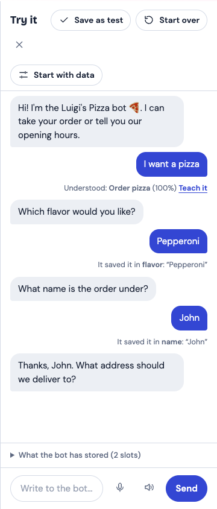
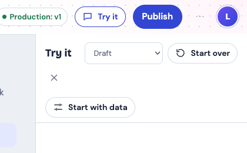
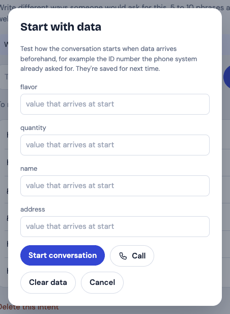
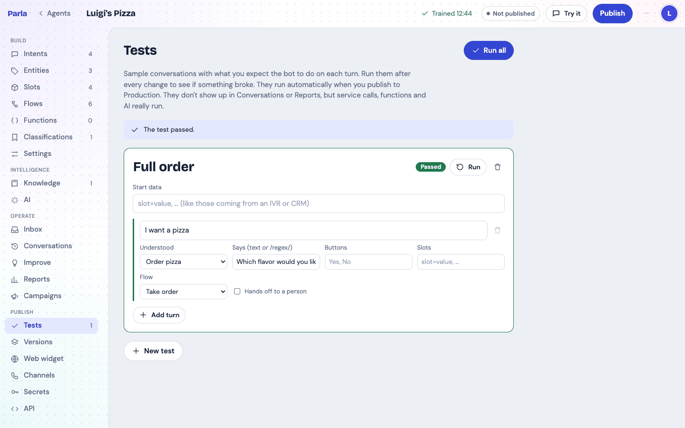
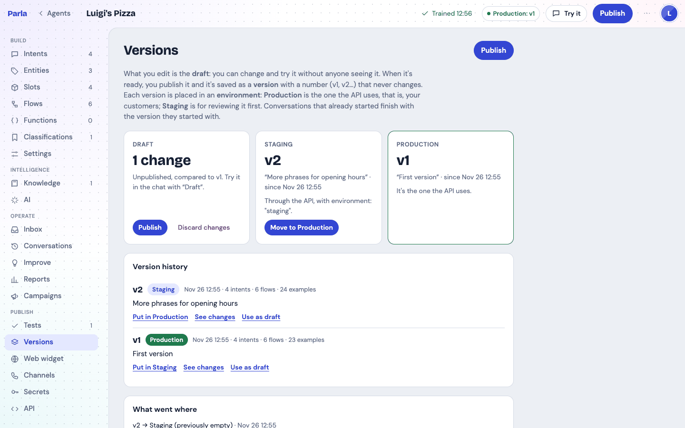
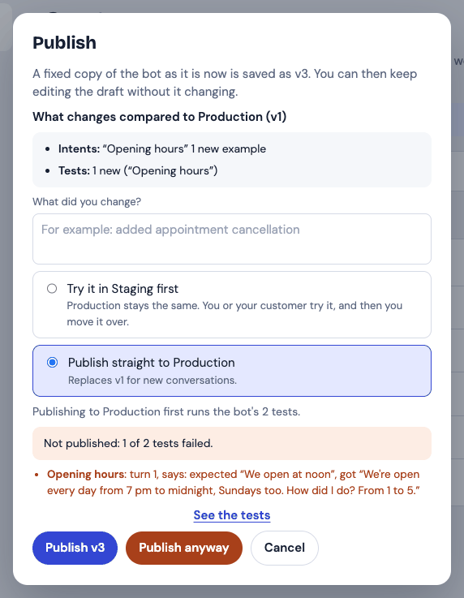

# 5. Testing and publishing

**English** · [Español](05-testing-and-publishing_es.md)

Customers should never be the first ones to find a mistake. This chapter covers the three tools that prevent that:

- **Try it**: chat or call your bot while you build it.
- **Tests**: sample conversations that Parla re-runs to check nothing broke.
- **Versions**: publish a fixed copy, try it in Staging, move it to Production and roll back if needed.

## The Try it panel

Click **Try it** at the top to open or close it. Before the first message it asks
**How do you want to try the bot?**:

- **Chat**: you write and it replies in writing.
- **Call (voice)**: you talk and it answers out loud, like on the phone. It needs a microphone and voice set up
  (see [Voice](04-knowledge-and-ai.md#voice)); if the browser can't use the microphone, this option is greyed out.

### Reading what the bot understood

Under each message you send there's a small line:

- **Understood: Order pizza (100%)**: the intent and how sure it was. The words it recognized as entities are
  highlighted.
- **It wasn't sure. Closest match: …**: below the minimum, so it answered "I didn't understand". Click
  **Teach it** to add that phrase to the right intent (then train).
- **It saved it in name: "John"**: the message was taken as the answer to a question.
- **It didn't recognize it as flavor**: the answer didn't match the entity. If the entity is a list, **Teach it**
  lets you add it as a synonym.
- Under the bot's replies you may see **Answered from Knowledge** or **Answered by AI**.

At the bottom, **What the bot has stored** shows the slots filled so far and what happened in the last turn. Very
useful when something doesn't add up.

### Other buttons

- **Start over**: a fresh conversation (and the Chat/Call choice again). If you have a flow that starts the
  conversation, this is how you see it.
- **Save as test**: saves this conversation in **Tests**, with what the bot replied as the expected result.
- **Microphone** (in chat mode): record a message by voice. **Speaker**: read the bot's replies aloud.
- **Which version to try**: once you've published, a selector appears next to **Try it**: **Draft** (what you're
  editing), **Staging (v2)** or **Production (v1)**. Use it to check exactly what customers get.

If you try a handoff to a person, the chat shows **A team member is replying now (Inbox)**. Answer from the
[Inbox](07-inbox-and-conversations.md) in another tab and you'll see the replies arrive here.

### Calls

In **Call (voice)** you see the bot's name, a timer and live subtitles. Talk naturally; you can interrupt the bot
while it speaks. **Mute** turns your microphone off and **Hang up** ends the call. Allow the microphone when the
browser asks.

### Start with data

**Start with data** (under the Try it title) simulates a conversation that arrives with known data, for example the
customer's ID that the phone system already asked for.

1. Click **Start with data**.
2. Fill in the values (only slots marked as **Initial value** appear; if none are marked, all of them).
3. Click **Start conversation** (or **Call** to try it by voice).

The values are remembered in this browser for next time; **Clear data** empties them. To use the data as soon as
the conversation starts, you need a flow that starts **When the conversation starts** (see
[Starting with data](03-flows.md#starting-with-data)).

## Tests

A test is a sample conversation plus what you expect the bot to do on each turn. After any change, click
**Run all** and in seconds you know whether something broke. They also run on their own when you publish to
Production (see [the publish gate](#the-publish-gate)).

### Creating tests the easy way

1. Have a good conversation in **Try it** (or open a real one in **Conversations**).
2. Click **Save as test**.
3. Go to **Tests**: the conversation is there with everything the bot did as the expected result.
4. **Loosen** whatever changes on its own: dates, names, order numbers. Delete those checks or replace the exact
   text with a part of it.

You can also click **+ New test** and write it by hand.

### What a test checks

Each turn has **What the customer writes** and, below, what you expect. Leave a box empty to not check it:

- **Understood**: the intent it should recognize.
- **Says (text or /regex/)**: a piece of the reply. "Which flavor" is enough; it doesn't need to be the whole sentence.
- **Buttons**: the buttons it should show, separated by commas.
- **Slots**: values it should have stored, like *flavor=pepperoni, quantity=2*.
- **Flow**: the flow it should be in.
- **Hands off to a person**: tick it if that turn should go to the Inbox.

Optionally, **Start data** simulates data arriving at the start (*name=Anna*). Add turns with **+ Add turn**.

### Running them

- **Run** on a test, or **Run all** at the top.
- **Which version to run against**: Draft, Staging or Production.
- Each test shows **Passed** or **Failed**; failures say what was expected and what came back, turn by turn.

Tests don't appear in Conversations or Reports, but services, functions and AI **really run**. If a test books
an appointment in your real system, use a test calendar.

## Versions and environments

Three words to know:

- **Draft**: what you're editing. Every change goes there.
- **Version**: a fixed copy of the bot, numbered (v1, v2…). It never changes.
- **Environment**: where a version is placed. **Production** is what customers get (on your website, WhatsApp,
  etc.); **Staging** is for reviewing a version before it goes to Production.

> Until you publish for the first time, customers get the draft: **every change you make goes live instantly**.
> Publish as soon as your bot works, so you can keep editing safely.

### Publishing

1. Click **Publish** at the top right (or in **Versions**).
2. Read **What changes compared to Production**: intents, phrases and flows added, changed or deleted.
3. In **What did you change?**, write a short note (*Added gluten-free options*). Your future self will thank you.
4. Choose:
   - **Try it in Staging first**: Production stays the same. You or your customer try it, and then you move it over.
   - **Publish straight to Production**: new conversations start using it. Conversations already in progress finish
     with the version they started with.
5. Click **Publish v2** (or whatever number comes next).

After publishing to Staging, try it with the **Staging** option of the Try it panel. When it's ready, go to
**Versions** and click **Move to Production** on the Staging card.

### The Versions screen

- **Draft** card: how many unpublished changes you have. **Discard changes** throws them away and goes back to
  the published version.
- **Staging** and **Production** cards: which version each one has and since when.
- **Version history**: every version with its note, date and contents. For each one: **See changes**,
  **Put in Production**, **Put in Staging** and **Use as draft** (copies that version into your draft; unpublished
  changes are lost).
- **What went where**: a log of every move between environments.

### Rolling back

If something goes wrong after publishing, don't panic:

1. Go to **Versions**.
2. On the **Production** card, click **Roll back to the previous version (v1)** (it appears once Production has had
   an earlier version). Or, in the history, click **Put in Production** on the version that worked.
3. Confirm in the window that opens.

New conversations use it right away. The faulty version stays saved, so you can fix it calmly.

### Comparing two versions (A/B)

Not sure the new version is better? In **Versions → A/B experiments**, click **New experiment**: pick the versions
(A is usually the one in Production), their weights (50/50 is fine), an optional goal (reached a flow, said an intent,
got a classification) and **Create experiment**. New conversations are split between the versions; each keeps its
version to the end. **See results** shows resolution, handoffs, not understood, goal, CSAT and cost per variant, with
badges: **No significant difference yet** until there's enough data and a real difference. When you've seen enough,
**Stop and choose**: keep the winner (it goes to Production) or stop without changing anything. Tips in
[experiments.md](../experiments.md).

## The publish gate

If your bot has tests, publishing to **Production** runs them first. If any fails, **nothing is published**:

You'll see **Not published: 1 of 2 tests failed.**, what each failure expected and what it got, and three options:

- **See the tests**: go fix the bot (or the test, if the test was out of date).
- **Publish anyway**: publishes despite the failures. Only do it if you're sure the test is what's wrong, and fix
  the test right after.
- **Cancel**.

Publishing to **Staging** doesn't run the gate, so you can share a work in progress for review.

## A safe routine

1. Change the draft.
2. **Train** if you touched phrases or entities.
3. **Try it** in the panel; **Save as test** the good conversations.
4. **Run all** tests.
5. **Publish** to Staging, check it, **Move to Production**.
6. Keep an eye on [Improve and Reports](08-improving-and-reports.md) for the next few days.
