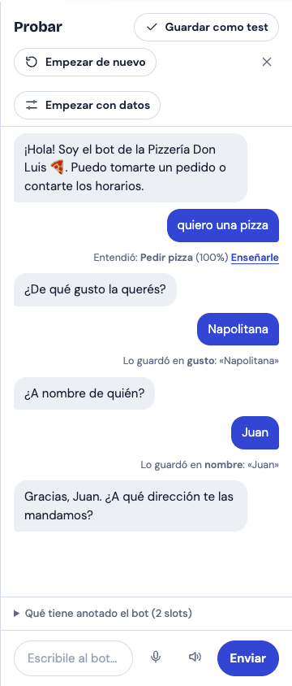
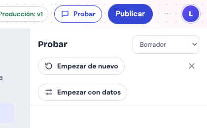
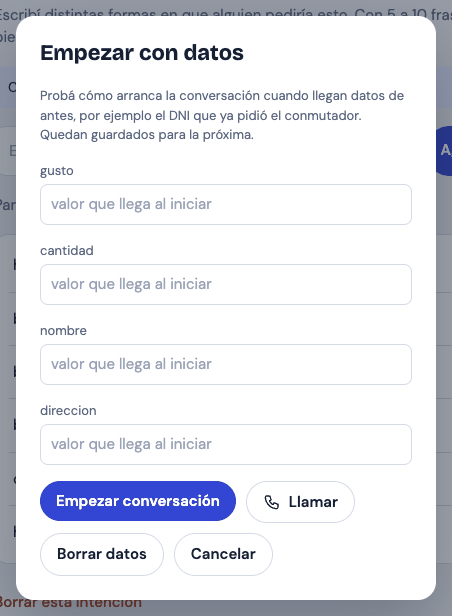
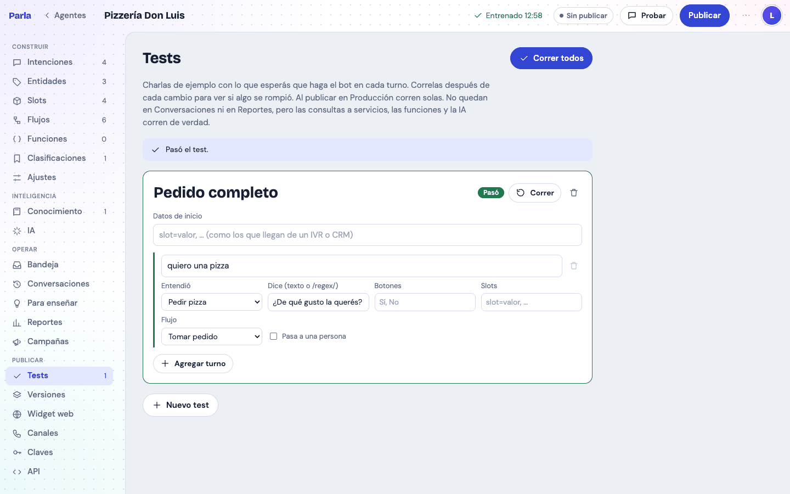
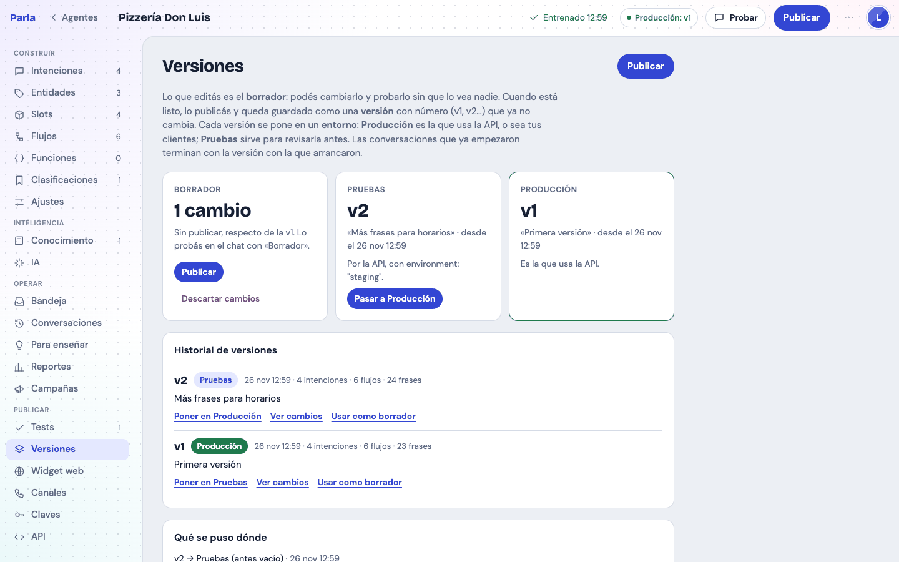
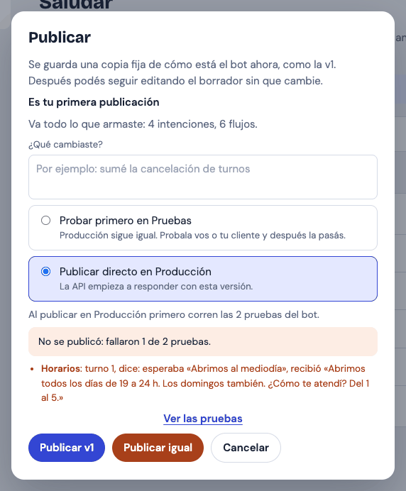

# 5. Probar y publicar

[English](05-testing-and-publishing.md) · **Español**

Los clientes nunca deberían ser los primeros en encontrar un error. Este capítulo cubre las tres herramientas que lo
evitan:

- **Probar**: chateá o llamá a tu bot mientras lo armás.
- **Tests**: charlas de ejemplo que Parla vuelve a correr para ver que nada se rompió.
- **Versiones**: publicá una copia fija, probala en Pruebas, pasala a Producción y volvé atrás si hace falta.

## El panel Probar

Tocá **Probar** arriba para abrirlo o cerrarlo. Antes del primer mensaje te pregunta
**¿Cómo querés probar al bot?**:

- **Chat**: le escribís y te responde por escrito.
- **Llamada (voz)**: le hablás y te contesta en voz alta, como por teléfono. Necesita micrófono y la voz configurada
  (mirá [Voz](04-knowledge-and-ai_es.md#voz)); si el navegador no puede usar el micrófono, la opción aparece gris.

### Leer qué entendió el bot

Abajo de cada mensaje que mandás hay una línea chiquita:

- **Entendió: Pedir pizza (100%)**: la intención y qué tan seguro estuvo. Las palabras que reconoció como entidades
  aparecen resaltadas.
- **No estuvo seguro. Lo más parecido: …**: no llegó al mínimo, así que contestó "no entendí". Tocá **Enseñarle**
  para sumar esa frase a la intención correcta (después entrená).
- **Lo guardó en nombre: «Juan»**: el mensaje se tomó como respuesta a una pregunta.
- **No lo reconoció como gusto**: la respuesta no coincide con la entidad. Si la entidad es una lista,
  **Enseñarle** te deja sumarla como sinónimo.
- Abajo de las respuestas del bot puede aparecer **Respondió con Conocimiento** o **Respondió la IA**.

Abajo de todo, **Qué tiene anotado el bot** muestra los slots completados hasta ahora y qué pasó en el último turno.
Muy útil cuando algo no cierra.

### Otros botones

- **Empezar de nuevo**: una conversación nueva (y otra vez la elección Chat o Llamada). Si tenés un flujo que arranca
  la conversación, así lo ves.
- **Guardar como test**: guarda esta charla en **Tests**, con lo que respondió el bot como lo esperado.
- **Micrófono** (en modo chat): grabá un mensaje por voz. **Parlante**: lee en voz alta las respuestas del bot.
- **Qué versión probar**: una vez que publicaste, aparece un selector al lado de **Probar**: **Borrador** (lo que
  estás editando), **Pruebas (v2)** o **Producción (v1)**. Usalo para ver exactamente lo que reciben los clientes.

Si probás un pase a una persona, el chat muestra **Ahora responde una persona (Bandeja)**. Contestá desde la
[Bandeja](07-inbox-and-conversations_es.md) en otra pestaña y vas a ver llegar las respuestas acá.

### Llamadas

En **Llamada (voz)** ves el nombre del bot, un reloj y subtítulos en vivo. Hablá con naturalidad; podés interrumpir
al bot mientras habla. **Silenciar** apaga tu micrófono y **Colgar** termina la llamada. Permití el micrófono cuando
el navegador lo pida.

### Empezar con datos

**Empezar con datos** (abajo del título **Probar**) simula una conversación que llega con datos conocidos, por
ejemplo el DNI que ya pidió el conmutador.

1. Tocá **Empezar con datos**.
2. Completá los valores (aparecen solo los slots marcados como **Dato inicial**; si no hay ninguno marcado, todos).
3. Tocá **Empezar conversación** (o **Llamar** para probarlo por voz).

Los valores quedan guardados en este navegador para la próxima; **Borrar datos** los vacía. Para usar los datos
apenas empieza la conversación, necesitás un flujo que arranque **Al empezar la conversación** (mirá
[Empezar con datos](03-flows_es.md#empezar-con-datos)).

## Tests

Un test es una charla de ejemplo más lo que esperás que haga el bot en cada turno. Después de cualquier cambio, tocá
**Correr todos** y en segundos sabés si algo se rompió. También corren solos cuando publicás en Producción (mirá
[el control al publicar](#el-control-al-publicar)).

### Crear tests de la forma fácil

1. Tené una buena charla en **Probar** (o abrí una real en **Conversaciones**).
2. Tocá **Guardar como test**.
3. Andá a **Tests**: la charla está ahí con todo lo que hizo el bot como resultado esperado.
4. **Aflojá** lo que cambia solo: fechas, nombres, números de pedido. Borrá esos controles o reemplazá el texto
   exacto por una parte.

También podés tocar **+ Nuevo test** y escribirlo a mano.

### Qué controla un test

Cada turno tiene **Lo que escribe el cliente** y, abajo, lo que esperás. Dejá un casillero vacío para no
controlarlo:

- **Entendió**: la intención que tiene que reconocer.
- **Dice (texto o /regex/)**: un pedazo de la respuesta. Con "De qué gusto" alcanza; no hace falta la oración entera.
- **Botones**: los botones que tiene que mostrar, separados por coma.
- **Slots**: valores que tiene que tener anotados, como *gusto=napolitana, cantidad=2*.
- **Flujo**: el flujo en el que tiene que estar.
- **Pasa a una persona**: marcalo si ese turno tiene que ir a la Bandeja.

Opcionalmente, **Datos de inicio** simula datos que llegan al empezar (*nombre=Ana*). Sumá turnos con
**+ Agregar turno**.

### Correrlos

- **Correr** en un test, o **Correr todos** arriba.
- **Contra qué versión correr**: Borrador, Pruebas o Producción.
- Cada test muestra **Pasó** o **Falló**; las fallas dicen, turno por turno, qué se esperaba y qué volvió.

Los tests no aparecen en Conversaciones ni en Reportes, pero los servicios, las funciones y la IA **corren de
verdad**. Si un test reserva un turno en tu sistema real, usá una agenda de prueba.

## Versiones y entornos

Tres palabras para saber:

- **Borrador**: lo que estás editando. Todo cambio va ahí.
- **Versión**: una copia fija del bot, numerada (v1, v2…). Nunca cambia.
- **Entorno**: dónde se pone una versión. **Producción** es lo que reciben los clientes (en tu web, WhatsApp,
  etc.); **Pruebas** sirve para revisar una versión antes de que vaya a Producción.

> Hasta que publiques por primera vez, los clientes reciben el borrador: **cada cambio que hacés sale en vivo al
> instante**. Publicá apenas tu bot funcione, así podés seguir editando tranquilo.

### Publicar

1. Tocá **Publicar** arriba a la derecha (o en **Versiones**).
2. Leé **Qué cambia respecto de Producción**: intenciones, frases y flujos agregados, cambiados o borrados.
3. En **¿Qué cambiaste?**, escribí una nota corta (*Sumé opciones sin TACC*). Tu yo del futuro te lo va a agradecer.
4. Elegí:
   - **Probar primero en Pruebas**: Producción sigue igual. Probala vos o tu cliente y después la pasás.
   - **Publicar directo en Producción**: las conversaciones nuevas empiezan a usarla. Las que ya están en curso
     terminan con la versión con la que arrancaron.
5. Tocá **Publicar v2** (o el número que siga).

Después de publicar en Pruebas, probala con la opción **Pruebas** del panel **Probar**. Cuando esté lista, andá a
**Versiones** y tocá **Pasar a Producción** en la tarjeta de Pruebas.

### La pantalla Versiones

- Tarjeta **Borrador**: cuántos cambios sin publicar tenés. **Descartar cambios** los tira y vuelve a la versión
  publicada.
- Tarjetas **Pruebas** y **Producción**: qué versión tiene cada una y desde cuándo.
- **Historial de versiones**: cada versión con su nota, fecha y contenido. Para cada una: **Ver cambios**,
  **Poner en Producción**, **Poner en Pruebas** y **Usar como borrador** (copia esa versión en tu borrador; los
  cambios sin publicar se pierden).
- **Qué se puso dónde**: un registro de cada movimiento entre entornos.

### Volver atrás

Si algo sale mal después de publicar, no te asustes:

1. Andá a **Versiones**.
2. En la tarjeta **Producción**, tocá **Volver a la versión anterior (v1)** (aparece cuando Producción ya tuvo una
   versión antes). O, en el historial, tocá **Poner en Producción** en la versión que funcionaba.
3. Confirmá en la ventana que se abre.

Las conversaciones nuevas la usan desde ya. La versión con problemas queda guardada, así la arreglás con calma.

### Comparar dos versiones (A/B)

¿No estás seguro de que la versión nueva sea mejor? En **Versiones → Experimentos A/B**, tocá **Nuevo experimento**:
elegí las versiones (A suele ser la de Producción), sus pesos (50/50 está bien), un objetivo opcional (llegó a un
flujo, dijo una intención, quedó clasificada) y **Crear experimento**. Las conversaciones nuevas se reparten entre las
versiones; cada una sigue con la suya hasta el final. **Ver resultados** muestra resueltas, derivadas, no entendidas,
objetivo, CSAT y costo por variante, con etiquetas: **Sin diferencia significativa todavía** hasta que haya datos
suficientes y una diferencia real. Cuando viste lo suficiente, **Terminar y elegir**: quedate con la ganadora (pasa a
Producción) o terminá sin cambiar nada. Consejos en [experiments_es.md](../experiments_es.md).

## El control al publicar

Si tu bot tiene tests, publicar en **Producción** primero los corre. Si alguno falla, **no se publica nada**:

Vas a ver **No se publicó: fallaron 1 de 2 pruebas.**, qué esperaba cada falla y qué recibió, y tres opciones:

- **Ver las pruebas**: andá a arreglar el bot (o el test, si el test quedó viejo).
- **Publicar igual**: publica a pesar de las fallas. Hacelo solo si estás seguro de que lo que está mal es el test,
  y arreglá el test enseguida.
- **Cancelar**.

Publicar en **Pruebas** no pasa por este control, así podés compartir algo a medio hacer para que lo revisen.

## Una rutina segura

1. Cambiá el borrador.
2. **Entrenar**, si tocaste frases o entidades.
3. **Probar** en el panel; **Guardar como test** las buenas charlas.
4. **Correr todos** los tests.
5. **Publicar** en Pruebas, revisarla, **Pasar a Producción**.
6. Mirá [Para enseñar y Reportes](08-improving-and-reports_es.md) los días siguientes.
