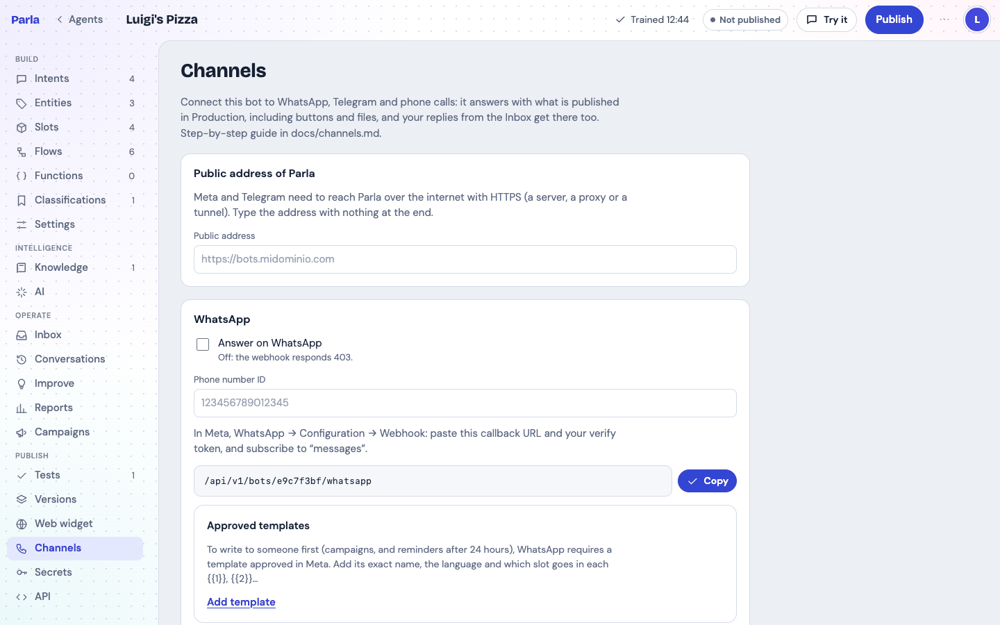
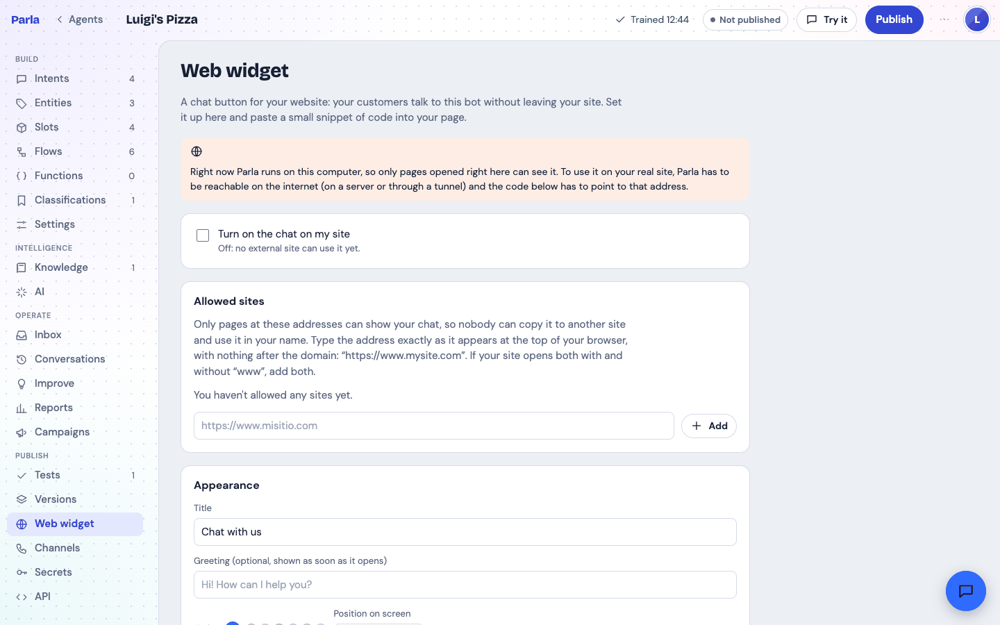
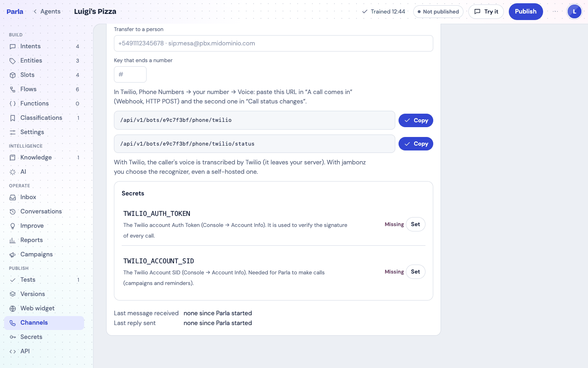

# 6. Channels: where customers talk to your bot

**English** · [Español](06-channels_es.md)

Your bot can talk to customers in four places:

| Channel | Where you set it up | What you need from IT |
|---|---|---|
| **Your website** (chat button) | **Web widget** | Someone who can paste a snippet in your site, and Parla reachable from the internet. |
| **WhatsApp** | **Channels** | A Meta (Facebook) business account with the WhatsApp API, and Parla reachable with HTTPS. |
| **Telegram** | **Channels** | Five minutes with Telegram's BotFather, and Parla reachable with HTTPS. |
| **Phone calls** | **Channels** | A phone provider (Twilio or jambonz) and Parla reachable with HTTPS. |

Two rules apply to all of them:

- **They answer with what's published in Production.** If you haven't published, they answer with the draft.
  See [Versions](05-testing-and-publishing.md#versions-and-environments).
- **Your Inbox replies travel through the same channel.** If a WhatsApp conversation is handed off to a person,
  the customer receives your team's replies on WhatsApp.

This chapter tells you what to click and what to ask for. The technical step-by-step guide for your IT team is
[channels.md](../channels.md).

## The public address

WhatsApp, Telegram and phone providers need to reach Parla over the internet. If Parla runs on someone's laptop,
they can't. Ask your IT team:

> "We need Parla published on the internet with HTTPS, for example at https://bots.ourcompany.com.
> It can be a server, a reverse proxy or a tunnel."

When you have that address, go to **Channels** and type it in **Public address of Parla**, with nothing at the end
(no slash). If IT already set it on the server, you'll read **Using the server's PARLA_PUBLIC_URL.** and don't need
to type anything.

## Web widget: a chat button on your website

Open **Web widget**. It's a chat bubble that appears in the corner of your website.

1. **Turn on the chat on my site**.
2. Under **Allowed sites**, add your website's address exactly as it appears at the top of your browser, with
   nothing after the domain: *https://www.mysite.com*. If your site opens with and without "www", add both. Only
   those sites can show your chat, so nobody can copy it and use it in your name.
3. Under **Appearance**, choose:
   - **Title** (for example *Chat with us*) and **Greeting (optional, shown as soon as it opens)**.
   - **Color**: any color or one of the quick ones.
   - **Position on screen**: **Bottom right** or **Bottom left**.
   - **Let people talk through the microphone**: the bot listens and also replies by voice. It hides itself if
     the visitor's browser doesn't support it.
4. Under **Code for your page**, click **Copy** and send that snippet to whoever manages your website. It goes
   right before the end of the page (before `</body>`). In WordPress, Wix, Shopify and similar, look for
   "add code" or "custom HTML".

Before going live, tick **Show the preview on this screen**: the real chat appears in the corner of Parla, so you
can try it. Those test conversations appear in Conversations with the channel *prueba-widget*.

> If you see **Right now Parla runs on this computer, so only pages opened right here can see it**, the widget
> will only work on your website once Parla has a public address (see above).

## WhatsApp

You'll need help from whoever manages your company's Meta (Facebook) Business account. Checklist to ask for:

- [ ] A **WhatsApp Business** app in Meta for Developers, with a phone number.
- [ ] The **Phone number ID** of that number.
- [ ] A **permanent access token** (from a "system user" in Meta Business).
- [ ] The **app secret** (App settings → Basic).
- [ ] Parla's [public address](#the-public-address).

Then, in **Channels → WhatsApp**:

1. Type the **Phone number ID**.
2. In the **Secrets** list of that section, click **Set** next to each secret and paste: the access token, the app
   secret, and a **verify token** (a long word you make up; you'll paste the same word in Meta).
3. Copy the callback URL with **Copy** and give it, with the verify token, to the person in Meta: *WhatsApp →
   Configuration → Webhook*, subscribed to "messages".
4. Turn on **Answer on WhatsApp**.
5. Send a WhatsApp message to the number. At the bottom of the section, **Last message received** and **Last reply
   sent** confirm it's working; **Last error** tells you what went wrong.

**Approved templates.** WhatsApp only lets a business write first (or after 24 hours of silence) with a template
approved by Meta. If you'll use campaigns or reminders, add each template under **Approved templates**: its exact
name, its language and which slot goes in each {{1}}, {{2}}…

## Telegram

The easiest channel to try.

1. In Telegram, talk to **@BotFather**, send `/newbot` and follow the steps. At the end it gives you a **token**
   (it looks like `123456:ABC…`).
2. In **Channels → Telegram**, click **Set** next to the token secret and paste it.
3. Turn on **Answer on Telegram**.
4. Click **Connect webhook**. You should see **Done: Telegram now sends messages to Parla. Try writing to your bot.**
5. Write to your bot in Telegram.

To stop, click **Disconnect**.

## Phone calls

Parla can answer phone calls: it listens, understands and replies with a voice. You need a phone provider:

- **Twilio**: a service you pay for; quick to start. The caller's voice is transcribed by Twilio (it leaves your server).
- **jambonz**: open source, run by your IT team; you choose who transcribes, even a self-hosted recognizer.

Checklist to ask IT for:

- [ ] A phone number in Twilio or jambonz.
- [ ] Twilio: the **Auth Token** (and the **Account SID** if Parla will also make calls). jambonz: the webhook secret
      (and an API key, account SID and application SID if Parla will make calls).
- [ ] Parla's [public address](#the-public-address).

Then, in **Channels → Phone**:

1. Choose the **Provider** and the **Call language**.
2. Set the secrets the section lists (**Missing** turns into **Set** when they're loaded).
3. Choose the **Voice**: **The provider's** or **Parla's (piper, on this server)**.
4. In **Transfer to a person**, type the number (or SIP address) where calls go when the bot hands off.
5. Optionally, **Key that ends a number**: the key callers press after typing a number (usually #).
6. Copy the two URLs and paste them in your provider (the screen tells you exactly where).
7. Turn on **Answer phone calls** and call your number.

Tip: design your flows for voice. Short sentences, one question at a time, and no buttons (people can't see them on
the phone; say the options instead).

## Campaigns (coming soon)

Outbound campaigns let Parla write first or call a list of people (a reminder, a survey, a notice) and continue the
conversation with the flow you choose when they reply. This feature is being built right now; you may already see
**Campaigns** in the menu. The technical details are in [outbound.md](../outbound.md).

Before sending anything: only contact people who gave you permission, use approved templates on WhatsApp, respect
quiet hours for calls and follow your country's rules.
