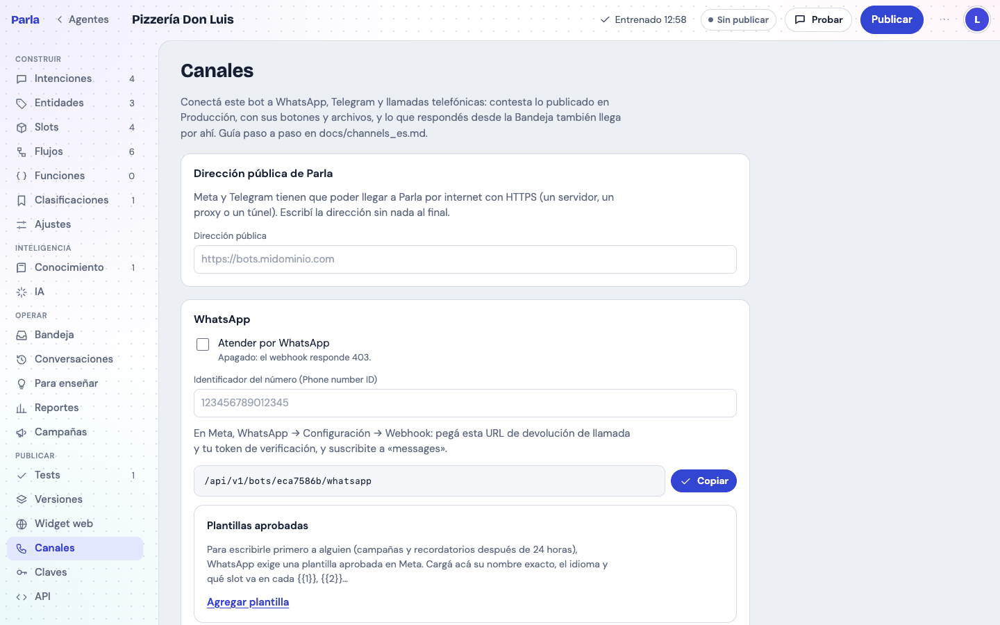
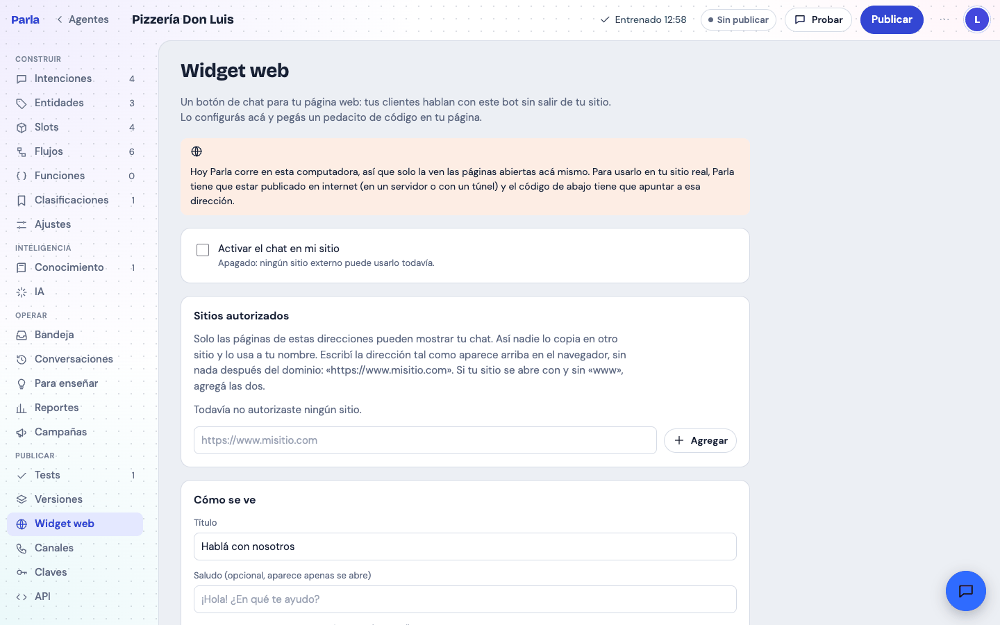
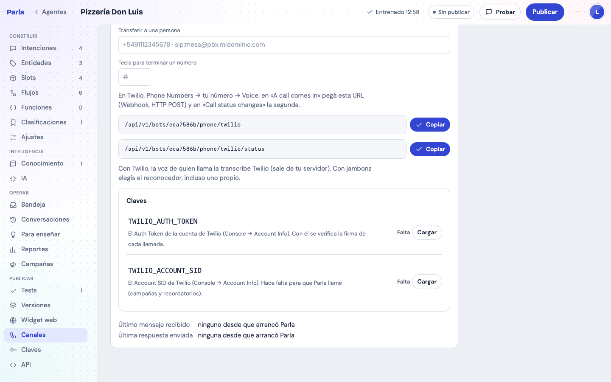

# 6. Canales: dónde hablan los clientes con tu bot

[English](06-channels.md) · **Español**

Tu bot puede hablar con los clientes en cuatro lugares:

| Canal | Dónde se configura | Qué necesitás de sistemas |
|---|---|---|
| **Tu sitio web** (botón de chat) | **Widget web** | Alguien que pueda pegar un pedacito de código en tu sitio, y Parla accesible desde internet. |
| **WhatsApp** | **Canales** | Una cuenta comercial de Meta (Facebook) con la API de WhatsApp, y Parla accesible con HTTPS. |
| **Telegram** | **Canales** | Cinco minutos con BotFather de Telegram, y Parla accesible con HTTPS. |
| **Llamadas telefónicas** | **Canales** | Un proveedor de telefonía (Twilio o jambonz) y Parla accesible con HTTPS. |

Dos reglas valen para todos:

- **Contestan con lo publicado en Producción.** Si no publicaste, contestan con el borrador.
  Mirá [Versiones](05-testing-and-publishing_es.md#versiones-y-entornos).
- **Lo que respondés desde la Bandeja viaja por el mismo canal.** Si una charla de WhatsApp pasa a una persona, el
  cliente recibe las respuestas de tu equipo por WhatsApp.

Este capítulo te dice qué tocar y qué pedir. La guía técnica paso a paso para tu equipo de sistemas está en
[channels_es.md](../channels_es.md).

## La dirección pública

WhatsApp, Telegram y los proveedores de telefonía necesitan llegar a Parla por internet. Si Parla corre en la
notebook de alguien, no pueden. Pedile a sistemas:

> "Necesitamos Parla publicado en internet con HTTPS, por ejemplo en https://bots.nuestraempresa.com.
> Puede ser un servidor, un proxy reverso o un túnel."

Cuando tengas esa dirección, andá a **Canales** y escribila en **Dirección pública de Parla**, sin nada al final
(sin barra). Si sistemas ya la configuró en el servidor, vas a leer **Usando PARLA_PUBLIC_URL del servidor.** y no
hace falta escribir nada.

## Widget web: un botón de chat en tu sitio

Abrí **Widget web**. Es una burbuja de chat que aparece en la esquina de tu sitio.

1. **Activar el chat en mi sitio**.
2. En **Sitios autorizados**, agregá la dirección de tu sitio tal como aparece arriba en el navegador, sin nada
   después del dominio: *https://www.misitio.com*. Si tu sitio se abre con y sin "www", agregá las dos. Solo esos
   sitios pueden mostrar tu chat, así nadie lo copia y lo usa a tu nombre.
3. En **Cómo se ve**, elegí:
   - **Título** (por ejemplo *Hablá con nosotros*) y **Saludo (opcional, aparece apenas se abre)**.
   - **Color**: cualquier color o uno de los rápidos.
   - **Lugar en la pantalla**: **Abajo a la derecha** o **Abajo a la izquierda**.
   - **Dejar que hablen por micrófono**: el bot escucha y contesta también con voz. Se oculta solo si el navegador
     del visitante no lo permite.
4. En **Código para tu página**, tocá **Copiar** y mandale ese pedacito a quien maneja tu sitio. Va justo antes del
   final de la página (antes de `</body>`). En WordPress, Wix, Tiendanube y parecidos, buscá "agregar código" o
   "HTML personalizado".

Antes de salir en vivo, marcá **Ver la vista previa en esta pantalla**: el chat de verdad aparece en la esquina de
Parla, así lo probás. Esas charlas de prueba aparecen en Conversaciones con el canal *prueba-widget*.

> Si ves **Hoy Parla corre en esta computadora, así que solo la ven las páginas abiertas acá mismo**, el widget va a
> funcionar en tu sitio recién cuando Parla tenga una dirección pública (mirá arriba).

## WhatsApp

Vas a necesitar ayuda de quien maneja la cuenta de Meta Business (Facebook) de tu empresa. Lista para pedir:

- [ ] Una app de **WhatsApp Business** en Meta for Developers, con un número de teléfono.
- [ ] El **identificador del número (Phone number ID)**.
- [ ] Un **token de acceso permanente** (de un "usuario del sistema" en Meta Business).
- [ ] La **clave secreta de la app** (Configuración de la app → Básica).
- [ ] La [dirección pública](#la-dirección-pública) de Parla.

Después, en **Canales → WhatsApp**:

1. Escribí el **Identificador del número (Phone number ID)**.
2. En la lista de **Claves** de esa sección, tocá **Cargar** al lado de cada clave y pegá: el token de acceso, la
   clave secreta de la app y un **token de verificación** (una palabra larga que inventás; la misma la vas a pegar
   en Meta).
3. Copiá la URL de devolución de llamada con **Copiar** y pasásela, junto con el token de verificación, a la persona
   de Meta: *WhatsApp → Configuración → Webhook*, suscripta a "messages".
4. Prendé **Atender por WhatsApp**.
5. Mandá un WhatsApp al número. Al final de la sección, **Último mensaje recibido** y **Última respuesta enviada**
   confirman que anda; **Último error** te dice qué falló.

**Plantillas aprobadas.** WhatsApp solo deja que una empresa escriba primero (o después de 24 horas de silencio) con
una plantilla aprobada por Meta. Si vas a usar campañas o recordatorios, cargá cada plantilla en
**Plantillas aprobadas**: su nombre exacto, su idioma y qué slot va en cada {{1}}, {{2}}…

## Telegram

El canal más fácil para probar.

1. En Telegram, hablale a **@BotFather**, mandá `/newbot` y seguí los pasos. Al final te da un **token** (se ve como
   `123456:ABC…`).
2. En **Canales → Telegram**, tocá **Cargar** al lado de la clave del token y pegalo.
3. Prendé **Atender por Telegram**.
4. Tocá **Conectar webhook**. Tendrías que ver **Listo: Telegram ya le manda los mensajes a Parla. Probá escribirle a
   tu bot.**
5. Escribile a tu bot en Telegram.

Para frenarlo, tocá **Desconectar**.

## Llamadas telefónicas

Parla puede atender llamadas: escucha, entiende y contesta con voz. Necesitás un proveedor de telefonía:

- **Twilio**: un servicio pago; rápido para empezar. La voz de quien llama la transcribe Twilio (sale de tu servidor).
- **jambonz**: código abierto, lo maneja tu equipo de sistemas; elegís quién transcribe, incluso un reconocedor propio.

Lista para pedirle a sistemas:

- [ ] Un número de teléfono en Twilio o jambonz.
- [ ] Twilio: el **Auth Token** (y el **Account SID** si Parla también va a llamar). jambonz: el webhook secret
      (y una API key, el account SID y el application SID si Parla va a llamar).
- [ ] La [dirección pública](#la-dirección-pública) de Parla.

Después, en **Canales → Teléfono**:

1. Elegí el **Proveedor** y el **Idioma de la llamada**.
2. Cargá las claves que lista la sección (**Falta** pasa a **Cargada** cuando están).
3. Elegí la **Voz**: **La del proveedor** o **La de Parla (piper, en este servidor)**.
4. En **Transferir a una persona**, escribí el número (o la dirección SIP) a donde van las llamadas cuando el bot pasa
   a una persona.
5. Opcional: **Tecla para terminar un número**, la tecla que aprietan después de marcar un número (por lo general #).
6. Copiá las dos URL y pegalas en tu proveedor (la pantalla te dice exactamente dónde).
7. Prendé **Atender llamadas** y llamá a tu número.

Consejo: pensá tus flujos para la voz. Oraciones cortas, una pregunta por vez y sin botones (por teléfono no se ven;
decí las opciones).

## Campañas (muy pronto)

Las campañas salientes dejan que Parla escriba primero o llame a una lista de personas (un recordatorio, una
encuesta, un aviso) y que, cuando responden, siga la charla con el flujo que elijas. Esta función se está armando
ahora; puede que ya veas **Campañas** en el menú. Los detalles técnicos están en [outbound_es.md](../outbound_es.md).

Antes de mandar nada: contactá solo a quien te dio permiso, usá plantillas aprobadas en WhatsApp, respetá el horario
de silencio en las llamadas y seguí las reglas de tu país.
