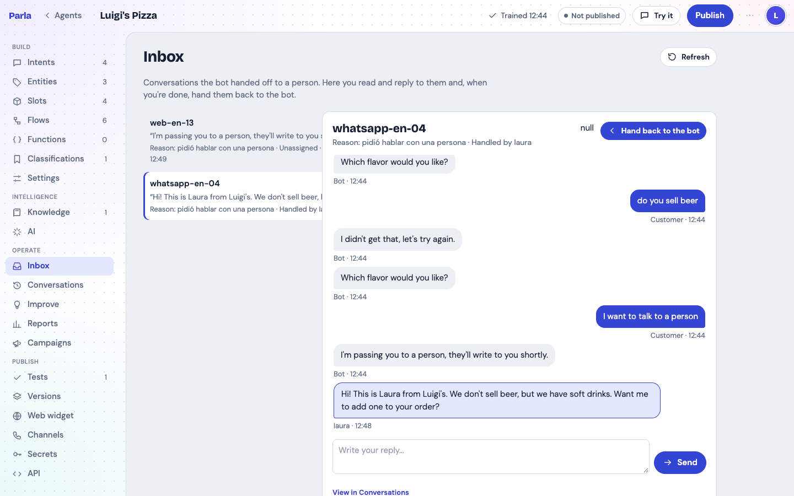
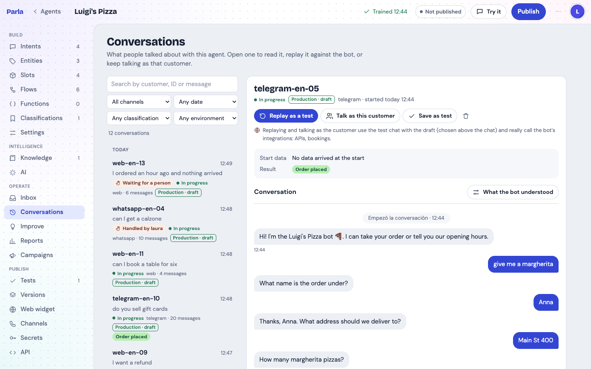

# 7. Inbox and conversations

**English** · [Español](07-inbox-and-conversations_es.md)

This chapter is for the people who talk to customers when the bot can't, and for anyone who reads conversations.
If your role is **Support**, the **Inbox** is your screen: it's where you read and answer the conversations the
bot hands over.

## When does a conversation reach the Inbox?

A conversation lands in the Inbox when:

- a flow reaches the **Hand off to a person** step (for example, "I want to file a complaint"), or
- the customer asks to talk to someone ("I want to talk to a person") and the **Talk to a person** system flow is on.

From that moment **the bot stops answering that conversation** until someone hands it back. The customer is told
something like *I'm handing you over to a person, they'll write to you shortly.*

## The Inbox

Open your agent and click **Inbox** (under **Operate**).

On the left, the conversations waiting for a person. Each one shows:

- the conversation's ID (for example *whatsapp-en-04*: the channel and a number);
- the last thing the bot said;
- **Reason**: why it was handed off (the reason written in the flow, or a standard one when the customer asked for a person);
- **Unassigned** or **Handled by** and the person's name;
- the time.

Click one to open it on the right, with the **whole history**: what the customer wrote, what the bot answered, and
any message from your team. Read it before writing, so the customer doesn't have to repeat themselves.

The list refreshes on its own every few seconds; **Refresh** forces it.

### Taking, replying and handing back

1. **Take conversation**: tells your teammates you're handling it. It changes to **Handled by** and your name.
2. Write in **Write your reply…** and click **Send**. The customer receives it in the same channel they're using
   (website, WhatsApp, Telegram).
3. When you're done, click **Hand back to the bot**. The conversation leaves the Inbox and the bot answers again
   from the next message.

**View in Conversations** opens the same conversation in the full viewer.

Photos, voice notes (with a player; the transcript is the message), files and locations the customer sends show up
in the conversation. On **WhatsApp after 24 hours** without a message from the customer, the reply box becomes a
**template picker**: choose an approved template, check the values (prefilled from the conversation's data) and
click **Send template**. When the customer replies, you can write normally again.

> Don't forget to hand it back. While a conversation is in the Inbox, the bot stays silent in it, even if the
> customer comes back tomorrow with a simple question.

### Phone calls

If the conversation is a **phone call**, there's no box to write in. When you click **Take conversation**, Parla
transfers the call to the number set in **Channels → Phone → Transfer to a person** as soon as the caller stops
talking. Make sure someone answers that number.

### What the customer sees

On the website chat, your messages appear with a notice that a person is helping them. On WhatsApp and Telegram
they arrive like any other message from the business.

## Good practices for human agents

- **Answer quickly.** The customer was told someone will write. If it will take a while, say so: "I'm checking,
  give me two minutes".
- **Read the history first.** The bot may have collected the name, the order or the problem already.
- **Introduce yourself** with your name. It makes the handoff feel human.
- **One topic, then hand back.** When the issue is solved, ask if there's anything else and hand it back to the
  bot.
- **Never ask for passwords or full card numbers** in the chat.
- **Note what the bot should have handled.** If customers keep asking for a person for the same thing, tell
  whoever builds the bot: it's a missing intent or a knowledge answer.

## The Conversations viewer

**Conversations** shows every conversation people had with this agent, from every channel, including the test
chats (as *Test chat*).

### Finding a conversation

- **Search by customer, ID or message**: type a name, a phone number or a phrase.
- Filters: **All channels** (web, WhatsApp, Telegram, phone, test chat), **Any date** (last 7 or 30 days),
  **Any classification** and **Any environment** (Production, Staging, Draft).

Each item in the list shows its ID, the first thing the customer wrote, whether it's **In progress** or
**Ended**, **Waiting for a person** or **Handled by …**, the channel, the number of messages, which version
answered (*Production · v1*, or *draft* if it was answered with unpublished changes) and its classifications.

### Reading a conversation

On the right you'll see:

- **Start data**: data that arrived when the conversation began, if any.
- **Result**: the classifications it got (for example *Order placed*) and whether it was handed off.
- **Conversation**: the full chat. Click **What the bot understood** to see, under each customer message, which
  intent it understood and how sure it was, which values it saved and in which flow it was.
- **What was saved at the end**: the slots and their values.

### Replay, talk as the customer, save as test

- **Replay as a test**: sends the same customer messages to the current bot (in the Try it panel) and compares:
  **Replied the same.** or **It diverged at the customer's message 3**. Ideal to check that a fix worked on a
  real conversation that went wrong.
- **Talk as this customer**: starts a new conversation in the Try it panel with this customer's start data, so you
  can keep testing from their situation.
- **Save as test**: turns this conversation into a test (see [Tests](05-testing-and-publishing.md#tests)).
- The **trash can** deletes the conversation and all its messages. It can't be undone.

> Replay and Talk as this customer **really call** the bot's integrations (bookings, orders). Be careful with bots
> that create things in your real systems.

To delete old conversations automatically, see [Privacy settings](09-administration.md#privacy-retention-and-personal-data).
