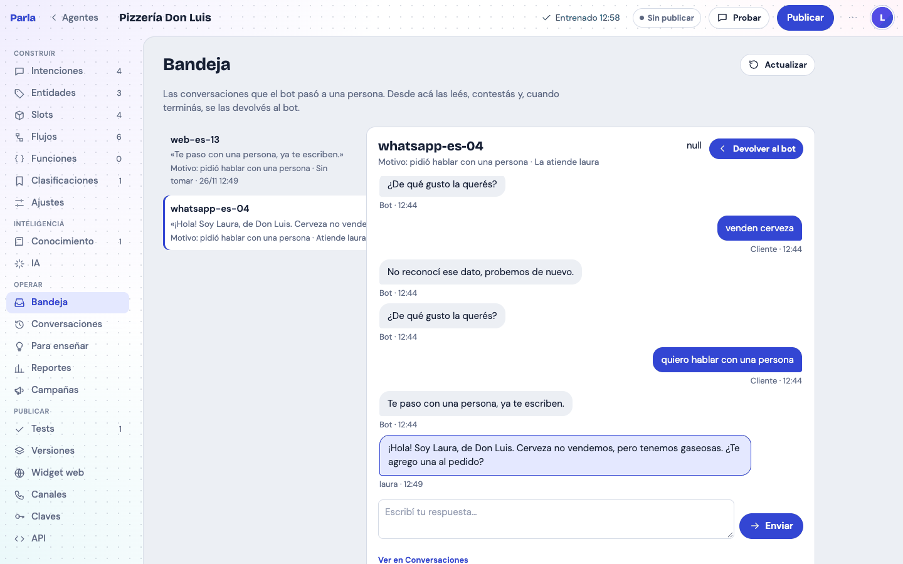
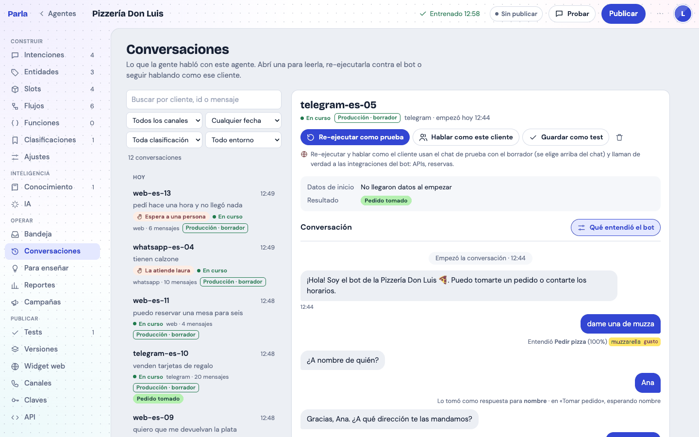

# 7. Bandeja y conversaciones

[English](07-inbox-and-conversations.md) · **Español**

Este capítulo es para las personas que les hablan a los clientes cuando el bot no puede, y para cualquiera que lea
conversaciones. Si tu rol es **Atención**, la **Bandeja** es tu pantalla: ahí leés y contestás las conversaciones
que el bot te pasa.

## ¿Cuándo llega una conversación a la Bandeja?

Una conversación llega a la Bandeja cuando:

- un flujo llega al paso **Pasar a una persona** (por ejemplo, "quiero hacer un reclamo"), o
- el cliente pide hablar con alguien ("quiero hablar con una persona") y el flujo del sistema **Hablar con una
  persona** está activado.

Desde ese momento **el bot deja de responder esa conversación** hasta que alguien se la devuelva. Al cliente se le
dice algo como *Te paso con una persona, ya te escriben.*

## La Bandeja

Abrí tu agente y tocá **Bandeja** (en **Operar**).

A la izquierda, las conversaciones que esperan a una persona. Cada una muestra:

- el identificador de la conversación (por ejemplo *whatsapp-es-04*: el canal y un número);
- lo último que dijo el bot;
- **Motivo**: por qué se pasó (el motivo escrito en el flujo, o uno estándar cuando el cliente pidió una persona);
- **Sin tomar** o **Atiende** y el nombre de la persona;
- la hora.

Tocá una para abrirla a la derecha, con **todo el historial**: lo que escribió el cliente, lo que contestó el bot y
los mensajes de tu equipo. Leelo antes de escribir, así el cliente no tiene que repetir todo.

La lista se actualiza sola cada pocos segundos; **Actualizar** la fuerza.

### Tomar, responder y devolver

1. **Tomar conversación**: les avisa a tus compañeros que la atendés vos. Cambia a **La atiende** y tu nombre.
2. Escribí en **Escribí tu respuesta…** y tocá **Enviar**. Al cliente le llega por el mismo canal que está usando
   (web, WhatsApp, Telegram).
3. Cuando terminás, tocá **Devolver al bot**. La conversación sale de la Bandeja y el bot vuelve a responder desde
   el próximo mensaje.

**Ver en Conversaciones** abre la misma conversación en el visor completo.

Las fotos, notas de voz (con reproductor; la transcripción es el mensaje), archivos y ubicaciones que manda el
cliente aparecen en la conversación. En **WhatsApp después de 24 horas** sin un mensaje del cliente, la caja de
respuesta pasa a ser un **selector de plantilla**: elegí una plantilla aprobada, revisá los valores (completados con
los datos de la conversación) y tocá **Enviar plantilla**. Cuando el cliente contesta, volvés a escribir normal.

> No te olvides de devolverla. Mientras una conversación está en la Bandeja, el bot no habla en ella, aunque el
> cliente vuelva mañana con una pregunta simple.

### Llamadas telefónicas

Si la conversación es una **llamada**, no hay caja para escribir. Cuando tocás **Tomar conversación**, Parla
transfiere la llamada al número cargado en **Canales → Teléfono → Transferir a una persona** apenas la persona deja
de hablar. Asegurate de que alguien atienda ese número.

### Qué ve el cliente

En el chat de la web, tus mensajes aparecen con un aviso de que lo atiende una persona. En WhatsApp y Telegram le
llegan como cualquier otro mensaje del negocio.

## Buenas prácticas para quienes atienden

- **Respondé rápido.** Al cliente le dijeron que alguien le escribe. Si vas a tardar, decíselo: "Lo estoy
  revisando, dame dos minutos".
- **Leé el historial primero.** Puede que el bot ya haya pedido el nombre, el pedido o el problema.
- **Presentate** con tu nombre. Hace que el paso se sienta humano.
- **Un tema y devolvé.** Cuando el problema está resuelto, preguntá si necesita algo más y devolvéselo al bot.
- **Nunca pidas contraseñas ni números de tarjeta completos** por el chat.
- **Anotá lo que el bot debería haber resuelto.** Si los clientes piden una persona siempre por lo mismo, avisale a
  quien arma el bot: falta una intención o una respuesta en Conocimiento.

## El visor de Conversaciones

**Conversaciones** muestra todas las charlas que la gente tuvo con este agente, de todos los canales, incluidos los
chats de prueba (como *Chat de prueba*).

### Encontrar una conversación

- **Buscar por cliente, id o mensaje**: escribí un nombre, un teléfono o una frase.
- Filtros: **Todos los canales** (web, WhatsApp, Telegram, teléfono, chat de prueba), **Cualquier fecha** (últimos 7
  o 30 días), **Toda clasificación** y **Todo entorno** (Producción, Pruebas, Borrador).

Cada elemento de la lista muestra su identificador, lo primero que escribió el cliente, si está **En curso** o
**Terminada**, **Espera a una persona** o **La atiende …**, el canal, la cantidad de mensajes, qué versión respondió
(*Producción · v1*, o *borrador* si respondió con cambios sin publicar) y sus clasificaciones.

### Leer una conversación

A la derecha vas a ver:

- **Datos de inicio**: los datos que llegaron al empezar la conversación, si hubo.
- **Resultado**: las clasificaciones que tuvo (por ejemplo *Pedido tomado*) y si pasó a una persona.
- **Conversación**: la charla completa. Tocá **Qué entendió el bot** para ver, debajo de cada mensaje del cliente,
  qué intención entendió y con qué seguridad, qué datos guardó y en qué flujo estaba.
- **Qué quedó anotado al final**: los slots y sus valores.

### Re-ejecutar, hablar como el cliente, guardar como test

- **Re-ejecutar como prueba**: manda los mismos mensajes del cliente al bot actual (en el panel Probar) y compara:
  **Respondió igual.** o **Se separó en el mensaje 3 del cliente.** Ideal para comprobar que un arreglo funciona con
  una conversación real que salió mal.
- **Hablar como este cliente**: empieza una charla nueva en el panel Probar con los datos de inicio de este cliente,
  para seguir probando desde su situación.
- **Guardar como test**: convierte esta conversación en un test (ver [Tests](05-testing-and-publishing_es.md#tests)).
- El **tachito** borra la conversación con todos sus mensajes. No se puede deshacer.

> Re-ejecutar y Hablar como este cliente **llaman de verdad** a las integraciones del bot (reservas, pedidos).
> Cuidado con los bots que crean cosas en tus sistemas reales.

Para borrar conversaciones viejas automáticamente, mirá
[Privacidad](09-administration_es.md#privacidad-cuánto-se-guarda-y-datos-personales).
