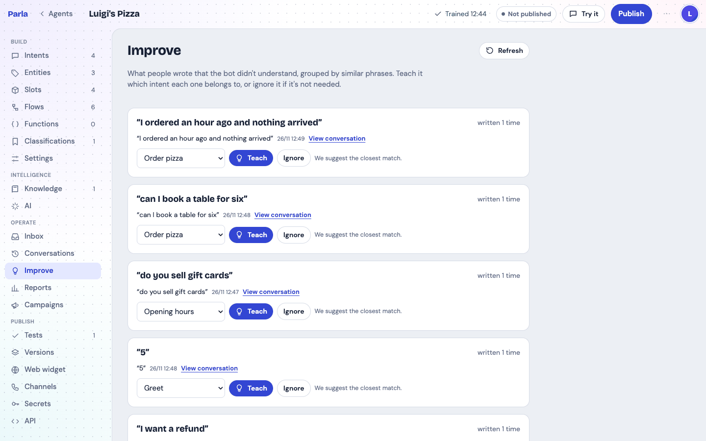
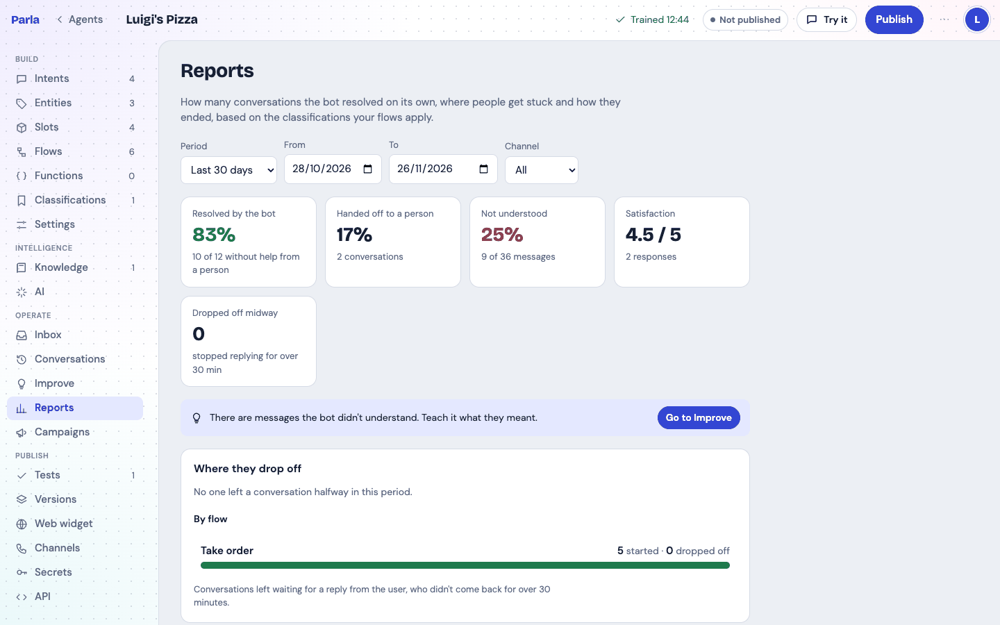
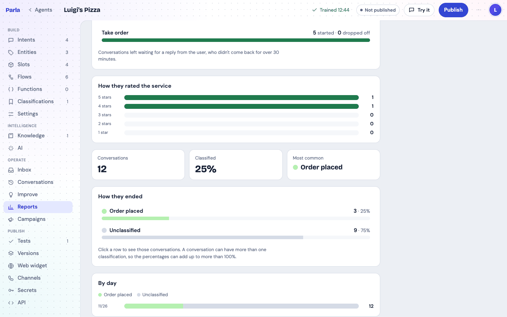

# 8. Improving the bot and reading reports

**English** · [Español](08-improving-and-reports_es.md)

A bot gets good by learning from real conversations. Two screens under **Operate** help you do that:

- **Improve**: what customers wrote that the bot didn't understand, ready to teach.
- **Reports**: how many conversations the bot resolved, where people get stuck and how they rate it.

At the end there's a [weekly routine](#a-weekly-improvement-routine) that takes about 30 minutes.

## Improve: teaching what it missed

Open **Improve**. You'll see what people wrote that the bot didn't understand, **grouped by similar phrases**, with
the most frequent first.

Each group shows:

- the message (and how many times it was written: **written 3 times**);
- the individual messages, with date and time, and **View conversation** to read the context;
- an intent picker with Parla's suggestion (**We suggest the closest match.**);
- **Teach** and **Ignore**.

For each group, decide:

| The message is… | What to do |
|---|---|
| A new way of asking for something the bot already handles | Choose the right intent and click **Teach**. |
| A topic the bot doesn't cover yet, but should | Don't force it into the closest intent. Create a new intent (and its flow) or add the answer to [Knowledge](04-knowledge-and-ai.md). |
| Noise, a joke, a stray "5", something you don't want to handle | **Ignore**. It won't show up again. |

> Don't accept the suggestion blindly. In the screenshot, Parla suggests *Order pizza* for "I ordered an hour ago
> and nothing arrived", but that customer wants to know **where their order is**: that's a new intent, not an order.

After teaching, you'll see **Done: you added 1 example phrase to "…". Train the bot again so it learns it.** Click
**Train now** when you've finished the batch (one training for all of them is enough).

**Analysts** can see this screen, but they can't change the bot: even if the buttons respond, nothing they teach or
ignore is saved. If you're an Analyst, pass the list to an Editor or Owner.

## Reports

Open **Reports**. At the top, choose the **Period** (**Last 7 days**, **Last 30 days**, **All time** or
**Choose dates** with **From** and **To**) and the **Channel**.

### The five numbers

- **Resolved by the bot**: conversations that finished without help from a person ("10 of 12 without help from a
  person"). Higher is better, but it's not the only goal: a bot that never hands off may be leaving customers stuck.
- **Handed off to a person**: conversations that went to the Inbox. Look at the reasons in the Inbox and in
  Conversations: each repeated reason is something the bot could learn.
- **Not understood**: the share of customer messages the bot didn't understand (the *fallback rate*). "9 of 36
  messages". As a rough guide, under 10% is good; over 20% means you have homework in **Improve**. When there are
  such messages, a banner offers **Go to Improve**.
- **Satisfaction**: the average rating (out of 5) from the closing survey, and how many people answered. To get
  this number, turn on the **Closing survey** system flow (see [System flows](03-flows.md#system-flows)).
- **Dropped off midway**: conversations where the bot asked something and the customer didn't reply for over 30
  minutes.

### Where they drop off

**By flow**: for each flow, how many conversations **started** it and how many **dropped off**, and at which
question. If many people leave at the same question, it may be confusing, too long, or asking for something people
don't have at hand. Rewrite it, add buttons, or make it optional.

### How they rated the service

The distribution of ratings, from 5 stars to 1. A few 1s among many 5s is normal; a growing number of 1s and 2s
deserves reading those conversations (filter them in **Conversations**).

### How they ended

This part uses the **classifications** your flows apply (see
[Classify the conversation](03-flows.md#classify-the-conversation)): **Conversations**, how many are **Classified**,
the **Most common** ending, and the list under **How they ended** (for example *Order placed 3 · 10%*,
*Unclassified 26 · 90%*). Click a row to see those conversations. A conversation can have more than one
classification, so the percentages can add up to more than 100%. **By day** shows the trend.

If most conversations are **Unclassified**, add **Classify the conversation** steps at the key points of your flows:
that's how you'll know what the bot achieves.

## A weekly improvement routine

Block 30 minutes a week (Monday morning works well):

1. **Reports, last 7 days.** Write down the five numbers. Are they better or worse than last week?
2. **Improve.** Go through the groups from top to bottom: teach, create what's missing, ignore the noise.
   Click **Train now** at the end.
3. **Handoffs.** In **Conversations**, filter the ones that went to a person and read the reasons. If one repeats,
   that's next week's new intent, flow or knowledge answer.
4. **Drop-offs.** Look at **Where they drop off** and fix the question that loses the most people.
5. **Low ratings.** Read two or three conversations rated 1 or 2. What went wrong?
6. **Test and publish.** **Run all** tests, save as tests the conversations you fixed, and publish (see
   [chapter 5](05-testing-and-publishing.md#a-safe-routine)).

Small weekly changes beat a big redesign every six months.
