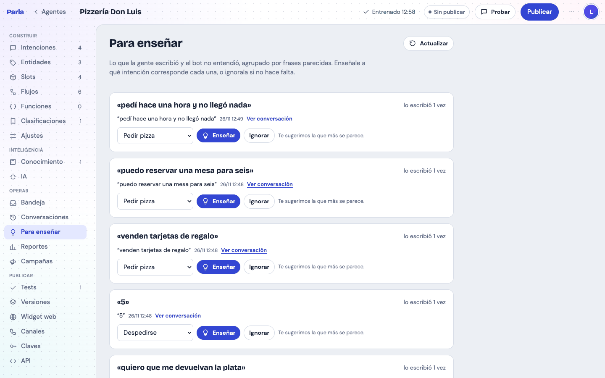
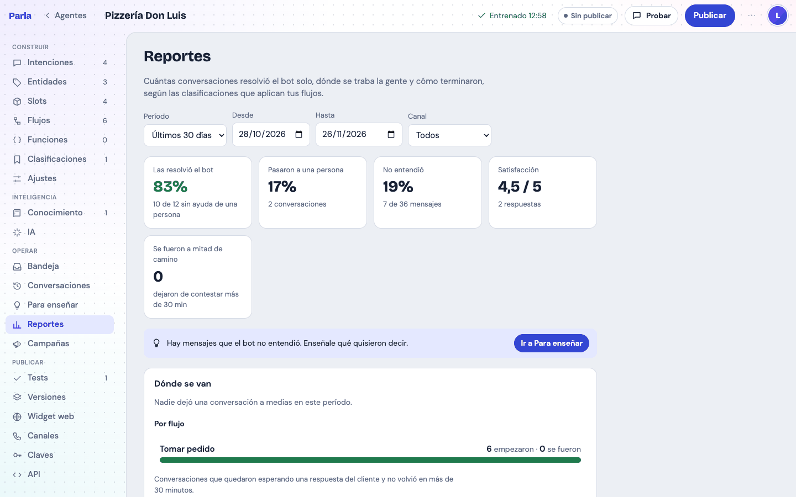
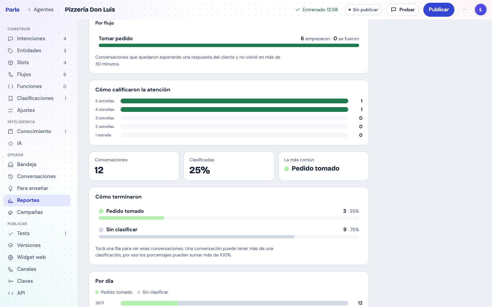

# 8. Mejorar el bot y leer los reportes

[English](08-improving-and-reports.md) · **Español**

Un bot se vuelve bueno aprendiendo de conversaciones reales. Dos pantallas de **Operar** te ayudan:

- **Para enseñar**: lo que escribieron los clientes y el bot no entendió, listo para enseñárselo.
- **Reportes**: cuántas conversaciones resolvió el bot, dónde se traba la gente y cómo lo califican.

Al final hay una [rutina semanal](#una-rutina-semanal-de-mejora) de unos 30 minutos.

## Para enseñar: lo que el bot no entendió

Abrí **Para enseñar**. Vas a ver lo que la gente escribió y el bot no entendió, **agrupado por frases parecidas**,
con lo más frecuente primero.

Cada grupo muestra:

- el mensaje (y cuántas veces lo escribieron: **lo escribió 3 veces**);
- los mensajes uno por uno, con fecha y hora, y **Ver conversación** para leer el contexto;
- un selector de intención con la sugerencia de Parla (**Te sugerimos la que más se parece.**);
- **Enseñar** e **Ignorar**.

Para cada grupo, decidí:

| El mensaje es… | Qué hacer |
|---|---|
| Una forma nueva de pedir algo que el bot ya resuelve | Elegí la intención correcta y tocá **Enseñar**. |
| Un tema que el bot todavía no cubre, pero debería | No lo fuerces en la intención más parecida. Creá una intención nueva (y su flujo) o sumá la respuesta en [Conocimiento](04-knowledge-and-ai_es.md). |
| Ruido, un chiste, un "5" suelto, algo que no querés atender | **Ignorar**. No vuelve a aparecer. |

> No aceptes la sugerencia sin pensar. En la captura, Parla sugiere *Pedir pizza* para «pedí hace una hora y no
> llegó nada», pero ese cliente quiere saber **dónde está su pedido**: es una intención nueva, no un pedido.

Después de enseñar vas a ver **Listo: sumaste 1 frase a «…». Para que el bot lo aprenda hay que entrenarlo de
nuevo.** Tocá **Entrenar ahora** cuando termines la tanda (con un solo entrenamiento para todas alcanza).

Quien tiene rol **Analista** puede ver esta pantalla, pero no puede cambiar el bot: aunque los botones respondan,
nada de lo que enseñe o ignore se guarda. Si sos Analista, pasale la lista a alguien con rol Editor o Dueño.

## Reportes

Abrí **Reportes**. Arriba elegí el **Período** (**Últimos 7 días**, **Últimos 30 días**, **Todo** o **Elegir
fechas** con **Desde** y **Hasta**) y el **Canal**.

### Los cinco números

- **Las resolvió el bot**: conversaciones que terminaron sin ayuda de una persona ("10 de 12 sin ayuda de una
  persona"). Cuanto más alto mejor, pero no es el único objetivo: un bot que nunca pasa a una persona puede estar
  dejando clientes trabados.
- **Pasaron a una persona**: conversaciones que fueron a la Bandeja. Mirá los motivos en la Bandeja y en
  Conversaciones: cada motivo que se repite es algo que el bot podría aprender.
- **No entendió**: la parte de los mensajes de clientes que el bot no entendió (la *tasa de no entendidos*). "9 de
  36 mensajes". Como referencia, menos del 10% está bien; más del 20% quiere decir que tenés tarea en **Para
  enseñar**. Cuando hay mensajes así, un aviso te ofrece **Ir a Para enseñar**.
- **Satisfacción**: la nota promedio (sobre 5) de la encuesta al final, y cuántas personas contestaron. Para tener
  este número, activá el flujo del sistema **Encuesta al final** (ver [Flujos del sistema](03-flows_es.md#flujos-del-sistema)).
- **Se fueron a mitad de camino**: conversaciones en las que el bot preguntó algo y el cliente no contestó por más
  de 30 minutos.

### Dónde se van

**Por flujo**: para cada flujo, cuántas conversaciones lo **empezaron** y cuántas **se fueron**, y en qué pregunta.
Si mucha gente se va en la misma pregunta, puede ser confusa, demasiado larga o pedir algo que la gente no tiene a
mano. Reescribila, sumale botones o hacela opcional.

### Cómo calificaron la atención

La distribución de las notas, de 5 estrellas a 1. Algunos 1 entre muchos 5 es normal; si crecen los 1 y los 2,
conviene leer esas conversaciones (filtralas en **Conversaciones**).

### Cómo terminaron

Esta parte usa las **clasificaciones** que aplican tus flujos (ver
[Clasificar la conversación](03-flows_es.md#clasificar-la-conversación)): **Conversaciones**, cuántas están
**Clasificadas**, **La más común** y la lista de **Cómo terminaron** (por ejemplo *Pedido tomado 3 · 10%*, *Sin
clasificar 26 · 90%*). Tocá una fila para ver esas conversaciones. Una conversación puede tener más de una
clasificación, por eso los porcentajes pueden sumar más de 100%. **Por día** muestra la tendencia.

Si la mayoría queda **Sin clasificar**, sumá pasos **Clasificar la conversación** en los puntos clave de tus flujos:
así vas a saber qué logra el bot.

## Una rutina semanal de mejora

Reservá 30 minutos por semana (el lunes a la mañana va bien):

1. **Reportes, últimos 7 días.** Anotá los cinco números. ¿Están mejor o peor que la semana pasada?
2. **Para enseñar.** Recorré los grupos de arriba hacia abajo: enseñá, creá lo que falta, ignorá el ruido. Al final
   tocá **Entrenar ahora**.
3. **Pases a una persona.** En **Conversaciones**, filtrá las que fueron a una persona y leé los motivos. Si uno se
   repite, esa es la intención, el flujo o la respuesta de Conocimiento de la semana que viene.
4. **Abandonos.** Mirá **Dónde se van** y arreglá la pregunta que más gente pierde.
5. **Notas bajas.** Leé dos o tres conversaciones con 1 o 2. ¿Qué salió mal?
6. **Probar y publicar.** Tocá **Correr todos** en Tests, guardá como test las conversaciones que arreglaste y
   publicá (ver [capítulo 5](05-testing-and-publishing_es.md#una-rutina-segura)).

Cambios chicos cada semana le ganan a un rediseño enorme cada seis meses.
