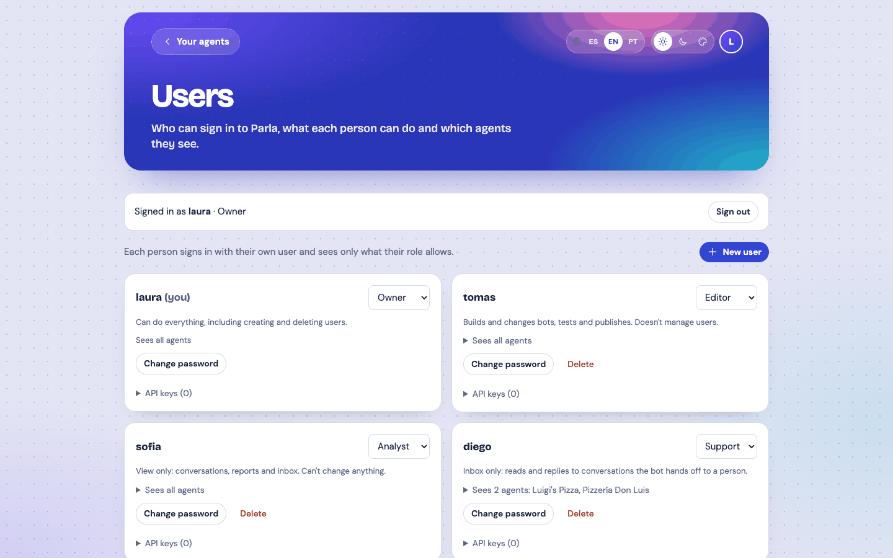
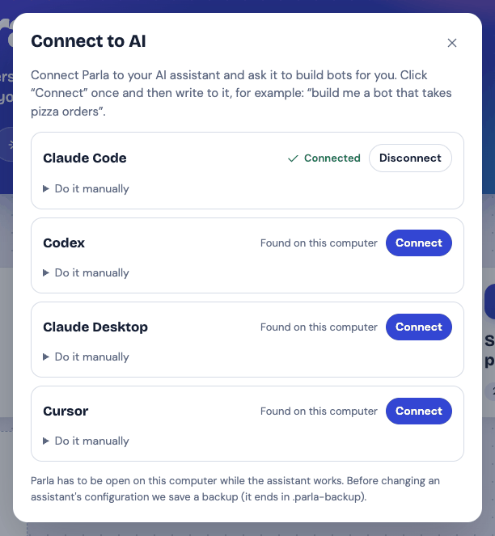
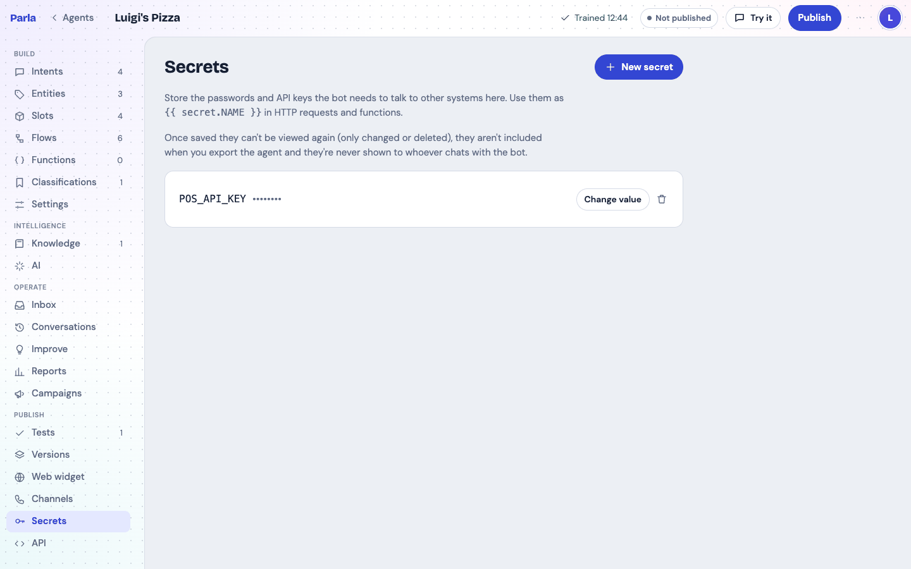
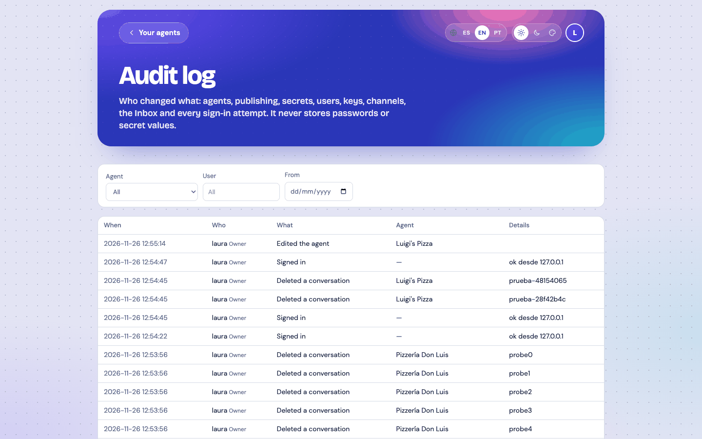
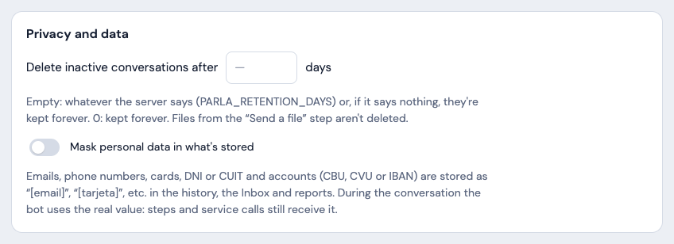

# 9. Administration

**English** · [Español](09-administration_es.md)

This chapter is for whoever manages Parla: who can sign in and what they can do, where passwords for other systems
are kept, who changed what, and how long conversations are stored. Most of it requires the **Owner** role.

## Users and roles

### The first user

A brand new Parla has no users: anyone who opens it on that computer can do everything. As soon as more than one
person uses it, create users:

1. On the home screen, click **Users** at the top right.
2. Type **Your username** and a password twice (5 characters or more).
3. Click **Create owner user**.

From then on, everyone has to sign in. The first user is the **Owner**: they can do everything and create the rest.

### The four roles

| Role | What they can do | Typical person |
|---|---|---|
| **Owner** | Everything, including creating and deleting users and API keys. Always sees every agent. | The person responsible for Parla. Have at least two, in case one is away. |
| **Editor** | Builds and changes bots, tests and publishes. Doesn't manage users. | Whoever designs the bots. |
| **Analyst** | View only: conversations, reports and inbox. Can't change anything. | Managers, quality, data. |
| **Support** | Reads and replies to the conversations the bot hands off to a person, in the Inbox. | Customer service agents. |

Each person only sees the menu sections their role allows.

### Managing users

Click your avatar (the circle with your initial, top right) and choose **Manage users**.

- **New user**: type the **Name**, choose **What can they do?** (the role), **Which agents do they see?** and a
  password (twice), then **Create user**. Give them the password in person or by a safe channel; they can't change it
  themselves.
- **Change the role**: use the selector on the user's card.
- **Which agents they see**: open **Sees all agents** (or **Sees 2 agents…**) on the card and choose **All**
  (including agents created later) or **Only these** and tick them. Click **Save**. The rest of the agents don't even
  appear in their list.
- **Change password**: type a new one twice and **Save password**. Let the person know.
- **Delete**: removes the user and their API keys. It can't be undone. The last owner can't be deleted.

People who aren't owners see **My user** in the avatar menu: their role and a reminder to ask the owner for changes.

### Signing in with your company account (SSO)

If your company set up single sign-on, the sign-in screen shows a **Sign in with …** button (Google, Microsoft,
Okta, Keycloak…).

- Click it and sign in with your usual company account. You don't need a Parla password.
- The first time, Parla creates your user. Your role comes from your company groups or is assigned by the Parla
  owner, depending on how IT set it up. When it comes from the groups, the users screen shows
  **managed by your identity provider** and it can't be changed in Parla.
- If you see *Your identity provider let you in, but you don't have a role in Parla. Ask whoever manages it for
  access.*, ask your administrator to add you to the right group.
- If you see *Signing in took too long or started in another tab. Try again.*, just try again in a single tab.
- **Sign out** (in the avatar menu) also signs you out of the company provider.

Users who sign in this way have an **SSO** badge in the users screen. Setting SSO up is technical: see
[sso.md](../sso.md).

## API keys

An API key lets a **program** sign in to Parla as a user, with that user's permissions: your developers' systems
using the [API](../api.md), or an AI assistant connected over MCP.

1. In **Manage users**, open **API keys** on the user's card.
2. Type what it's for (*MCP on my computer*, *Website backend*) and click **Create key**.
3. **Copy it now: it won't be shown again.** Give it to whoever needs it, by a safe channel.

To cut access, click the trash can next to the key (**Revoke the key**). Whatever used it stops working at once.

Good habits: one key per program, a clear label, and create it on a user with the minimum role needed (an Analyst if
the program only reads).

## Connect to AI

**Connect to AI** (on the home screen, or in **More options** inside an agent) connects Parla with an AI assistant
installed on your computer (Claude Code, Codex, Claude Desktop, Cursor), so you can ask it to build or change bots
in plain language: *"build me a bot that takes pizza orders"*.

1. Click **Connect** next to your assistant (**Connected** means it's done). **Do it manually** shows the setup for
   other cases.
2. Open the assistant and ask for what you need.

Parla has to be open on that computer while the assistant works. Before changing an assistant's configuration,
Parla saves a backup copy. Use it when you want to move fast; then review the result in Parla, try it and publish as
usual. **Disconnect** undoes it.

## Secrets

**Secrets** (under **Publish**) stores the passwords and API keys the bot needs to talk to other systems: your
ordering system, a calendar, an AI provider, WhatsApp.

- **New secret**: a **Name** (capital letters, numbers and _, like *POS_API_KEY*) and its **Value**. **Save**.
- Once saved, **it can't be viewed again**, only changed (**Change value**) or deleted (trash can).
- Secrets **aren't included when you export the agent** and are **never shown** to whoever chats with the bot.
- Technical people use them in services and functions as *{{ secret.NAME }}*. If you delete one, whatever uses it
  stops working until you set it again.

The AI and Channels screens save their keys here for you.

## Audit log

Owners can see who changed what. Click your avatar and choose **Audit log**.

It records agents created, imported, edited, trained, published and deleted; versions moved between environments;
secrets saved and deleted (never their values); files; channel changes; Inbox activity (who took, replied to or handed
back a conversation); users and keys; and every sign-in attempt. Filter by **Agent**, **User** and **From** (date).

Use it to answer "who published this change on Friday?" or "who saw this conversation?". It never stores passwords
or secret values.

## Privacy: retention and personal data

Each agent has its own privacy settings in **Settings → Privacy and data**.

- **Delete inactive conversations after … days**: conversations with no activity for that many days are deleted.
  Empty means whatever the server says (your IT team may set a default) or forever; 0 means keep them forever. Files
  sent with the **Send a file** step aren't deleted.
- **Mask personal data in what's stored**: emails, phone numbers, cards, ID numbers (DNI, CUIT) and bank accounts
  (CBU, CVU, IBAN) are stored masked (*[email]*, *[tarjeta]*…) in the history, the Inbox and the reports. During the
  conversation the bot still uses the real value, so steps and services work as usual. What was stored before turning
  it on is masked when that conversation is saved again.

Also remember the [AI provider decision](04-knowledge-and-ai.md#local-or-a-provider-the-privacy-decision): with a
local model, conversations never leave your server.

## Moving and deleting agents

In **Settings**, under **Take it elsewhere**, **Export agent** downloads the whole bot (intents, entities, slots,
flows and settings) as a file. To use it on another Parla, click **Import agent** on the home screen; it's created as
a new agent and trains when opened. Secrets aren't exported: set them again there.

**Delete this agent**, at the bottom of **Settings**, deletes it with its versions, conversations and files. It can't
be undone; export it first if in doubt.
