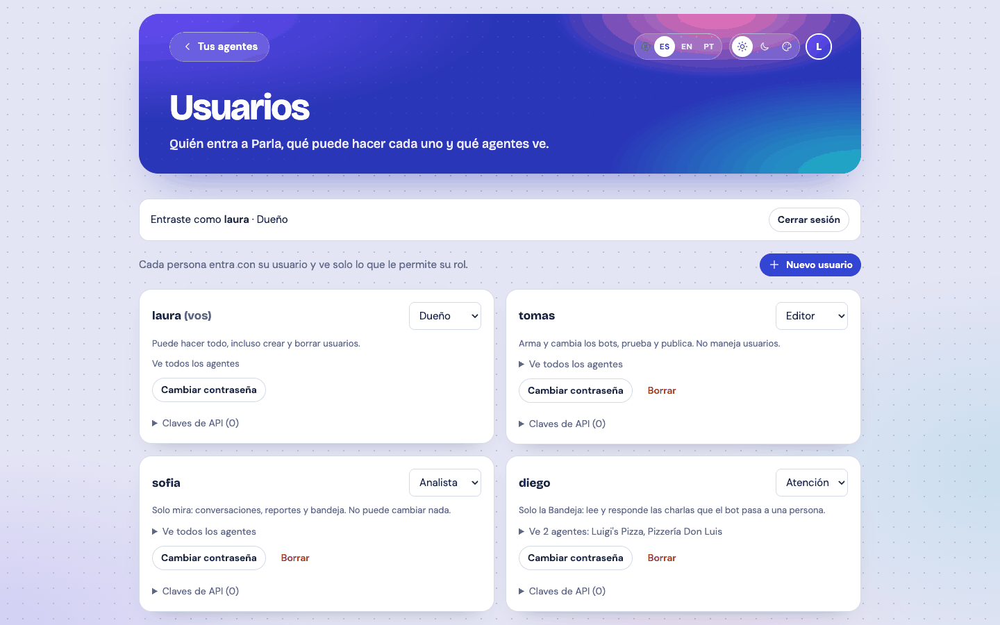
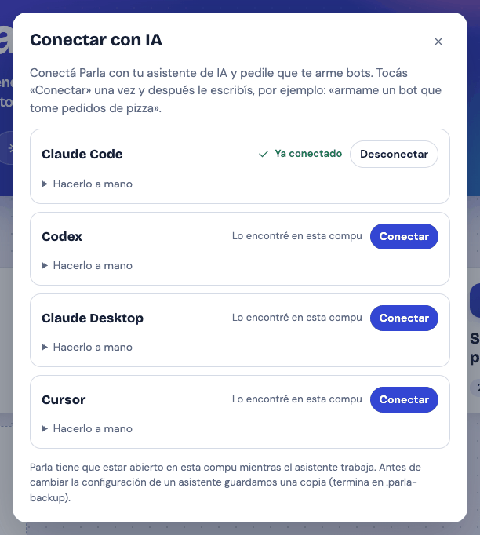
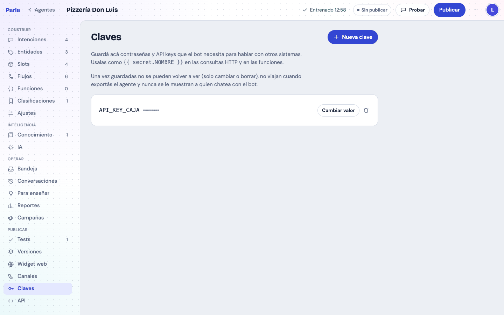
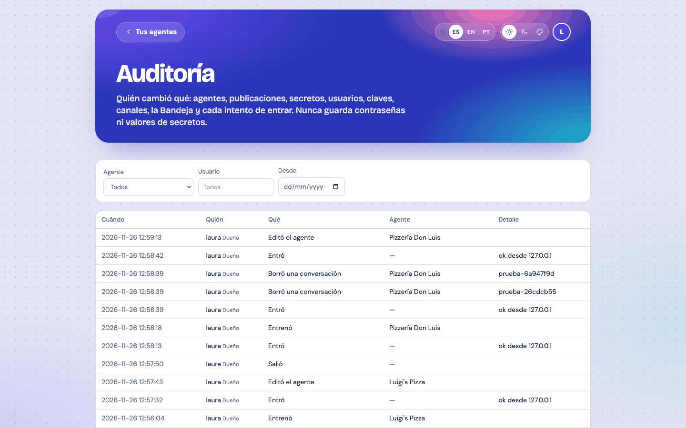
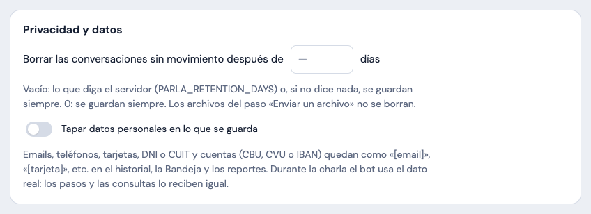

# 9. Administración

[English](09-administration.md) · **Español**

Este capítulo es para quien administra Parla: quién puede entrar y qué puede hacer, dónde se guardan las
contraseñas de otros sistemas, quién cambió qué y cuánto tiempo se guardan las conversaciones. Casi todo requiere el
rol **Dueño**.

## Usuarios y roles

### El primer usuario

Un Parla recién instalado no tiene usuarios: cualquiera que lo abra en esa compu puede hacer todo. Apenas lo use más
de una persona, creá usuarios:

1. En la pantalla de inicio, tocá **Usuarios** arriba a la derecha.
2. Escribí **Tu nombre de usuario** y una contraseña dos veces (5 caracteres o más).
3. Tocá **Crear usuario dueño**.

Desde ese momento, todos tienen que iniciar sesión. El primer usuario es el **Dueño**: puede hacer todo y crea al
resto.

### Los cuatro roles

| Rol | Qué puede hacer | Persona típica |
|---|---|---|
| **Dueño** | Todo, incluso crear y borrar usuarios y claves de API. Siempre ve todos los agentes. | La persona responsable de Parla. Conviene tener al menos dos, por si uno no está. |
| **Editor** | Arma y cambia los bots, prueba y publica. No maneja usuarios. | Quien diseña los bots. |
| **Analista** | Solo mira: conversaciones, reportes y bandeja. No puede cambiar nada. | Gerencia, calidad, datos. |
| **Atención** | Lee y responde, en la Bandeja, las charlas que el bot pasa a una persona. | Agentes de atención al cliente. |

Cada persona ve solo las secciones del menú que permite su rol.

### Administrar usuarios

Tocá tu avatar (el círculo con tu inicial, arriba a la derecha) y elegí **Administrar usuarios**.

- **Nuevo usuario**: escribí el **Nombre**, elegí **¿Qué puede hacer?** (el rol), **¿Qué agentes ve?** y una
  contraseña (dos veces), y tocá **Crear usuario**. Pasale la contraseña en persona o por un canal seguro; no la
  puede cambiar por su cuenta.
- **Cambiar el rol**: usá el selector de la tarjeta del usuario.
- **Qué agentes ve**: abrí **Ve todos los agentes** (o **Ve 2 agentes…**) en la tarjeta y elegí **Todos**
  (incluidos los que se creen más adelante) o **Solo estos** y marcalos. Tocá **Guardar**. Los demás agentes ni le
  aparecen en la lista.
- **Cambiar contraseña**: escribí una nueva dos veces y tocá **Guardar contraseña**. Avisale a la persona.
- **Borrar**: borra el usuario y sus claves de API. No se puede deshacer. El último dueño no se puede borrar.

Quien no es dueño ve **Mi usuario** en el menú del avatar: su rol y un recordatorio de que los cambios se los pide
al dueño.

### Entrar con la cuenta de tu empresa (SSO)

Si tu empresa configuró el inicio de sesión único, la pantalla de entrada muestra un botón **Entrar con …** (Google,
Microsoft, Okta, Keycloak…).

- Tocalo y entrá con tu cuenta de siempre de la empresa. No necesitás contraseña de Parla.
- La primera vez, Parla crea tu usuario. Tu rol viene de los grupos de tu empresa o lo asigna el dueño de Parla,
  según cómo lo haya configurado Sistemas. Cuando viene de los grupos, la pantalla de usuarios muestra **lo maneja
  tu proveedor de identidad** y no se puede cambiar en Parla.
- Si ves *Tu proveedor de identidad te dejó entrar, pero no tenés un rol en Parla. Pedile acceso a quien lo
  administra.*, pedile a tu administrador que te sume al grupo correcto.
- Si ves *El inicio de sesión tardó demasiado o empezó en otra pestaña. Probá de nuevo.*, probá otra vez en una sola
  pestaña.
- **Cerrar sesión** (en el menú del avatar) también te saca del proveedor de la empresa.

Los usuarios que entran así tienen la marca **SSO** en la pantalla de usuarios. La configuración del SSO es técnica:
mirá [sso_es.md](../sso_es.md).

## Claves de API

Una clave de API deja que un **programa** entre a Parla como un usuario, con sus mismos permisos: los sistemas de tus
desarrolladores que usan la [API](../api_es.md), o un asistente de IA conectado por MCP.

1. En **Administrar usuarios**, abrí **Claves de API** en la tarjeta del usuario.
2. Escribí para qué es (*MCP de mi compu*, *Backend de la web*) y tocá **Crear clave**.
3. **Copiala ahora: no se vuelve a mostrar.** Pasásela a quien la necesite por un canal seguro.

Para cortar el acceso, tocá el tachito al lado de la clave (**Revocar la clave**). Lo que la usaba deja de andar en
el momento.

Buenas costumbres: una clave por programa, un nombre claro, y creala en un usuario con el rol mínimo necesario (un
Analista si el programa solo lee).

## Conectar con IA

**Conectar con IA** (en la pantalla de inicio, o en **Más opciones** dentro de un agente) conecta Parla con un
asistente de IA instalado en tu compu (Claude Code, Codex, Claude Desktop, Cursor), para que le pidas que arme o
cambie bots en lenguaje común: *"armame un bot que tome pedidos de pizza"*.

1. Tocá **Conectar** al lado de tu asistente (**Ya conectado** quiere decir que está listo). **Hacerlo a mano**
   muestra la configuración para otros casos.
2. Abrí el asistente y pedile lo que necesites.

Parla tiene que estar abierto en esa compu mientras el asistente trabaja. Antes de cambiar la configuración de un
asistente, Parla guarda una copia. Usalo cuando quieras ir rápido; después revisá el resultado en Parla, probalo y
publicalo como siempre. **Desconectar** lo deshace.

## Claves

**Claves** (en **Publicar**) guarda las contraseñas y API keys que el bot necesita para hablar con otros sistemas:
tu sistema de pedidos, una agenda, un proveedor de IA, WhatsApp.

- **Nueva clave**: un nombre (**Nombre (mayúsculas, números y _)**, como *API_KEY_CAJA*) y su **Valor**. Tocá
  **Guardar**.
- Una vez guardada, **no se puede volver a ver**, solo cambiar (**Cambiar valor**) o borrar (tachito).
- Las claves **no viajan cuando exportás el agente** y **nunca se le muestran** a quien chatea con el bot.
- Las personas técnicas las usan en consultas y funciones como *{{ secret.NOMBRE }}*. Si borrás una, lo que la usa
  deja de andar hasta que la vuelvas a cargar.

Las pantallas IA y Canales guardan sus claves acá por vos.

## Auditoría

Quien es dueño puede ver quién cambió qué. Tocá tu avatar y elegí **Auditoría**.

Registra agentes creados, importados, editados, entrenados, publicados y borrados; versiones que pasaron de un
entorno a otro; claves guardadas y borradas (nunca sus valores); archivos; cambios en los canales; la actividad de la
Bandeja (quién tomó, respondió o devolvió una charla); usuarios y claves de API; y cada intento de entrar. Filtrá por
**Agente**, **Usuario** y **Desde** (fecha).

Sirve para responder "¿quién publicó este cambio el viernes?" o "¿quién vio esta conversación?". Nunca guarda
contraseñas ni valores de claves.

## Privacidad: cuánto se guarda y datos personales

Cada agente tiene su propia privacidad en **Ajustes → Privacidad y datos**.

- **Borrar las conversaciones sin movimiento después de … días**: las conversaciones sin actividad durante esa
  cantidad de días se borran. Vacío quiere decir lo que diga el servidor (Sistemas puede poner un valor por defecto)
  o para siempre; 0 quiere decir que se guardan siempre. Los archivos del paso **Enviar un archivo** no se borran.
- **Tapar datos personales en lo que se guarda**: emails, teléfonos, tarjetas, DNI o CUIT y cuentas (CBU, CVU o IBAN)
  quedan tapados (*[email]*, *[tarjeta]*…) en el historial, la Bandeja y los reportes. Durante la charla el bot usa el
  dato real, así que los pasos y las consultas funcionan igual. Lo que se guardó antes de prenderlo se tapa cuando
  esa conversación vuelve a guardarse.

Acordate también de la [decisión sobre el proveedor de IA](04-knowledge-and-ai_es.md#local-o-un-proveedor-la-decisión-de-privacidad):
con un modelo local, las conversaciones nunca salen de tu servidor.

## Llevar y borrar agentes

En **Ajustes**, en **Llevarlo a otro lado**, **Exportar agente** descarga el bot completo (intenciones, entidades,
slots, flujos y ajustes) en un archivo. Para usarlo en otro Parla, tocá **Importar agente** en la pantalla de inicio;
se crea como un agente nuevo y se entrena al abrirlo. Las claves no se exportan: cargalas de nuevo allá.

**Borrar este agente**, abajo de todo en **Ajustes**, lo borra con sus versiones, conversaciones y archivos. No se
puede deshacer; si tenés dudas, exportalo antes.
