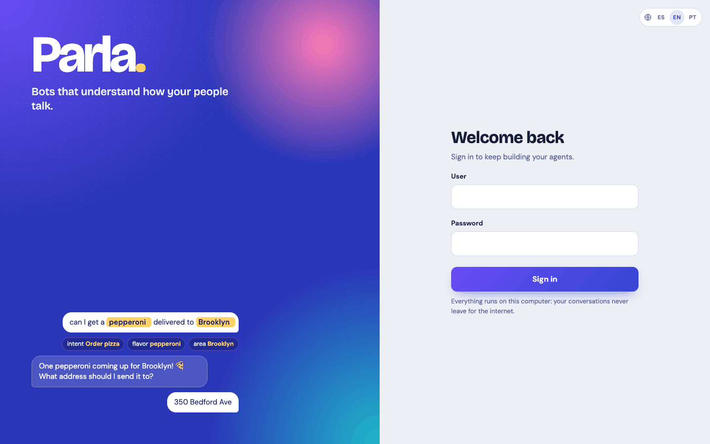
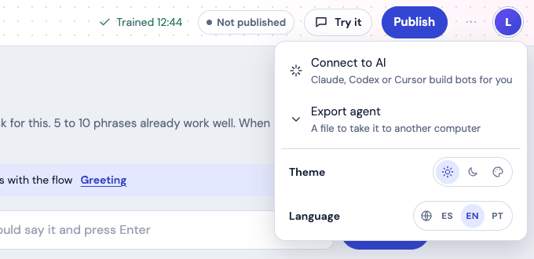
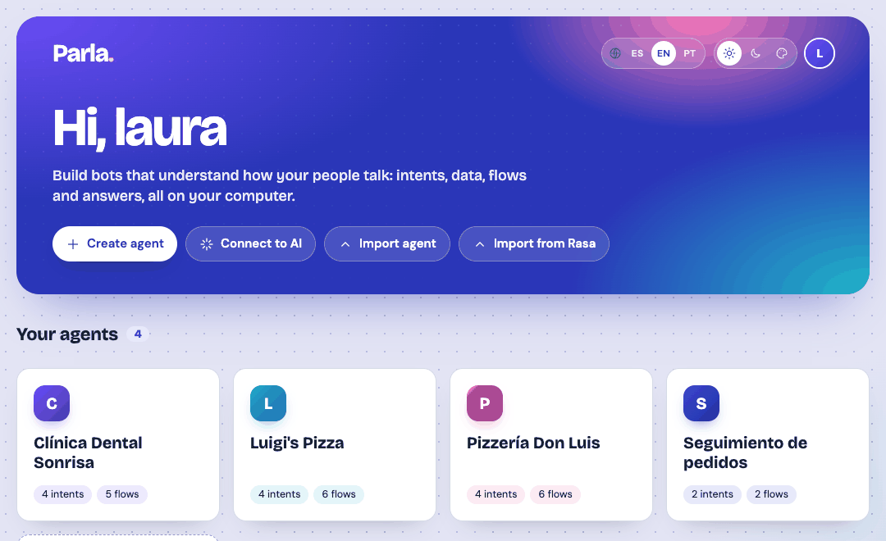

# Parla user manual

**English** · [Español](README_es.md)

This manual is for the people who use Parla every day through its web interface: the ones who build the bots,
the ones who answer customers when the bot hands a conversation over, the ones who read the results and the ones
who manage access. You don't need to know how to program. If you're a developer, the
[technical documentation](../README.md) is the place for you.

## Where to start

Pick what describes you best. Each path lists the chapters in the order we suggest reading them.

| I… | Read |
|---|---|
| **build bots** | [1. Your first bot](01-first-bot.md) → [2. How the bot understands](02-understanding.md) → [3. Flows](03-flows.md) → [4. Knowledge and AI](04-knowledge-and-ai.md) → [5. Testing and publishing](05-testing-and-publishing.md) → [6. Channels](06-channels.md) |
| **answer customers (Inbox)** | [7. Inbox and conversations](07-inbox-and-conversations.md) |
| **read results** | [8. Improving the bot and reports](08-improving-and-reports.md), then [7. Conversations](07-inbox-and-conversations.md#the-conversations-viewer) |
| **administer Parla** | [9. Administration](09-administration.md) and [6. Channels](06-channels.md) |

When something doesn't work, go to [10. Troubleshooting and glossary](10-troubleshooting.md).

## Signing in

Open the address your administrator gave you (on your own computer it's usually `http://127.0.0.1:8000`).

- If Parla asks you to sign in, type your **User** and **Password** and click **Sign in**. If your company uses
  single sign-on, you'll also see a **Sign in with …** button (for example *Sign in with Google*): click it and use
  your company account. See [Signing in with your company account](09-administration.md#signing-in-with-your-company-account-sso).
- If Parla opens straight to the home screen without asking for a password, nobody has created users yet. Anyone who
  opens it on that computer can do everything. See [Users and roles](09-administration.md#users-and-roles) to change that.

## Language and theme

Parla speaks English, Spanish and Portuguese. You choose the language of the **interface** (the menus and buttons);
it has nothing to do with the language your bot speaks to customers.

- On the home screen, use the **ES · EN · PT** buttons at the top right.
- Inside an agent, click **More options** (the **⋯** button next to **Publish**) and use **Language**.

Right next to the language you'll find the **Theme**: light (sun), dark (moon) or colorful (palette).
Your choice is remembered in this browser.

## The home screen

In Parla each bot is called an **agent**. The home screen shows:

- **Create agent**: starts a new, empty bot. You only need to give it a name.
- **Connect to AI**: lets an AI assistant on your computer (Claude, Codex, Cursor) build bots for you.
  See [Connect to AI](09-administration.md#connect-to-ai).
- **Import agent**: opens a bot file that someone exported (a `.parla.json` file).
- **Import from Rasa**: if your company used Rasa before, it brings that project in (as a `.zip`).
- **Your agents**: one card per bot, with how many intents and flows it has. Click a card to open it.
- At the top right: language, theme and your user (the circle with your initial).

## Inside an agent

When you open an agent you see three areas:

1. **The menu on the left**, grouped in four blocks:
   - **Build**: Intents, Entities, Slots, Flows, Functions, Classifications and Settings.
   - **Intelligence**: Knowledge and AI.
   - **Operate**: Inbox, Conversations, Improve, Reports and Campaigns.
   - **Publish**: Tests, Versions, Web widget, Channels, Secrets and API.
2. **The work area** in the middle.
3. **The Try it panel** on the right, a chat to talk to your bot as a customer would. Open or close it with
   **Try it** at the top.

The top bar also shows whether the bot is trained (**Trained 12:44**) or has **Untrained changes**, whether it's
published (**Not published** or **Production: v1**), the **Publish** button and **More options**.

Parla saves every change on its own; you'll see **Saving…** and then **Changes saved**. There's no save button.

> Your role decides what you see. Someone with the **Support** role works in the Inbox; an **Analyst** sees
> conversations and results but can't change the bot. See [Users and roles](09-administration.md#users-and-roles).

## Chapters

1. [Your first bot](01-first-bot.md): a guided tutorial, from zero to published.
2. [How the bot understands](02-understanding.md): intents, example phrases, entities and slots.
3. [Flows](03-flows.md): what the bot says and does, step by step.
4. [Knowledge and AI](04-knowledge-and-ai.md): documents, AI models, voice and privacy.
5. [Testing and publishing](05-testing-and-publishing.md): Try it, Tests, Versions and environments.
6. [Channels](06-channels.md): your website, WhatsApp, Telegram and phone calls.
7. [Inbox and conversations](07-inbox-and-conversations.md): for the people who answer customers.
8. [Improving the bot and reports](08-improving-and-reports.md): teaching it what it missed and reading the numbers.
9. [Administration](09-administration.md): users, roles, secrets, audit log and privacy.
10. [Troubleshooting and glossary](10-troubleshooting.md).
