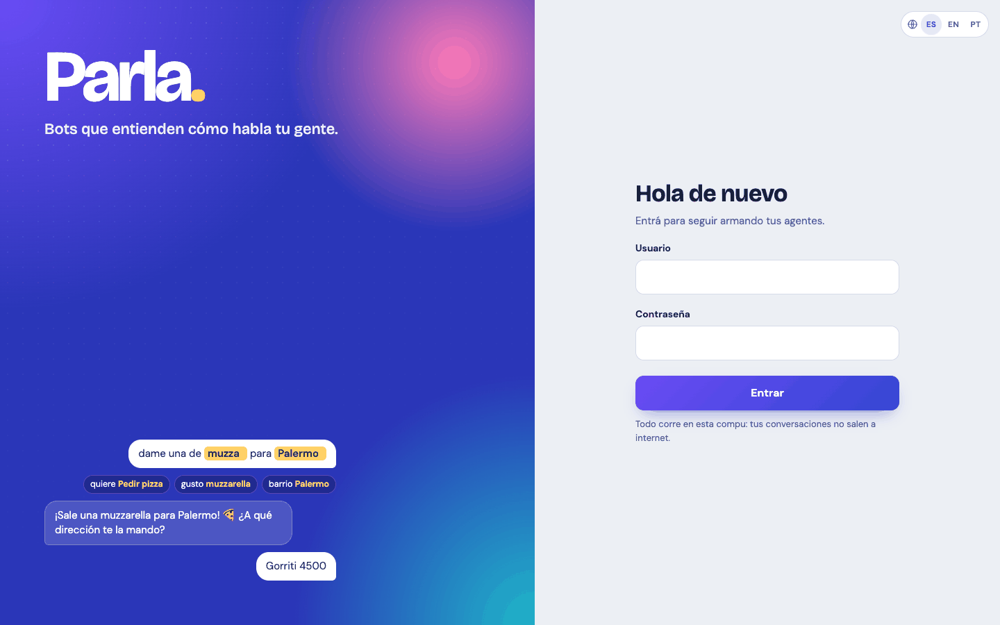
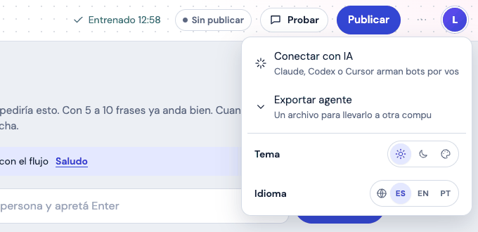
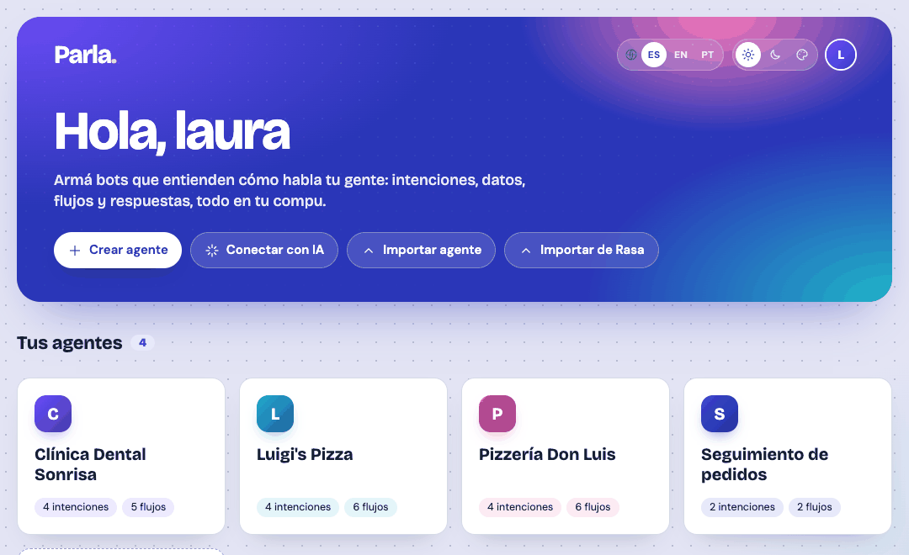

# Manual de uso de Parla

[English](README.md) · **Español**

Este manual es para las personas que usan Parla todos los días desde su interfaz web: las que arman los bots, las
que atienden a los clientes cuando el bot pasa una conversación, las que leen los resultados y las que administran
los accesos. No hace falta saber programar. Si sos desarrollador, lo tuyo está en la
[documentación técnica](../README_es.md).

## Por dónde empezar

Elegí lo que mejor te describe. Cada camino lista los capítulos en el orden en que te sugerimos leerlos.

| Yo… | Leé |
|---|---|
| **armo bots** | [1. Tu primer bot](01-first-bot_es.md) → [2. Cómo entiende el bot](02-understanding_es.md) → [3. Flujos](03-flows_es.md) → [4. Conocimiento e IA](04-knowledge-and-ai_es.md) → [5. Probar y publicar](05-testing-and-publishing_es.md) → [6. Canales](06-channels_es.md) |
| **atiendo clientes (Bandeja)** | [7. Bandeja y conversaciones](07-inbox-and-conversations_es.md) |
| **leo resultados** | [8. Mejorar el bot y reportes](08-improving-and-reports_es.md), y después [7. Conversaciones](07-inbox-and-conversations_es.md#el-visor-de-conversaciones) |
| **administro Parla** | [9. Administración](09-administration_es.md) y [6. Canales](06-channels_es.md) |

Cuando algo no funciona, andá a [10. Problemas frecuentes y glosario](10-troubleshooting_es.md).

## Entrar

Abrí la dirección que te pasó quien administra Parla (en tu propia compu suele ser `http://127.0.0.1:8000`).

- Si Parla te pide entrar, escribí tu **Usuario** y tu **Contraseña** y tocá **Entrar**. Si tu empresa usa inicio
  de sesión único, también vas a ver un botón **Entrar con …** (por ejemplo *Entrar con Google*): tocalo y usá la
  cuenta de tu empresa. Mirá [Entrar con la cuenta de tu empresa](09-administration_es.md#entrar-con-la-cuenta-de-tu-empresa-sso).
- Si Parla abre directo en la pantalla de inicio sin pedir contraseña, todavía nadie creó usuarios. Cualquiera que
  lo abra en esa compu puede hacer todo. Para cambiarlo, mirá [Usuarios y roles](09-administration_es.md#usuarios-y-roles).

## Idioma y tema

Parla habla español, inglés y portugués. Elegís el idioma de la **interfaz** (los menús y botones); no tiene nada
que ver con el idioma en que tu bot les habla a los clientes.

- En la pantalla de inicio, usá los botones **ES · EN · PT** arriba a la derecha.
- Dentro de un agente, tocá **Más opciones** (el botón **⋯** al lado de **Publicar**) y usá **Idioma**.

Justo al lado del idioma está el **Tema**: claro (sol), oscuro (luna) o colorido (paleta). Tu elección queda
guardada en este navegador.

## La pantalla de inicio

En Parla cada bot se llama **agente**. La pantalla de inicio muestra:

- **Crear agente**: empieza un bot nuevo, vacío. Solo hace falta ponerle un nombre.
- **Conectar con IA**: deja que un asistente de IA de tu compu (Claude, Codex, Cursor) te arme bots.
  Mirá [Conectar con IA](09-administration_es.md#conectar-con-ia).
- **Importar agente**: abre el archivo de un bot que alguien exportó (un archivo `.parla.json`).
- **Importar de Rasa**: si tu empresa usaba Rasa, trae ese proyecto (como `.zip`).
- **Tus agentes**: una tarjeta por bot, con cuántas intenciones y flujos tiene. Tocá una tarjeta para abrirlo.
- Arriba a la derecha: idioma, tema y tu usuario (el círculo con tu inicial).

## Dentro de un agente

Cuando abrís un agente ves tres zonas:

1. **El menú de la izquierda**, agrupado en cuatro bloques:
   - **Construir**: Intenciones, Entidades, Slots, Flujos, Funciones, Clasificaciones y Ajustes.
   - **Inteligencia**: Conocimiento e IA.
   - **Operar**: Bandeja, Conversaciones, Para enseñar, Reportes y Campañas.
   - **Publicar**: Tests, Versiones, Widget web, Canales, Claves y API.
2. **La zona de trabajo**, en el medio.
3. **El panel Probar**, a la derecha: un chat para hablarle a tu bot como lo haría un cliente. Lo abrís o cerrás
   con **Probar** arriba.

La barra de arriba también muestra si el bot está entrenado (**Entrenado 12:44**) o si **Hay cambios sin
entrenar**, si está publicado (**Sin publicar** o **Producción: v1**), el botón **Publicar** y **Más opciones**.

Parla guarda cada cambio solo; vas a ver **Guardando…** y después **Cambios guardados**. No hay botón de guardar.

> Tu rol decide qué ves. Alguien con el rol **Atención** trabaja en la Bandeja; un **Analista** ve
> conversaciones y resultados pero no puede cambiar el bot. Mirá [Usuarios y roles](09-administration_es.md#usuarios-y-roles).

## Capítulos

1. [Tu primer bot](01-first-bot_es.md): un tutorial guiado, de cero a publicado.
2. [Cómo entiende el bot](02-understanding_es.md): intenciones, frases de ejemplo, entidades y slots.
3. [Flujos](03-flows_es.md): lo que el bot dice y hace, paso a paso.
4. [Conocimiento e IA](04-knowledge-and-ai_es.md): documentos, modelos de IA, voz y privacidad.
5. [Probar y publicar](05-testing-and-publishing_es.md): Probar, Tests, Versiones y entornos.
6. [Canales](06-channels_es.md): tu sitio web, WhatsApp, Telegram y llamadas.
7. [Bandeja y conversaciones](07-inbox-and-conversations_es.md): para quienes atienden a los clientes.
8. [Mejorar el bot y reportes](08-improving-and-reports_es.md): enseñarle lo que no entendió y leer los números.
9. [Administración](09-administration_es.md): usuarios, roles, claves, auditoría y privacidad.
10. [Problemas frecuentes y glosario](10-troubleshooting_es.md).
